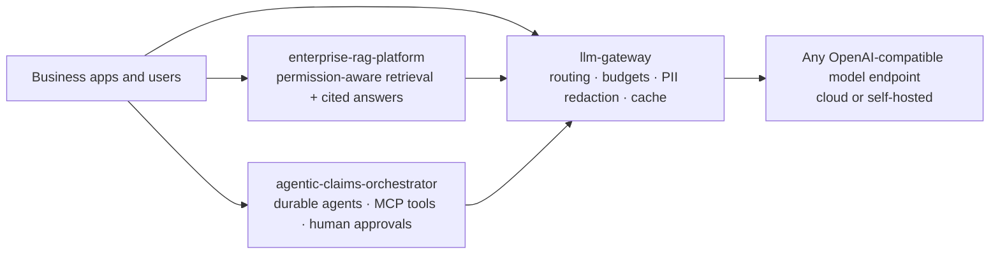
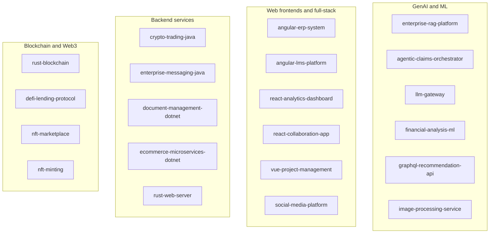

# Portfolio — Oscar Alvarez

**Principal AI Architect** · GenAI platforms, agentic systems and cloud-native architecture
[oralvarez@gmail.com](mailto:oralvarez@gmail.com) · [github.com/oscar-rolando-alvarez](https://github.com/oscar-rolando-alvarez)

This monorepo holds 21 independent, runnable reference systems. Each one builds, tests and ships in its own GitHub Actions pipeline, and comes with a README explaining the problem it solves, its architecture (Mermaid C4, sequence and data diagrams), how to run it, and the trade-offs behind it.

The three **flagship GenAI systems** below are the best starting point. They show how I approach production AI: governance and evaluation first, provider-agnostic by design, observable end to end, and deployable through infrastructure as code.

## ⭐ Flagship GenAI systems

| Project | What it is | Highlights | CI |
|---|---|---|---|
| [**enterprise-rag-platform**](enterprise-rag-platform/) | Multi-tenant, permission-aware knowledge assistant (RAG) | Hybrid retrieval (full-text + pgvector HNSW, RRF, reranking); tenant/group ACLs enforced inside the query and by Postgres row-level security; answers with verified citations or a refusal; PII and prompt-injection safeguards; golden-set eval gate (recall@k, MRR, faithfulness, ACL leaks); per-tenant cost accounting; Terraform for AWS (ECS Fargate, RDS pgvector) · Python 3.13, FastAPI | [](https://github.com/oscar-rolando-alvarez/portfolio/actions/workflows/enterprise-rag-platform.yml) |
| [**agentic-claims-orchestrator**](agentic-claims-orchestrator/) | Governed multi-agent system for insurance claims intake and triage | Custom durable agent graph with Postgres checkpoints, leases and crash recovery; MCP tool servers behind a validating gateway; declarative guardrail policy with human-in-the-loop approvals; PII tokenization vault; fraud model trained offline and scored in TypeScript; hash-chained audit trail; scenario eval gate · TypeScript, Node 24, Hono, Drizzle, Helm | [](https://github.com/oscar-rolando-alvarez/portfolio/actions/workflows/agentic-claims-orchestrator.yml) |
| [**llm-gateway**](llm-gateway/) | Enterprise LLM gateway and AI control plane | OpenAI-compatible API with streaming; cost-, latency- and weight-based routing with fallback, circuit breakers and hedging; per-tenant virtual keys, rate limits and token/USD budgets; checksum-validated PII redaction; exact + semantic cache; OpenTelemetry GenAI traces and Prometheus FinOps metrics; ~2 ms gateway overhead at p95 in local load tests · Go, Redis, Helm | [](https://github.com/oscar-rolando-alvarez/portfolio/actions/workflows/llm-gateway.yml) |



The three systems are independent, but they are designed to compose as shown: the gateway is the single governed path to models, and the RAG platform and agent orchestrator are workloads behind it.

## Portfolio map



## All projects

### GenAI and machine learning

| Project | Summary | Stack | CI |
|---|---|---|---|
| [financial-analysis-ml](financial-analysis-ml/) | Portfolio risk analytics with LLM-written narrative reports grounded only in computed metrics | Python 3.13, FastAPI, NumPy/pandas, optional TensorFlow, PostgreSQL | [](https://github.com/oscar-rolando-alvarez/portfolio/actions/workflows/financial-analysis-ml.yml) |
| [graphql-recommendation-api](graphql-recommendation-api/) | Hybrid recommendations plus embedding-based semantic search and similar items | Python 3.13, Strawberry GraphQL, Qdrant, PostgreSQL, Redis | [](https://github.com/oscar-rolando-alvarez/portfolio/actions/workflows/graphql-recommendation-api.yml) |
| [image-processing-service](image-processing-service/) | Image transformation API with vision-model captions, tags and alt text | Python 3.13, FastAPI, Pillow, OpenCV, optional OCR/YOLO | [](https://github.com/oscar-rolando-alvarez/portfolio/actions/workflows/image-processing-service.yml) |

### Web frontends and full-stack

| Project | Summary | Stack | CI |
|---|---|---|---|
| [angular-erp-system](angular-erp-system/) | ERP shell with an inventory module, signals and zoneless change detection | Angular 22, NgRx, Angular Material 3, Vitest | [](https://github.com/oscar-rolando-alvarez/portfolio/actions/workflows/angular-erp-system.yml) |
| [angular-lms-platform](angular-lms-platform/) | Learning platform: catalog, lesson player, graded quizzes, progress tracking | Angular 22, NgRx SignalStore, Vitest | [](https://github.com/oscar-rolando-alvarez/portfolio/actions/workflows/angular-lms-platform.yml) |
| [react-analytics-dashboard](react-analytics-dashboard/) | Analytics dashboard with AI-generated insights and a rule-based fallback | Next.js 16, React 19, Tailwind 4, Recharts, AI SDK | [](https://github.com/oscar-rolando-alvarez/portfolio/actions/workflows/react-analytics-dashboard.yml) |
| [react-collaboration-app](react-collaboration-app/) | Real-time collaborative whiteboard with history replay | React 19, Vite 8, Fabric 7, Socket.IO, Express 5 | [](https://github.com/oscar-rolando-alvarez/portfolio/actions/workflows/react-collaboration-app.yml) |
| [vue-project-management](vue-project-management/) | Kanban project management with optimistic updates and role checks | Nuxt 4, Vue 3.5, Pinia 4, Nuxt UI 4 | [](https://github.com/oscar-rolando-alvarez/portfolio/actions/workflows/vue-project-management.yml) |
| [social-media-platform](social-media-platform/) | Social network: ranked feed, messaging, real-time notifications, AI moderation | Nuxt 4, Prisma 7, PostgreSQL 18, Nitro WebSocket | [](https://github.com/oscar-rolando-alvarez/portfolio/actions/workflows/social-media-platform.yml) |

### Backend services

| Project | Summary | Stack | CI |
|---|---|---|---|
| [crypto-trading-java](crypto-trading-java/) | Order matching engine and trading API | Spring Boot 4.1, Java 21 virtual threads, PostgreSQL, Testcontainers | [](https://github.com/oscar-rolando-alvarez/portfolio/actions/workflows/crypto-trading-java.yml) |
| [enterprise-messaging-java](enterprise-messaging-java/) | Real-time messaging with Kafka events and encrypted messages | Spring Boot 4.1, Java 21, Kafka 4 (KRaft), WebSocket | [](https://github.com/oscar-rolando-alvarez/portfolio/actions/workflows/enterprise-messaging-java.yml) |
| [document-management-dotnet](document-management-dotnet/) | Multi-tenant document management with review workflow and AI summaries | .NET 10, ASP.NET Core, EF Core, PostgreSQL, S3 | [](https://github.com/oscar-rolando-alvarez/portfolio/actions/workflows/document-management-dotnet.yml) |
| [ecommerce-microservices-dotnet](ecommerce-microservices-dotnet/) | Microservices storefront with an order–payment saga | .NET 10, Aspire, YARP, RabbitMQ, PostgreSQL, MongoDB, Redis | [](https://github.com/oscar-rolando-alvarez/portfolio/actions/workflows/ecommerce-microservices-dotnet.yml) |
| [rust-web-server](rust-web-server/) | High-performance API server with JWT auth, SSE, WebSocket and metrics | Rust 2024, actix-web, sqlx, Redis | [](https://github.com/oscar-rolando-alvarez/portfolio/actions/workflows/rust-web-server.yml) |

### Blockchain and Web3

| Project | Summary | Stack | CI |
|---|---|---|---|
| [rust-blockchain](rust-blockchain/) | Blockchain node with P2P networking, wallets and smart-contract runtime | Rust 2024, libp2p, tokio | [](https://github.com/oscar-rolando-alvarez/portfolio/actions/workflows/rust-blockchain.yml) |
| [defi-lending-protocol](defi-lending-protocol/) | Isolated-market lending with liquidations, flash loans and governance | Solana, Anchor 1.2, Next.js 16, @solana/kit | [](https://github.com/oscar-rolando-alvarez/portfolio/actions/workflows/defi-lending-protocol.yml) |
| [nft-marketplace](nft-marketplace/) | Escrowed listings, offers and auctions for SPL and Token-2022 NFTs | Solana, Anchor 1.2, Next.js 16 | [](https://github.com/oscar-rolando-alvarez/portfolio/actions/workflows/nft-marketplace.yml) |
| [nft-minting](nft-minting/) | Token-2022 NFT minting with on-chain metadata, collections and royalties | Solana, Anchor 1.2 | [](https://github.com/oscar-rolando-alvarez/portfolio/actions/workflows/nft-minting.yml) |

## Engineering standards applied across the repo

- **Every project builds and tests in CI.** Each project has its own path-filtered GitHub Actions workflow with least-privilege permissions: lint, format, type checks, unit tests and integration tests (Testcontainers or service containers), plus a container build with a smoke test.
- **AI is evaluated, not assumed.** LLM features sit behind provider-agnostic interfaces (any OpenAI-compatible endpoint) with deterministic fakes, so test suites and eval gates run offline in CI. Real models are enabled through configuration.
- **Security by default.** Multi-stage, non-root, pinned container images; secrets only via environment (`.env.example` files hold placeholders); dependency audits per ecosystem; Dependabot for dependencies, base images and actions; see [SECURITY.md](SECURITY.md).
- **Observable.** Backend services emit structured logs, health/readiness probes, Prometheus metrics and OpenTelemetry traces (GenAI semantic conventions for model calls).
- **Documented decisions.** Each README covers the problem, architecture diagrams, run/test instructions and trade-offs, and states known limitations. The flagship projects add Architecture Decision Records under `docs/adr/`.
- **Infrastructure as code.** Terraform and Helm charts are validated in CI without cloud credentials.

## Repository layout

```text
portfolio/
├── .github/
│   ├── workflows/        # one pipeline per project, path-filtered
│   └── dependabot.yml    # grouped monthly updates for every ecosystem
├── <project>/            # 21 self-contained projects, each with its own README
├── SECURITY.md
└── README.md
```

Each folder is standalone: there are no build or runtime dependencies between projects. Open a project's README for its quickstart.

## License

Unless a project folder contains its own LICENSE file, the code is shared for portfolio and evaluation purposes.
