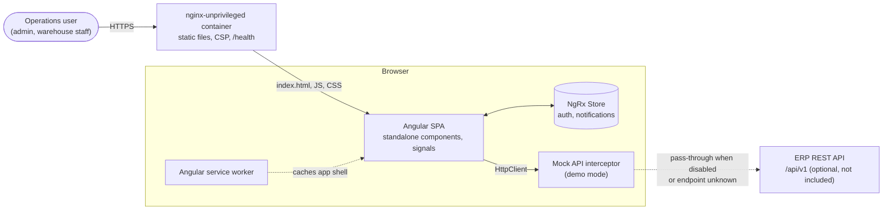
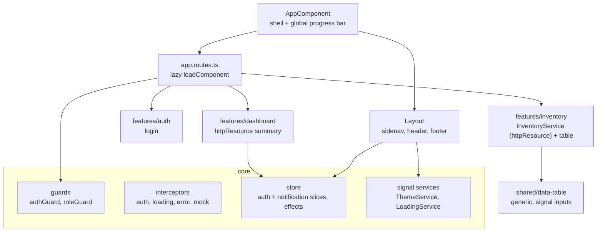
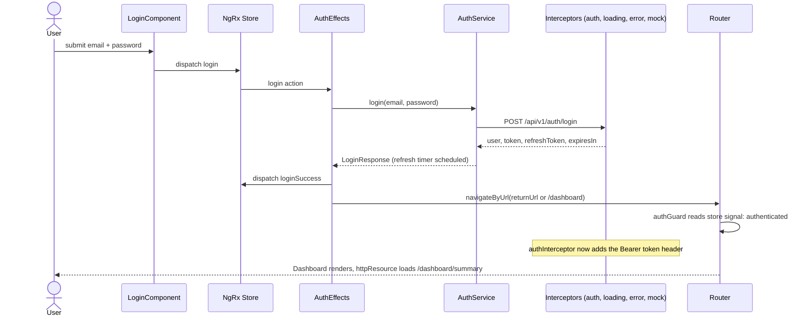
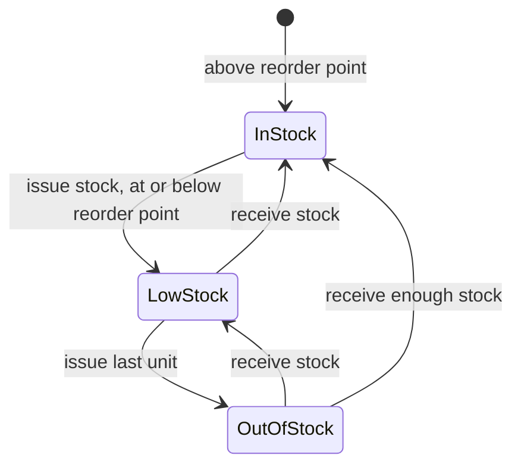

# Angular ERP System


A modular ERP (Enterprise Resource Planning) front end built with **Angular 22**, **Angular Material 3** and **NgRx**. It shows how a large back-office application is structured: a role-aware shell, authentication with session restore, a global notification inbox, and feature modules that load lazily. The **Inventory** module is fully implemented; additional modules (HR, Finance, CRM, ...) plug into the same shell, navigation and role model.

The app ships with an **in-browser mock API**, so it runs end to end with no backend: clone, `npm start`, sign in.

## Problem it solves

Mid-sized companies often run inventory, purchasing and back-office work in spreadsheets. This front end gives operations staff one place to see stock levels, react to low-stock alerts and record stock movements, with access restricted by role.

## Key features

- **Role-based shell**: navigation and routes are filtered by the signed-in user's roles (`roleGuard` + shared navigation model).
- **Authentication flow**: login, token refresh scheduling, session restore before the first navigation (`provideAppInitializer`), and redirect back to the originally requested page.
- **Inventory module**: KPIs (SKUs, items needing reorder, stock value), live search, category and stock-status filters, sortable/paginated table, add product form, receive/issue stock actions.
- **Notifications**: inbox loaded from the API (unread badge, mark all read) plus transient toasts driven by NgRx effects.
- **Light/dark theme** that follows the OS by default and is remembered per browser.
- **Mock backend** implemented as a functional `HttpInterceptor`; disable it with one flag to talk to a real API.
- **PWA-ready**: Angular service worker in production builds.
- **Hardened container**: non-root nginx, strict Content Security Policy, health endpoint.

## Tech stack

| Area | Technology | Version |
| --- | --- | --- |
| Framework | Angular (standalone components, signals, zoneless) | 22.2 |
| UI | Angular Material / CDK (Material 3 tokens) | 22.2 |
| State | NgRx Store + Effects (+ Store Devtools) | 22.0 |
| Reactive | RxJS | 7.8 |
| Language | TypeScript | 6.0 |
| Build | Angular CLI, `@angular/build` (esbuild + Vite) | 22.2 |
| Unit tests | Vitest via `@angular/build:unit-test`, jsdom | 5.0 |
| Lint / format | ESLint flat config + angular-eslint + typescript-eslint, Prettier | 10 / 22.6 / 8.71 / 3.9 |
| Runtime (CI, Docker build) | Node.js LTS | 24 |
| Web server | nginx-unprivileged (Alpine) | 1.30 |

## Architecture

### Context and containers



### Code structure



### Sign-in and first data load



### Inventory state model



## Project structure

```text
angular-erp-system/
├── src/
│   ├── app/
│   │   ├── core/
│   │   │   ├── guards/          authGuard, roleGuard
│   │   │   ├── http/            apiUrl() and response envelope helpers
│   │   │   ├── interceptors/    auth, loading, error
│   │   │   ├── mock/            in-browser API + seed data
│   │   │   ├── models/          domain types
│   │   │   ├── navigation/      role-aware navigation model
│   │   │   ├── services/        auth, notifications, theme, loading
│   │   │   └── store/           NgRx auth + notification slices
│   │   ├── features/            auth, dashboard, inventory (lazy loaded)
│   │   ├── layout/              shell: sidenav, header, footer
│   │   ├── shared/components/   data-table, not-found
│   │   ├── store/               root reducer map
│   │   ├── app.config.ts        providers (zoneless, router, http, store)
│   │   └── app.routes.ts
│   ├── environments/
│   └── styles.scss              Material 3 theme
├── Dockerfile                   multi-stage, non-root runtime
├── nginx.conf / security-headers.conf
├── docker-compose.yml
└── eslint.config.js             flat config
```

## Running locally

Requirements: Node.js 24 LTS and npm 11.

```bash
cd angular-erp-system
npm ci
npm start            # http://localhost:4200
```

Demo accounts (served by the in-browser mock API, password `demo1234`):

| Email | Roles | Sees |
| --- | --- | --- |
| `admin@erp.local` | admin | Dashboard, Inventory |
| `warehouse@erp.local` | warehouse_employee | Dashboard, Inventory |
| `sales@erp.local` | sales_rep | Dashboard only (Inventory is role-restricted) |

### With Docker

```bash
cd angular-erp-system
docker compose up --build        # http://localhost:8080
# or
docker build -t angular-erp-system .
docker run --rm -p 8080:8080 --read-only --tmpfs /tmp angular-erp-system
```

The container runs as the unprivileged `nginx` user on port 8080 and exposes `GET /health` for liveness checks.

## Testing and quality checks

```bash
npm test               # Vitest (jsdom) via the Angular CLI unit-test builder
npm run test:coverage  # with V8 coverage report in ./coverage
npm run lint           # ESLint flat config (angular-eslint, typescript-eslint)
npm run typecheck      # tsc for app and spec projects
npm run format:check   # Prettier
npm run build          # production build with budgets
```

Tests cover the auth reducer, `authGuard`, the mock API (login, 401 handling, persistence), the theme service, the login form and the inventory page (KPIs, search, stock actions via `HttpTestingController`).

CI (`.github/workflows/angular-erp-system.yml`) runs all of the above on Node 24, an advisory `npm audit --audit-level=high`, and builds the Docker image and smoke-tests it (health endpoint, SPA fallback, CSP header, non-root user).

## Configuration

Build-time configuration lives in `src/environments/` (production values are swapped in by `fileReplacements`).

| Setting | Default | Description |
| --- | --- | --- |
| `apiUrl` | `/api` | Base URL of the ERP REST API |
| `apiVersion` | `v1` | Path segment appended to `apiUrl` |
| `enableMocking` | `true` | Serve the API from the in-browser mock; set `false` to call a real backend |
| `security.tokenExpirationTime` | `3600000` | Fallback token lifetime (ms) used to schedule refresh |

Runtime (Docker Compose) variables:

| Variable | Default | Description |
| --- | --- | --- |
| `ERP_WEB_PORT` | `8080` | Host port mapped to the container |

No secrets are needed: the app is a static bundle and the demo credentials exist only in the mock seed data.

## Design decisions

- **Zoneless + signals**: Angular 22 apps are zoneless by default. Components are `OnPush`, read state through signals (`selectSignal`, `toSignal`, `httpResource`, `computed`) and never mutate template-bound objects.
- **NgRx where it pays off, signals elsewhere**: authentication and notifications are shared across the app and involve side effects, so they stay in NgRx Store with Effects. Purely presentational state (theme, global loading indicator, page filters) uses signal services and component signals, which removes a lot of boilerplate.
- **`httpResource` for reads, `HttpClient` for writes**: reads are declarative and cancel automatically; writes patch the resource value locally for instant feedback.
- **Mock API as an interceptor**: the UI talks to real HTTP endpoints and the mock sits behind the same contract, so switching to a real backend is a configuration change, and unknown endpoints already pass through.
- **Focused scope**: the original version advertised many modules whose files were never written and could not compile. This version ships the shell, auth and one complete vertical slice (Inventory) instead; new modules are added by registering a route and a navigation entry.
- **Strict CSP**: critical-CSS inlining is disabled so no inline script is needed and `script-src 'self'` can be enforced by nginx.

## Known limitations

- There is no real backend in this repository; the mock API keeps data in memory and resets on reload.
- Only the Inventory module is implemented; HR, Finance, CRM and other modules are not part of this version.
- No end-to-end browser tests in CI yet (unit and component tests only).
