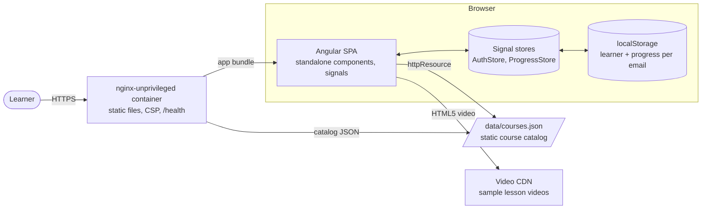
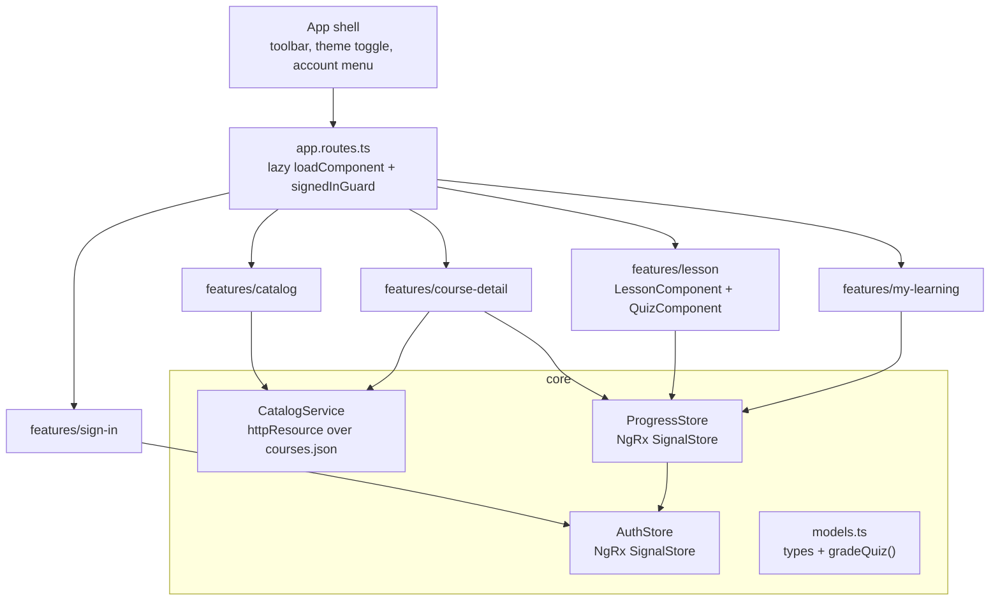
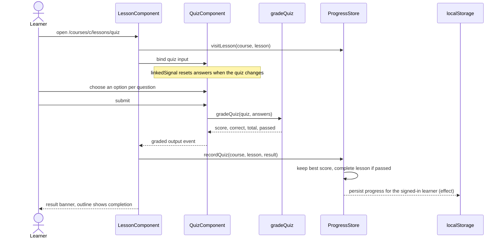
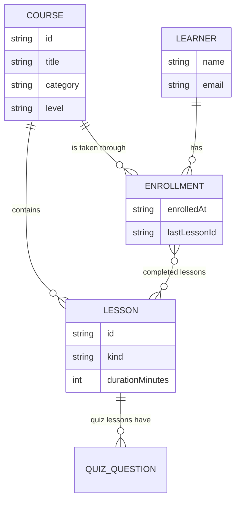

# Angular LMS Platform (LearnHub)


A learning management front end built with **Angular 22**, **NgRx SignalStore** and **Angular Material 3**. Learners browse a course catalog, enroll, work through video, reading and quiz lessons, and pick up exactly where they left off. Everything runs in the browser from a static bundle, so it can be hosted on any static web server or the included hardened nginx container.

## Problem it solves

Internal academies and training teams need a lightweight way to publish short courses and let people track their own progress without standing up a full LMS. LearnHub focuses on the learner experience: discoverability, a distraction-free lesson player, graded checks for understanding and visible progress.

## Key features

- **Course catalog** with free-text search (title, subtitle, tags), level and topic filters.
- **Course page** with syllabus, total duration, enrolment and a "Start / Continue / Review" call to action that resumes at the next incomplete lesson.
- **Lesson player** for three lesson types: HTML5 video (auto-completes when the video ends), reading, and **graded quizzes** with explanations and a pass mark.
- **My learning** dashboard: enrolled courses, completed count and average progress.
- **Progress tracking** per learner, persisted locally and restored on sign-in.
- **Guarded routes** with an open-redirect-safe `returnUrl`.
- **Accessible, responsive UI**: skip link, landmarks, focus outlines, Material 3 light and dark themes.
- **Hardened container**: non-root nginx, strict Content Security Policy, `/health` endpoint.

## Tech stack

| Area | Technology | Version |
| --- | --- | --- |
| Framework | Angular (standalone, signals, zoneless, `httpResource`, `linkedSignal`) | 22.2 |
| State | NgRx SignalStore (`@ngrx/signals`) | 22.0 |
| UI | Angular Material / CDK (Material 3 tokens) | 22.2 |
| Language | TypeScript | 6.0 |
| Build | Angular CLI, `@angular/build` (esbuild + Vite) | 22.2 |
| Unit tests | Vitest via `@angular/build:unit-test`, jsdom | 5.0 |
| Lint / format | ESLint flat config + angular-eslint + typescript-eslint, Prettier | 10 / 22.6 / 8.71 / 3.9 |
| Runtime (CI, Docker build) | Node.js LTS | 24 |
| Web server | nginx-unprivileged (Alpine) | 1.30 |

## Architecture

### Context and containers



### Code structure



### Taking a quiz



### Domain model



## Project structure

```text
angular-lms-platform/
├── public/
│   └── data/courses.json        course catalog (edit to publish courses)
├── src/
│   ├── app/
│   │   ├── core/                models, CatalogService, AuthStore, ProgressStore, theme, storage
│   │   ├── features/            catalog, course-detail, lesson (+ quiz), my-learning, sign-in
│   │   ├── shared/              course card, not-found page
│   │   ├── testing/             test fixtures
│   │   ├── app.ts               shell
│   │   ├── app.config.ts        providers (zoneless, router input binding, http, service worker)
│   │   └── app.routes.ts
│   └── styles.scss              Material 3 theme
├── Dockerfile                   multi-stage, non-root runtime
├── nginx.conf / security-headers.conf
├── docker-compose.yml
└── eslint.config.js             flat config
```

## Running locally

Requirements: Node.js 24 LTS and npm 11.

```bash
cd angular-lms-platform
npm ci
npm start            # http://localhost:4200
```

Sign in with any name and email: the demo has no identity provider, nothing leaves the browser and no password is stored.

### With Docker

```bash
cd angular-lms-platform
docker compose up --build        # http://localhost:8081
# or
docker build -t angular-lms-platform .
docker run --rm -p 8081:8080 --read-only --tmpfs /tmp angular-lms-platform
```

The container runs as the unprivileged `nginx` user on port 8080 and exposes `GET /health`.

## Testing and quality checks

```bash
npm test               # Vitest (jsdom) via the Angular CLI unit-test builder
npm run test:coverage  # with V8 coverage report in ./coverage
npm run lint           # ESLint flat config
npm run typecheck      # tsc for app and spec projects
npm run format:check   # Prettier
npm run build          # production build with budgets
```

Tests cover quiz grading and duration helpers, catalog filtering and rendering, the progress store (enrolment, completion, best quiz score, per-learner persistence), the quiz component and the sign-in flow including `returnUrl` sanitising.

CI (`.github/workflows/angular-lms-platform.yml`) runs all of the above on Node 24, an advisory `npm audit --audit-level=high`, and builds and smoke-tests the Docker image (health endpoint, deep-link fallback, catalog JSON, CSP header, non-root user).

## Configuration

| Item | Where | Description |
| --- | --- | --- |
| Course catalog | `public/data/courses.json` | Courses and lessons (`video`, `reading`, `quiz`). Served as a static asset. |
| Theme palette | `src/styles.scss` | Material 3 primary/tertiary palettes |
| Allowed media hosts | `security-headers.conf` (`media-src`) | Add the host that serves your lesson videos |
| `LMS_WEB_PORT` | Docker Compose env | Host port for the container (default `8081`) |

No secrets or environment variables are required at build time.

## Design decisions

- **NgRx SignalStore for client state**: progress and the learner session are local, synchronous and signal-shaped, so SignalStore (`withState`, `withComputed`, `withMethods`, `withHooks`) gives typed, testable stores without actions/reducers boilerplate. Persistence is a plain `effect` keyed by learner email.
- **Static catalog over an API**: courses change rarely and are public, so a JSON document served next to the app is cacheable, versionable in git and easy to replace with an API later (`CatalogService` is the only consumer).
- **Router input binding**: route params arrive as signal `input()`s (`withComponentInputBinding`), so pages are pure functions of their inputs and stores.
- **Pure domain functions**: grading, completion percentage and next-lesson logic are plain functions in `core/`, unit-tested without Angular.
- **Zoneless and OnPush everywhere**, Material 3 design tokens for theming, and strict CSP (critical-CSS inlining disabled so no inline script is needed).
- **Rebuild instead of patch**: the previous version referenced dozens of stores, guards, services and pages that did not exist and never compiled. Rather than ship placeholders, this version implements a smaller but complete learner journey.

## Known limitations

- Demo authentication only; progress lives in the browser's localStorage and is not shared across devices.
- No instructor authoring UI: courses are edited in `courses.json`.
- Lesson videos are open-licensed sample clips from a public CDN, used as placeholders.
- No end-to-end browser tests in CI yet (unit and component tests only).
