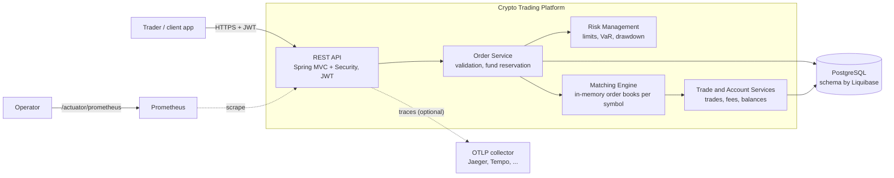
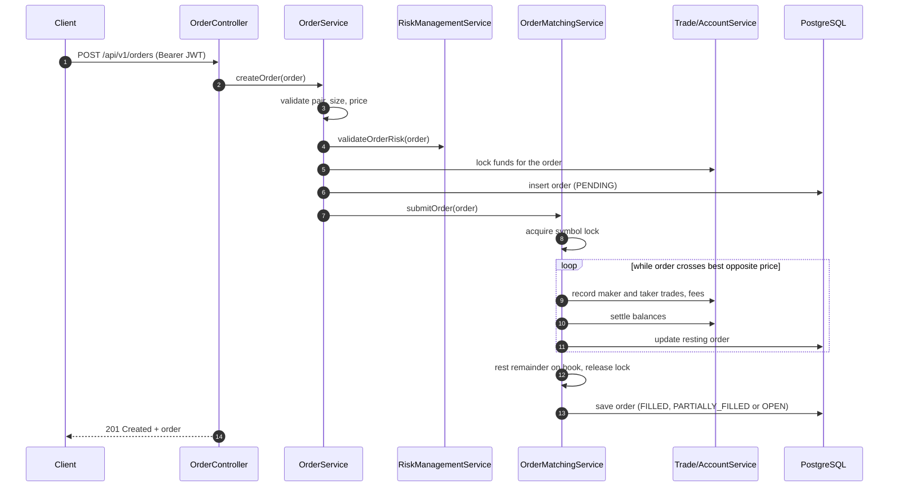
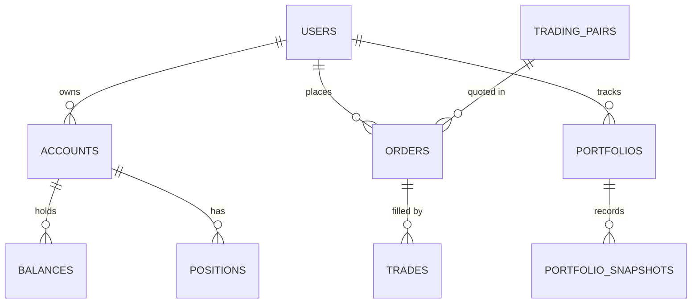

# Crypto Trading Platform (Java)


A Spring Boot backend for a centralized crypto exchange: user accounts and balances, order entry,
an in-memory **price-time priority matching engine**, pre-trade risk checks and trade settlement,
backed by PostgreSQL. It is built to show how the core of an exchange fits together cleanly on a
modern JVM stack, with real tests against a real database.

## What it does

Exchanges need a single, consistent place where orders meet. This service owns that flow:

1. A trader registers and logs in to get a JWT.
2. An order is validated (trading pair, size limits), checked against risk limits and the
   required funds are reserved.
3. The matching engine matches the order against the opposite side of the book for its symbol.
   Fills produce maker and taker trades, commissions and balance updates; any remainder of a
   limit order rests on the book.

## Key features

- **Matching engine**: per-symbol order books with price-time priority, market and limit orders,
  partial fills, maker/taker fees charged in the received asset, sorted depth snapshots.
- **Concurrency**: one lock per symbol (a `ReentrantLock`, so virtual threads never pin a
  carrier thread), so different symbols match in parallel.
- **Risk management**: max position size, daily loss, drawdown and margin requirement checks
  (configurable), plus VaR, Sharpe ratio and max drawdown calculations.
- **Accounts and balances**: available/locked balances per asset, fund reservation on order
  entry, settlement on fills.
- **Security**: stateless JWT (HS256) auth, BCrypt password hashing, role-based endpoint rules.
- **API docs**: OpenAPI 3 with Swagger UI.
- **Observability**: Actuator health probes, Prometheus metrics, OpenTelemetry tracing through
  Micrometer (OTLP export when configured), trace IDs in logs, ECS JSON logs in containers.
- **Schema management**: Liquibase owns the schema, and Hibernate validates the mapping against it
  at startup.

## Tech stack

| Area | Technology | Version |
| --- | --- | --- |
| Language / runtime | Java (Eclipse Temurin), virtual threads | 21 LTS |
| Framework | Spring Boot (Spring Framework 7, Spring Security 7) | 4.1.1 |
| Persistence | Spring Data JPA, Hibernate ORM | Boot-managed (Hibernate 7.4) |
| Database | PostgreSQL | 18.6 |
| Migrations | Liquibase | Boot-managed |
| Auth | JJWT | 0.13.0 |
| API docs | springdoc-openapi | 3.1.1 |
| Observability | Micrometer, Prometheus registry, OpenTelemetry | Boot-managed |
| Testing | JUnit 5, Mockito, AssertJ, Testcontainers | Boot-managed (Testcontainers 2) |
| Build | Maven wrapper, Spotless | Maven 3.9.16 |
| Container | Multi-stage Dockerfile, Temurin JRE on Alpine, non-root | 21.0.12 |

## Architecture

### Container view



### Placing a limit order



### Core data model



## Project structure

```
crypto-trading-java/
├── src/main/java/com/cryptotrading/
│   ├── config/          # Spring Security configuration
│   ├── controller/      # REST controllers, DTOs, ProblemDetail error mapping
│   ├── domain/          # JPA entities and enums
│   ├── repository/      # Spring Data repositories and analytics queries
│   ├── security/        # JWT issuing/validation filter
│   └── service/         # orders, matching engine, risk, accounts, trades
├── src/main/resources/
│   ├── application.yml
│   └── db/changelog/    # Liquibase changelog (formatted SQL)
├── src/test/java/       # unit tests and *IT integration tests (Testcontainers)
├── k8s/deployment.yaml  # reference Kubernetes manifests
├── Dockerfile
└── docker-compose.yml
```

## Running locally

Prerequisites: JDK 21 and Docker. The Maven wrapper downloads Maven for you.

**With Docker Compose (app + PostgreSQL):**

```bash
cp .env.example .env            # optional: adjust values
docker compose up --build
# optional tracing UI at http://localhost:16686
docker compose --profile observability up --build
```

**Without Docker for the app:**

```bash
docker compose up -d postgres   # or point DB_URL at your own PostgreSQL
./mvnw spring-boot:run
```

Then try it:

```bash
curl -X POST localhost:8080/api/v1/auth/register -H 'Content-Type: application/json' \
  -d '{"username":"alice","email":"alice@example.com","password":"s3cure-passw0rd"}'
TOKEN=$(curl -s -X POST localhost:8080/api/v1/auth/login -H 'Content-Type: application/json' \
  -d '{"username":"alice","password":"s3cure-passw0rd"}' | jq -r .accessToken)
curl -H "Authorization: Bearer $TOKEN" localhost:8080/api/v1/orders/active
```

Useful URLs: Swagger UI `http://localhost:8080/swagger-ui.html`, health
`http://localhost:8080/actuator/health`, metrics `http://localhost:8080/actuator/prometheus`.

## Testing

```bash
./mvnw spotless:check   # formatting
./mvnw test             # unit tests (matching engine)
./mvnw verify           # unit + integration tests (needs Docker for Testcontainers)
```

`CryptoTradingApplicationIT` boots the whole application against PostgreSQL 18 in a container. It
applies the Liquibase changelog, has Hibernate validate the schema, and runs the
register, login and protected-call flow plus the health, metrics and OpenAPI endpoints. CI runs
the same `verify` on every pull request.

## Configuration

| Variable | Default | Purpose |
| --- | --- | --- |
| `DB_URL` | `jdbc:postgresql://localhost:5432/crypto_trading` | JDBC URL |
| `DB_USERNAME` / `DB_PASSWORD` | `crypto_user` / `crypto_password` | Database credentials (local dev only) |
| `DB_POOL_SIZE` | `20` | Hikari max pool size |
| `JWT_SECRET` | dev-only value | HS256 key, Base64 or raw, at least 256 bits. **Set in every real environment.** |
| `JWT_EXPIRATION` / `JWT_REFRESH_EXPIRATION` | `86400000` / `604800000` | Token lifetimes in ms |
| `RISK_MAX_POSITION_SIZE`, `RISK_MAX_DAILY_LOSS`, `RISK_MAX_DRAWDOWN`, `RISK_MARGIN_REQUIREMENT` | `1000000`, `100000`, `0.2`, `0.1` | Pre-trade risk limits |
| `LOG_LEVEL` | `INFO` | Application log level |
| `LOGGING_STRUCTURED_FORMAT_CONSOLE` | unset (ECS in the image) | `ecs`, `logstash` or `gelf` JSON logs |
| `TRACING_SAMPLING_PROBABILITY` | `0.1` | Trace sampling ratio |
| `MANAGEMENT_OPENTELEMETRY_TRACING_EXPORT_OTLP_ENDPOINT` | unset | e.g. `http://collector:4318/v1/traces`; enables OTLP export |
| `SERVER_PORT` | `8080` | HTTP port |

## Design decisions

- **In-memory order books, single writer per symbol.** Matching needs low latency and strict
  ordering, so each symbol has one book guarded by one lock and the database is the system of
  record. As a result the service runs as a **single replica** (see `k8s/deployment.yaml`).
  Scaling out means partitioning symbols across instances, for example by consistent hashing or
  one Kafka partition per symbol.
- **Virtual threads + `ReentrantLock`.** Request handling uses virtual threads. The matching lock
  is a `ReentrantLock` rather than `synchronized`, because on Java 21 a virtual thread that blocks
  inside `synchronized` pins its carrier thread.
- **Liquibase owns the schema; Hibernate only validates.** A schema drift fails startup and
  fails CI, so it never reaches production.
- **`BigDecimal` everywhere** for prices, quantities and fees (scale 18), with no floating point in
  money paths.
- **Real dependencies in tests.** The integration tests use Testcontainers PostgreSQL instead of
  H2, so the SQL dialect, constraints and migrations are exactly the ones used in production.
- **Opt-in telemetry export.** Metrics and trace context are always on. The OTLP exporter is only
  created when an endpoint is configured, so local runs and CI stay self-contained.

## Known limitations

- The order books are not rebuilt from the database on restart. Resting orders survive in
  PostgreSQL but are not re-submitted to the engine.
- External exchange connectivity and arbitrage are out of scope for this service. The repository
  queries for market data exist, but no exchange adapters do.
- `POST /api/v1/orders` accepts the order entity directly. A dedicated request DTO with
  server-side resolution of user, account and pair is the next step.
