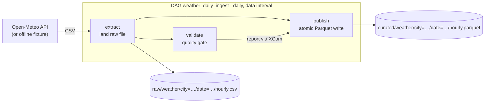
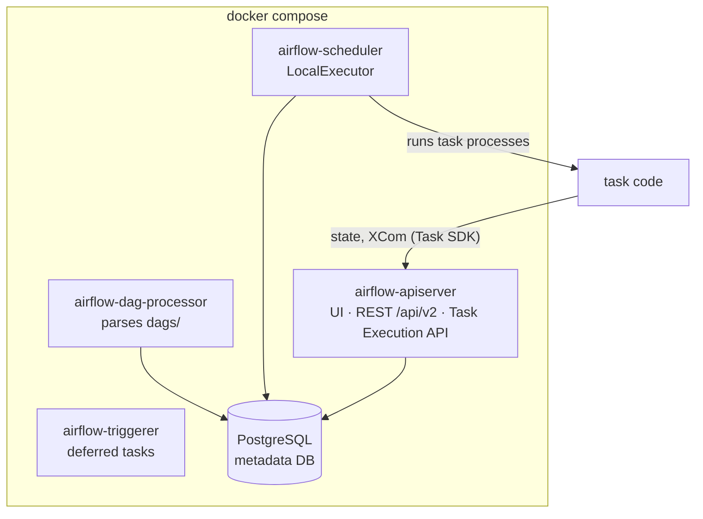

# Level 1 · Airflow 3 foundations

> **Goal:** run Apache Airflow 3 locally exactly as it is laid out in production, and write a first DAG that follows the rules a platform team would enforce: data-interval driven, idempotent, validated, with light XComs.

Part of the [data engineering learning path](../README.md) · Next: [Level 2 · Idempotent loads into Snowflake](../02-snowflake-idempotent-loads/)

## What it does

`weather_daily_ingest` runs every day at 02:00 UTC and, for the interval that just closed, downloads 24 hourly weather readings for a city from the public [Open-Meteo](https://open-meteo.com/) API (no key needed), checks them, and publishes a Parquet partition.



### Local architecture



Airflow 3 split the old webserver/scheduler monolith: the **dag-processor** is its own process, and task code no longer talks to the metadata database directly; it goes through the **Task Execution API** on the api-server. The compose file runs each component as its own container, so what you see locally matches a production deployment (minus Celery/Kubernetes, which arrive in [Level 5](../05-principal-reference-architecture/)).

## Run it

Requirements: Docker with ~4 GB of memory.

```bash
cp .env.example .env          # optional: defaults work out of the box
make up                       # or: docker compose up -d --build --wait
```

Open <http://localhost:8081> (user `airflow`, password `airflow` unless you changed `.env`), unpause `weather_daily_ingest` and trigger it. Output lands in `./data`.

```bash
make e2e     # triggers a run through the REST API and waits for success
make test    # ruff + unit tests + DagBag + dag.test(), offline, in the test image
make down    # stop everything and delete the metadata volume
```

No internet? Set `WEATHER_SOURCE_MODE=fixture` in `.env`; the DAG then uses a bundled sample re-dated to the run's day.

## Design decisions

| Decision | Why |
|---|---|
| `CronDataIntervalTimetable("0 2 * * *")` instead of `schedule="@daily"` | Airflow 3 changed the default cron timetable to `CronTriggerTimetable`, where `data_interval_start == data_interval_end`. A batch pipeline that processes "the day that just closed" needs a real interval, so it asks for one explicitly. The run for `17 Nov 02:00 → 18 Nov 02:00` processes 17 November. |
| The date comes from `data_interval_start`, never `now()` | Results depend on the run, not on the wall clock. That is what makes retries and backfills reproducible. |
| One partition per run, overwritten atomically (temp file + `rename`) | Idempotency: running the same day twice yields the same files, and a crash never leaves a half-written partition. |
| Raw zone kept untouched, curated zone typed and renamed | You can always replay curation from the raw file without calling the source again. |
| XCom carries paths and a small report, not data | The metadata DB is not a data lake. |
| `AirflowFailException` on quality failures, retries for everything else | Network errors are transient and retried with exponential backoff; bad data is not, so the run fails fast and visibly. |
| Business logic in `include/weather/`, with no Airflow imports | Unit tests run in milliseconds, and the code could move to another orchestrator unchanged. |
| Separate `test` stage in the Dockerfile | Test tooling (pytest, ruff) never ships in the runtime image. |
| `catchup=False`, `max_active_runs=3` | Deploying never launches hundreds of runs by surprise; backfills are a deliberate action (`airflow backfill create` or the UI). |

## Tests

| Test | What it proves |
|---|---|
| `test_quality.py` | Each quality rule rejects what it should: missing hours, other-day rows, nulls, out-of-range values, schema drift |
| `test_storage.py` | Hive-style partition paths; re-writing a partition is idempotent and leaves no temp files |
| `test_dag_integrity.py` | `DagBag` loads with no import errors; every DAG has an owner, retries, tags, docs and `catchup=False` |
| `test_dag_run.py` | `dag.test()` runs the real DAG twice for the same interval and finds exactly one 24-row partition |

## What this demonstrates

- Airflow 3 architecture and the 3.x API surface (`airflow.sdk`, `/api/v2`, Task Execution API, FAB auth manager)
- The data interval concept and the Airflow 3 timetable change that trips up people coming from 2.x
- Idempotent, atomic, partitioned writes, and a data-quality gate before publication
- A testable project layout (thin DAG, pure-Python logic) and a lint-and-test container used by CI

## Project layout

```text
01-airflow-foundations/
├── dags/weather_daily_ingest.py   # thin DAG: wiring, schedule, retries
├── include/weather/               # source, quality rules, storage (no Airflow imports)
├── tests/                         # unit, DagBag integrity, dag.test() end to end
├── scripts/e2e.py                 # REST API smoke test against the running stack
├── Dockerfile                     # runtime and test stages on apache/airflow:3.4.0
└── docker-compose.yml             # Postgres + api-server + scheduler + dag-processor + triggerer
```
