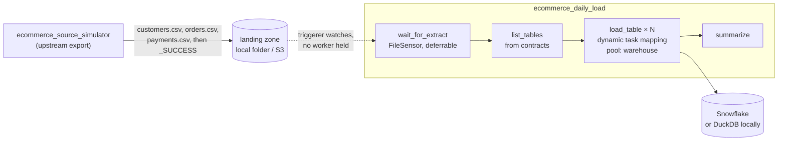
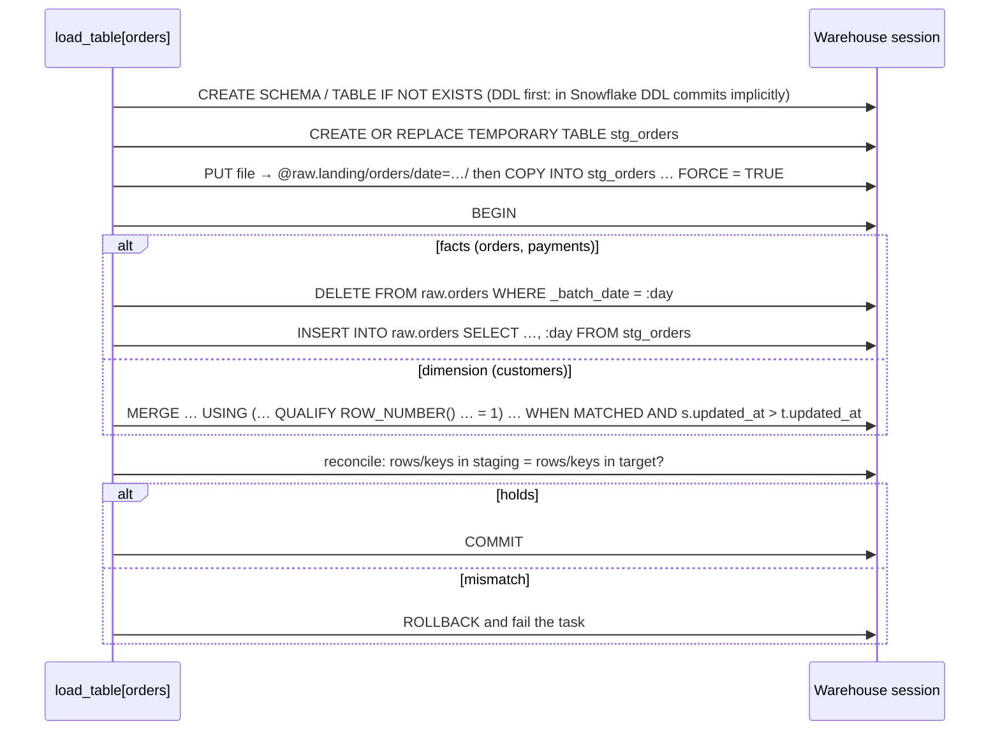

# Level 2 · Idempotent loads into Snowflake

> **Goal:** load daily extracts into Snowflake so that retries, reruns and out-of-order backfills can never duplicate or regress data, while protecting the warehouse from load spikes and keeping workers free while waiting for files.

Part of the [data engineering learning path](../README.md) · Previous: [Level 1](../01-airflow-foundations/) · Next: [Level 3 · dbt, Cosmos and Assets](../03-dbt-cosmos-assets/)

**No Snowflake account?** The default `WAREHOUSE_BACKEND=duckdb` runs the same SQL (MERGE, QUALIFY, transactions) on an embedded DuckDB file, so everything runs and every test passes offline. Switch to `snowflake` and set one connection in `.env` to run it for real.

## What it does

An upstream system (simulated by `ecommerce_source_simulator`) drops one CSV per table per day plus a `_SUCCESS` marker. `ecommerce_daily_load` waits for the marker, then loads each table with the strategy its contract declares.



### The load protocol (one table, one batch, one session)



## Run it

```bash
cp .env.example .env     # optional; defaults run locally on DuckDB
make e2e                 # starts the stack and runs the scenario below
make test                # ruff + unit + idempotency tests + dag.test(), offline
make query SQL="SELECT * FROM raw.customers LIMIT 5"
make down
```

`make e2e` drives the REST API through a realistic scenario:

1. Triggers the loader **before** the files exist and waits until `wait_for_extract` is `deferred`, sitting in the triggerer and holding no worker slot.
2. Runs the simulator; the triggerer sees the marker and the loader resumes on its own.
3. **Clears and reruns** the same run. Row counts stay identical.

UI: <http://localhost:8082> (default login `airflow` / `airflow`). In the Grid view the mapped instances are labelled by table name (`map_index_template`).

### Against a real Snowflake account

1. Create a service user with key-pair auth, a `LOADER` role, a `LOAD_WH` warehouse and an `ANALYTICS` database.
2. In `.env`: `WAREHOUSE_BACKEND=snowflake`, `WAREHOUSE_POOL_SLOTS=4`, and `AIRFLOW_CONN_SNOWFLAKE_DEFAULT` (shape in `.env.example`; mount the private key, never paste it).
3. `make e2e`. The loader creates `RAW.*` tables and the `RAW.LANDING` internal stage on first use.

## Design decisions

| Decision | Why |
|---|---|
| **Strategy per table in a contract** (`include/ecommerce/contracts.py`) | Facts are immutable events: replace the whole batch (`DELETE` + `INSERT` by `_batch_date`). Dimensions are mutable: `MERGE` by natural key. Adding a table is a contract entry, not DAG code. |
| **Partition facts by load batch, not by business date** | Late-arriving orders (an order timestamped yesterday inside today's extract) are still replaced exactly once, because the delete key is the batch that delivered them. |
| **`MERGE` keeps only the newest version** (`QUALIFY ROW_NUMBER()` + `WHEN MATCHED AND s.updated_at > t.updated_at`) | Deduplicates CDC noise inside an extract, and replaying an *older* day after a newer one cannot overwrite newer data. A test replays day 1 after day 2 and checks nothing changes. |
| **`COPY INTO … FORCE = TRUE` after `CREATE OR REPLACE` of staging** | Snowflake's 64-day load history makes `COPY` silently skip a file it already loaded. On a rerun that leaves staging empty, and `DELETE` + `INSERT` becomes a silent delete. `FORCE` plus a fresh staging table makes reruns safe. |
| **`TEMPORARY` staging table** | Session-scoped, so two runs loading different days at once (`max_active_runs=2`) never truncate each other's staging rows, a classic shared-staging bug. |
| **DDL and staging before `BEGIN`** | In Snowflake any DDL commits the open transaction implicitly; keeping it outside means the `BEGIN … COMMIT` block is really atomic. |
| **Reconcile inside the transaction** | The check runs before `COMMIT`; a mismatch rolls back, so a buggy load never becomes visible. A test injects a bug that inserts every row twice and proves the target is unchanged. |
| **Pool `warehouse`** | Mapped tasks would otherwise all hit the warehouse at once. Size the pool to the warehouse (4–8 for an X-Small/Small); locally it is 1 because DuckDB allows a single writer. |
| **Deferrable `FileSensor`** (`S3KeySensor(deferrable=True)` on AWS) | A six-hour wait costs one async coroutine in the triggerer instead of a worker slot for six hours. |
| **Dynamic task mapping + `map_index_template`** | One retryable, observable task per table, decided at runtime; a failure in `payments` retries only `payments`. |
| **Credentials only through `AIRFLOW_CONN_*`** | The code references a `conn_id`; in production the connection comes from AWS Secrets Manager via the secrets backend. |

## Tests (all offline)

| Test | What it proves |
|---|---|
| `test_duckdb_loads.py` | Facts match the extract exactly; rerun **and out-of-order replay** are no-ops; customers are upserted, not duplicated, and the newest version wins; a failed reconciliation rolls back |
| `test_snowflake_backend.py` | Against a recording fake connection: DDL/PUT/COPY happen before `BEGIN`, `FORCE = TRUE`, per-batch stage path, `COMMIT` last, connection closed |
| `test_sql.py` | Generated SQL for both strategies |
| `test_dag_integrity.py` | DagBag loads; platform rules; the loader uses the pool and a deferrable sensor |
| `test_dag_run.py` | `dag.test()`: simulator → sensor → three mapped loads → summary, run twice, exact row counts |

## What this demonstrates

- Idempotent loading patterns and the Snowflake details that break them (`COPY` load history, implicit commits on DDL)
- Dynamic task mapping, pools and deferrable sensors working together in Airflow 3
- A warehouse abstraction that lets the same SQL run on Snowflake and on a local engine, so CI needs no account
- Testing a database integration both against a real engine and against a protocol-level fake
