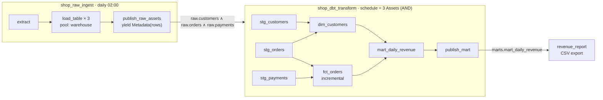

# Level 3 · dbt with Cosmos, data-aware scheduling and tested DAGs

> **Goal:** run a dbt project as first-class Airflow tasks, chain pipelines by **data** (Assets) instead of by clock, and gate every change with DAG and data tests in CI.

Part of the [data engineering learning path](../README.md) · Previous: [Level 2](../02-snowflake-idempotent-loads/) · Next: [Level 4 · Databricks and Delta Lake](../04-databricks-delta-medallion/)

Runs fully locally on DuckDB (`DBT_TARGET=local`); the same dbt project has a `snowflake` target.

## What it does



Each box inside `shop_dbt_transform` is an Airflow task that Cosmos generated from the dbt manifest. Each one runs `dbt build` for its model, so the model's tests run right after it, and a failed test stops downstream models from building on bad data.

## Run it

```bash
cp .env.example .env    # optional
make e2e                # triggers ONLY the ingestion; Assets start dbt, then the report
make test               # ruff + DAG integrity + real `dbt build` + dag.test() of all three DAGs
make down
```

`make e2e` ends by printing `data/reports/daily_revenue_latest.csv`. UI: <http://localhost:8083>. Open **Assets** to see the producer/consumer graph and each event's metadata (row counts per table).

To run against Snowflake, set `WAREHOUSE_BACKEND=snowflake`, `DBT_TARGET=snowflake` and the `SNOWFLAKE_*` variables in `.env` (key-pair auth, key file mounted).

## Design decisions

| Decision | Why |
|---|---|
| **Cosmos `DbtTaskGroup`, not one `BashOperator("dbt build")`** | One task per model gives per-model retries, logs and timing in the Airflow UI, and dbt's lineage becomes Airflow dependencies. A single `dbt build` task means rerunning everything after any failure. |
| **`TestBehavior.BUILD`** | `dbt build` per model runs its tests in the same task, which halves the task count compared with separate test tasks and still blocks bad data. |
| **`LoadMode.DBT_MANIFEST`, manifest built in the Dockerfile** | The DAG processor parses DAG files continuously; running `dbt ls` on every parse costs seconds. Reading a prebuilt manifest took ~0.4 s here. The dbt project ships inside the image as an immutable, versioned artifact. |
| **dbt in its own virtualenv** (`/opt/dbt-venv`) | dbt and Airflow pin conflicting dependencies; isolating them avoids constraint conflicts. Cosmos calls `dbt_executable_path`. |
| **Assets with an AND condition** | The transform runs when all three raw tables have new data, whatever time ingestion finishes. No cron alignment, no `ExternalTaskSensor`. |
| **Explicit `publish_*` tasks own the outlets** | The Asset event fires only after every mapped load (or every dbt model and test) succeeded, never on partial success. |
| **`Metadata` on Asset events** | Consumers and operators can see what changed (batch date, row counts) without opening the warehouse. |
| **Incremental `fct_orders` with `delete+insert` on `order_id` and a lookback** | Reruns and late corrections re-merge the last N load batches by key, so the model is idempotent. A test runs `dbt build` twice and checks there are no duplicates. |
| **Inferred members in `dim_customers`** | Orders can arrive before their customer record (late-arriving dimension). Dropping them loses revenue, and failing the FK test blocks the pipeline. An `is_inferred` placeholder keeps referential integrity and is filled in by the next customer `MERGE`. |
| **Singular test `assert_paid_orders_are_fully_settled`** | Business invariants belong in tests too; a test corrupts one payment and checks that the build fails. |

## Tests and CI

| Test | What it proves |
|---|---|
| `test_dag_integrity.py` | DagBag has no import errors; platform rules; Asset wiring (producer outlets, AND condition, consumer); Cosmos renders exactly one task per dbt model, all in the `warehouse` pool, keeping dbt lineage |
| `test_dbt_project.py` | A real `dbt build` over data loaded by the real loader passes; a second (incremental) build adds no duplicates; mart revenue equals the sum of payments; a corrupted payment fails the build |
| `test_pipeline_run.py` | `dag.test()` runs ingestion → Cosmos/dbt → report and checks the exported CSV |

CI runs the same containers: [`.github/workflows/data-engineering-path.yml`](../../.github/workflows/data-engineering-path.yml) builds each level's `test` image and runs `ruff`, `pytest` and `dbt build`, without cloud credentials. The workflow is path-filtered, so it runs only when the learning path changes.

## What this demonstrates

- dbt orchestration with Cosmos the way production teams run it (manifest parsing, isolated dbt venv, per-model `build`)
- Airflow 3 Assets: AND conditions, event metadata, chained producer/consumer DAGs
- Analytics-engineering patterns: incremental idempotent models, late-arriving dimensions, business-rule tests
- A test pyramid for data pipelines, from DAG integrity to a real dbt build and a three-DAG `dag.test()`
