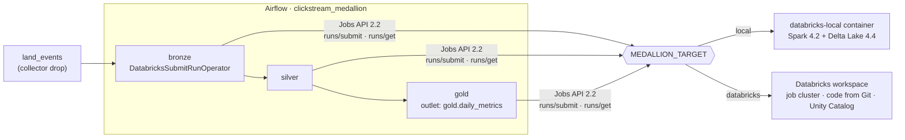

# Level 4 · Databricks and Delta Lake medallion, orchestrated by Airflow

> **Goal:** build a bronze → silver → gold lakehouse pipeline in PySpark on Delta Lake, orchestrate it from Airflow through the Databricks Jobs API, and make the whole thing runnable and testable on a laptop with **no Databricks account**.

Part of the [data engineering learning path](../README.md) · Previous: [Level 3](../03-dbt-cosmos-assets/) · Next: [Level 5 · Principal reference architecture](../05-principal-reference-architecture/)

## What it does

A mobile/web app emits clickstream events as JSON lines, with the usual mess: duplicates from at-least-once delivery, malformed records, and events that arrive a day late. `clickstream_medallion` lands each day's file and submits three Spark jobs.



| Layer | Job | Contract |
|---|---|---|
| **Bronze** `bronze/events` | `jobs/bronze_ingest.py` | Every line exactly as received, plus `_source_file`, `_ingested_at`, `_batch_date`. Never parsed, so it can always be replayed. `replaceWhere _batch_date = D`. |
| **Silver** `silver/events` | `jobs/silver_events.py` | Parsed against an explicit schema; invalid rows go to `silver/events_quarantine` with their reasons; deduped by `event_id`; `MERGE … WHEN NOT MATCHED THEN INSERT`. The job **fails** if more than 5% of the batch is invalid. |
| **Gold** `gold/daily_metrics` | `jobs/gold_daily_metrics.py` | DAU, sessions, funnel counts, revenue and conversion per `event_date`, recomputed for **every date the batch touched**, then `replaceWhere event_date IN (…)`. |

### The local Databricks stand-in

`databricks_local/` is a ~200-line FastAPI app implementing the four Jobs API 2.2 endpoints that `DatabricksSubmitRunOperator` uses (`runs/submit`, `runs/get`, `runs/get-output`, `runs/cancel`), bearer-token auth and `idempotency_token`. It runs each `spark_python_task` as a local PySpark process with Delta Lake. The Airflow DAG is **the same code** for both targets; only the `databricks_default` connection and `MEDALLION_TARGET` change. It is a development tool, not a Databricks product.

## Run it

Requirements: Docker with ~6 GB of memory (Airflow plus a Spark driver).

```bash
cp .env.example .env    # optional
make e2e                # runs 16 Nov, then 17 Nov (carrying late 16 Nov events), then reruns 17 Nov
make test               # Airflow DAG/payload tests + Spark/Delta tests + emulator contract tests
make sql Q="SELECT * FROM silver_events_quarantine LIMIT 5"
make down
```

- Airflow UI: <http://localhost:8084>. Each Databricks task links to its `run_page_url`.
- Run pages and driver logs: `http://localhost:8090/runs/<run_id>`.
- Delta tables are plain folders under `./lake` (open `_delta_log/` to see the commits).

### Against a real workspace

Set `MEDALLION_TARGET=databricks`, `AIRFLOW_CONN_DATABRICKS_DEFAULT` (an OAuth service principal rather than a personal token), `DATABRICKS_GIT_URL`/`BRANCH`, catalog/schema and, ideally, `DATABRICKS_CLUSTER_POLICY_ID`. Each layer then runs from Git at that branch on an autoscaling job cluster (spot with on-demand driver, cost tags per layer), writing `main.clickstream.{bronze,silver,gold}_*` Unity Catalog tables. In production the `land_events` task disappears: the collector writes to S3 and bronze reads it (Auto Loader or `COPY INTO`).

## Design decisions

| Decision | Why |
|---|---|
| **`DatabricksSubmitRunOperator` per layer** instead of one notebook doing everything | Each layer is retried, timed and alerted on separately, and gold can be recomputed without re-ingesting. `DatabricksWorkflowTaskGroup` (one Databricks job, shared cluster) is the next step when cluster start-up time dominates; see the trade-off in Level 5's ADRs. |
| **`idempotency_token`** = hash(dag, task, run_id), ≤ 64 chars | If a worker dies after submitting, the Airflow retry re-attaches to the run already in flight instead of starting a second cluster that writes the same data. The flip side: clearing a task in the same DAG run re-attaches to the finished Databricks run. To recompute on purpose, trigger a new DAG run for that interval; the jobs are idempotent, so that is safe. |
| **`deferrable=True`** | A 40-minute Spark job costs a coroutine in the triggerer, not a worker slot. |
| **Code from Git, job clusters, cluster policy** | Reproducible runs pinned to a ref; ephemeral compute that dies with the run (no idle all-purpose clusters); the policy caps instance types and enforces tags. |
| **Bronze stores raw text** | Schema bugs are fixed by replaying bronze, never by asking the source to resend. |
| **Quarantine plus a failure threshold** | Bad records are kept with reasons for triage, but a broken producer (above 5% invalid) stops the line before it pollutes gold. |
| **Insert-only `MERGE` on `event_id`** | Silver is idempotent across reruns *and* absorbs duplicates that arrive in a later batch. |
| **Gold recomputes all touched dates** | Late events change yesterday's metrics; recomputing affected partitions from silver (not adding deltas) keeps gold exactly consistent. A test compares gold with a from-scratch recomputation. |
| **`replaceWhere` over `overwrite`** | Atomic replacement of only the partitions owned by this batch; concurrent or historical partitions are untouched. |
| **Pure transforms in `jobs/lib/transforms.py`, I/O in `jobs/lib/tables.py`** | The same functions run on local Spark, in tests and on Databricks; `Tables` switches between path-based Delta and Unity Catalog names. |
| **Delta jars resolved at image build** | Runs and CI never reach Maven Central at runtime. |

## Tests

| Suite | Test | What it proves |
|---|---|---|
| Spark (`tests_spark/`) | `test_medallion.py` | Bronze keeps every line and is idempotent; silver quarantines, dedupes and reruns cleanly; late events update the previous day's gold, which equals a full recomputation; the quality threshold stops the line; Delta rejects a wrong schema; every write is a versioned commit (time travel) |
| | `test_databricks_local_api.py` | Emulator contract: auth, success, failure with error message, idempotency token re-attach, `run_id` in query or JSON body (the async hook's shape), missing file, path escape |
| Airflow (`tests_airflow/`) | `test_dag.py` | Topology and platform rules; deferrable operators; Asset outlet; rendered payload uses the data interval; idempotency token is short, stable across retries, unique per run/task; Databricks payload (Git source, UC parameters, policy, tags) vs. local payload |

## What this demonstrates

- Medallion architecture on Delta Lake with the hard parts handled: replay, quarantine, dedupe across batches, late data, schema enforcement, time travel
- Production Databricks orchestration from Airflow: Jobs API, idempotency tokens, deferrable operators, job clusters from Git, cluster policies and cost tags
- Making a cloud-only platform testable: a contract-tested local stand-in that lets the real operator code run in CI
