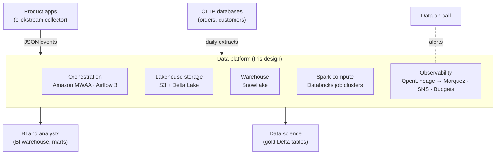
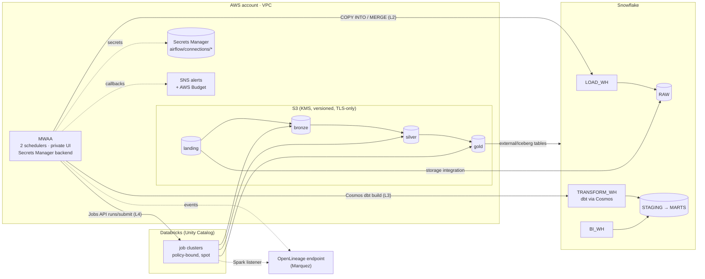
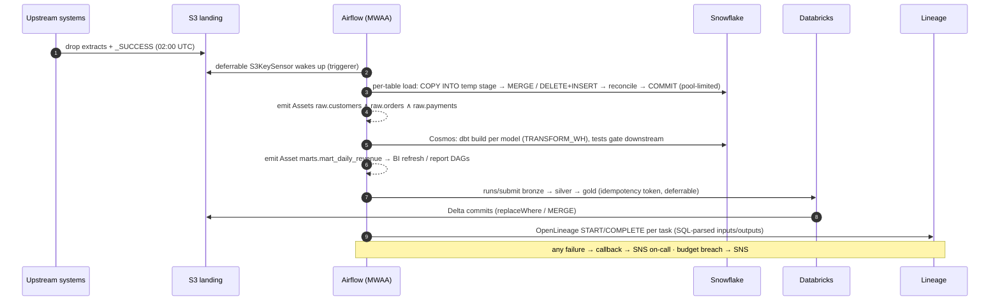

# Level 5 · Principal reference architecture on AWS

> **Goal:** turn Levels 1-4 into a platform design a Principal Data Engineer can defend: AWS infrastructure as tested Terraform, Snowflake and Databricks provisioned with guardrails, end-to-end lineage with OpenLineage, a cost model, and the decisions written down as ADRs.

Part of the [data engineering learning path](../README.md) · Previous: [Level 4](../04-databricks-delta-medallion/)

**Runnable without any cloud account:** every Terraform module is planned and asserted with mocked providers (`terraform test`), the lineage stack (Airflow + Marquez) runs in Docker, and the cost model is plain Python.

## Context: who uses the platform and what it touches



## Containers and data flow



## A day in production



## What is in this folder

| Path | What | Verified by |
|---|---|---|
| [`terraform/modules/data_lake`](terraform/modules/data_lake) | 4 zone buckets, KMS with rotation, versioning, TLS-only policy, lifecycle and landing expiry | `terraform test` (mocked AWS) |
| [`terraform/modules/mwaa`](terraform/modules/mwaa) | MWAA in private subnets, 2 schedulers, least-privilege execution role, Secrets Manager backend, OpenLineage transport | `terraform test` |
| [`terraform/modules/snowflake`](terraform/modules/snowflake) | Database and schemas, one warehouse per workload with resource monitors, functional roles and grants, key-pair service users, S3 storage integration | `terraform test` (mocked Snowflake) |
| [`terraform/modules/databricks`](terraform/modules/databricks) | Job cluster policy, service principal, UC storage credential, external locations, schema grants | `terraform test` (mocked Databricks) |
| [`terraform/modules/observability`](terraform/modules/observability) | SNS alert topic, AWS Budget on the cost-center tag | `terraform test` |
| [`terraform/envs/prod`](terraform/envs/prod) | Composition, S3 backend with native locking, Snowflake ↔ IAM trust wiring without a dependency cycle | `terraform test` |
| [`lineage/`](lineage) | Airflow 3 + PostgreSQL + Marquez; SQL DAG whose lineage is captured automatically | pytest (SQL lineage contract) + `make e2e` (asserts the graph in Marquez) |
| [`cost/estimate.py`](cost/estimate.py) | Monthly cost model per scenario with explicit, overridable price assumptions | pytest |
| [`docs/adr/`](docs/adr) | Eight architecture decision records | review |

## Run it

```bash
make test    # Terraform fmt/validate/test for 6 roots (mocked providers) + cost model + lineage contract tests
make e2e     # Airflow + Marquez up; run the SQL pipeline; assert the mart's upstream lineage in Marquez
make cost    # print the scenario table
make down
```

- Airflow: <http://localhost:8085> (`airflow` / `airflow` by default)
- Marquez UI: <http://localhost:3002>. Search `daily_revenue_by_country` to see the graph `raw.* → staging.orders_enriched → marts.daily_revenue_by_country`, including column lineage.
- Marquez publishes amd64 images only; on Apple silicon they run under emulation and take about a minute to start.

To plan against real accounts: copy `terraform/envs/prod/terraform.tfvars.example`, export AWS/Snowflake/Databricks credentials (OIDC or SSO, never static keys), then `terraform init -backend-config=…` and `terraform plan`.

## Cost model (illustrative)

`make cost` prints monthly estimates for three scenarios. **The prices are illustrative list-price assumptions** (in `cost/estimate.py`); verify current pricing or your contract before using them. The model is for comparing scenarios and showing the levers:

| Scenario | MWAA | Snowflake | Databricks | S3 | Total / month |
|---|---:|---:|---:|---:|---:|
| small | ~$378 | ~$603 | ~$51 | ~$47 | **~$1.1k** |
| medium | ~$701 | ~$2.6k | ~$340 | ~$471 | **~$4.1k** |
| large | ~$1.7k | ~$8.6k | ~$1.6k | ~$4.7k | **~$16.7k** |

The biggest lever is warehouse uptime: with the same assumptions, auto-suspend saves about $8k per month in the medium scenario compared with always-on warehouses. Next come warehouse size per workload, spot for job clusters, and the MWAA class. Guardrails enforce these levers (ADR 0008): resource monitors, the cluster policy and the budget alert.

## Non-functional requirements and how the design meets them

| Requirement | Mechanism |
|---|---|
| Correct under retries, reruns and backfills | Idempotency contract (ADR 0003), tested in Levels 1-4 |
| Daily marts ready by 06:00 UTC | Asset-driven chaining (ADR 0004) instead of clock offsets; deferrable sensors and operators; SLA callbacks to SNS |
| Bad data never reaches marts | Quality gates before publish: Level 1 validation, Level 2 in-transaction reconciliation, Level 3 dbt `build` tests, Level 4 quarantine threshold |
| Security | Private MWAA, KMS everywhere, TLS-only buckets, no static credentials (ADR 0008), least-privilege roles, Unity Catalog and Snowflake RBAC |
| Bounded cost | Resource monitors, auto-suspend, cluster policy, budget alerts; cost model versioned with the infrastructure |
| Explainability and impact analysis | OpenLineage across Airflow, dbt and Spark into one graph (ADR 0007) |
| Recoverability | S3 versioning, Snowflake Time Travel, Delta time travel; bronze keeps raw data for replay |

## Architecture decisions

1. [Airflow runtime: MWAA, with EKS + Helm as the documented exit](docs/adr/0001-airflow-runtime-mwaa.md)
2. [Snowflake for governed SQL and BI, Databricks for Spark, S3 + Delta in between](docs/adr/0002-snowflake-and-databricks-split.md)
3. [Idempotency contract for every task](docs/adr/0003-idempotency-contract.md)
4. [Data-aware scheduling with Assets](docs/adr/0004-data-aware-scheduling.md)
5. [dbt through Cosmos, rendered from a manifest](docs/adr/0005-dbt-with-cosmos.md)
6. [Databricks submission model](docs/adr/0006-databricks-job-submission.md)
7. [Lineage with OpenLineage and Marquez](docs/adr/0007-lineage-with-openlineage.md)
8. [Identity, secrets and cost guardrails](docs/adr/0008-identity-secrets-and-cost-guardrails.md)

## Known limitations

- Terraform is validated and tested with mocked providers, not applied to real accounts from this repository. VPC, subnets and the Unity Catalog IAM role are inputs, because most companies already own them.
- MWAA supports a subset of Airflow versions and trails upstream; set `airflow_version` to one MWAA currently offers.
- The cost model is deliberately simple (no Snowflake serverless features, Databricks serverless, data transfer or support plans).
