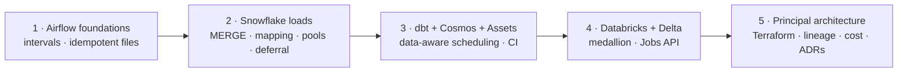

# Data engineering learning path: Airflow 3, Snowflake and Databricks

Five projects that build on each other, from a first Airflow DAG to a Principal-level platform design. Every project runs with `docker compose`, and every test suite passes **without a Snowflake or Databricks account** (DuckDB and local Spark + Delta Lake stand in, behind the same interfaces). Each level has its own README with diagrams, run instructions, design decisions and what it demonstrates.

| Level | Project | You build | Key techniques | Local stand-in |
|---|---|---|---|---|
| 1 · Basic | [01-airflow-foundations](01-airflow-foundations/) | Daily weather ingestion from a public API into date-partitioned Parquet | Airflow 3 components in Compose, TaskFlow, data intervals (and the Airflow 3 timetable change), atomic partition writes, quality gate, DagBag + `dag.test()` | none needed |
| 2 · Intermediate | [02-snowflake-idempotent-loads](02-snowflake-idempotent-loads/) | Idempotent daily loads of three tables into Snowflake | `COPY INTO … FORCE` + `MERGE` / `DELETE`+`INSERT`, in-transaction reconciliation, dynamic task mapping, pools, deferrable sensors | DuckDB (same SQL) |
| 3 · Advanced | [03-dbt-cosmos-assets](03-dbt-cosmos-assets/) | Ingestion → dbt → report, chained by data | Astronomer Cosmos, manifest parsing, incremental models, late-arriving dimensions, Assets with AND conditions and metadata, CI | dbt-duckdb |
| 4 · Lakehouse | [04-databricks-delta-medallion](04-databricks-delta-medallion/) | Clickstream bronze/silver/gold on Delta Lake orchestrated through the Databricks Jobs API | PySpark, Delta `MERGE`/`replaceWhere`, quarantine, late data, idempotency tokens, deferrable `DatabricksSubmitRunOperator`, job clusters from Git | Spark 4 + Delta 4 behind a contract-tested Jobs API emulator |
| 5 · Principal | [05-principal-reference-architecture](05-principal-reference-architecture/) | AWS reference architecture for the whole platform | Terraform (S3, MWAA, Snowflake, Databricks, budgets) tested with mocked providers, OpenLineage + Marquez, cost model, 8 ADRs | mocked providers, Marquez in Docker |



## Quick start

```bash
cd data-engineering-path/01-airflow-foundations
make up      # Airflow UI on http://localhost:8081 (airflow / airflow)
make e2e     # trigger the DAG through the REST API and wait for success
make test    # lint + unit + DAG tests in the test container
make down
```

Each level uses its own ports (Airflow on 808N for level N), so stacks don't collide, but run one at a time on a laptop: each Airflow stack needs about 3-4 GB of memory, and Level 4 adds a Spark driver.

## Conventions shared by every level

- **Airflow 3.4** with the `airflow.sdk` API, LocalExecutor, PostgreSQL metadata DB, and the api-server, scheduler, dag-processor and triggerer as separate containers.
- **Thin DAGs, pure logic:** business logic lives in `include/` (or `jobs/` for Spark) without Airflow imports, so it is unit-tested in milliseconds.
- **Idempotent by construction:** every task keyed by its data interval; every level has a test that runs the work twice.
- **Two-stage Dockerfiles:** `runtime` for Compose, `test` (ruff + pytest) for CI; dev tools never ship.
- **Secrets only via environment:** each level ships `.env.example` with placeholders; real Snowflake and Databricks connections are optional and come from `.env`.
- **CI:** [`.github/workflows/data-engineering-path.yml`](../.github/workflows/data-engineering-path.yml) runs each level's test containers and the Terraform checks, path-filtered.

## Test summary (local run, 2026-11-18)

| Level | Test suites | End to end with `make e2e` |
|---|---|---|
| 1 | 13 pytest (ruff clean) | DAG run against the live Open-Meteo API |
| 2 | 14 pytest | sensor deferred until the extract lands → 3 mapped loads → cleared rerun with identical counts |
| 3 | 7 pytest, including a real `dbt build` | ingestion triggers dbt through Assets, which triggers the report |
| 4 | 6 Airflow + 12 Spark/Delta/emulator pytest | three daily runs through the Jobs API, late events recomputing the previous day's gold |
| 5 | 10 `terraform test` runs across 6 roots + 5 cost + 5 lineage pytest | lineage graph asserted in Marquez |

Study notes in Spanish, with interview questions per level: [GUIA.md](GUIA.md).
