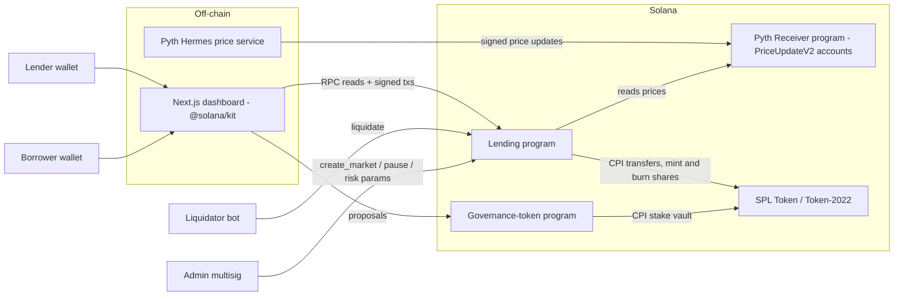
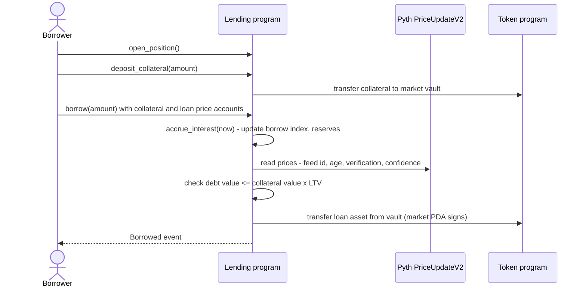
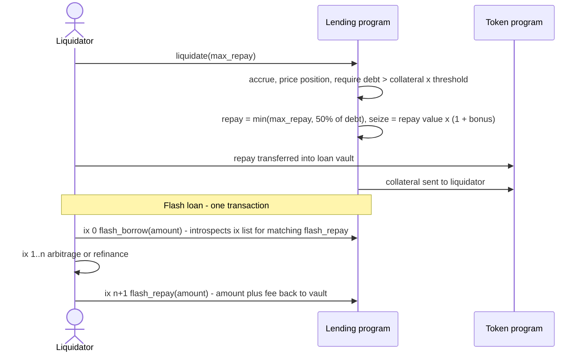
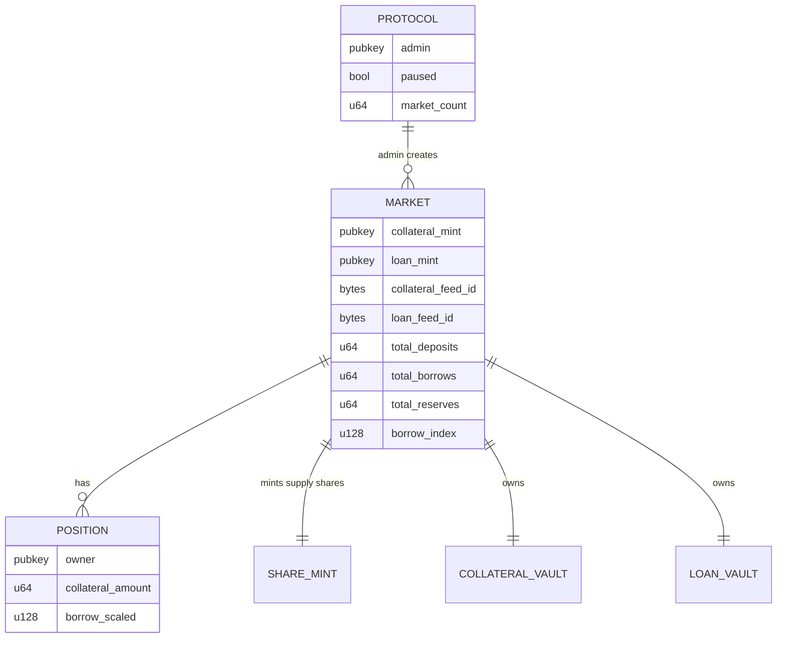

# DeFi Lending Protocol (Solana)


An over-collateralised lending protocol for Solana built with Anchor. Lenders supply an asset and
earn interest through share tokens; borrowers lock collateral and borrow against it, priced by
**Pyth pull oracles**. Unhealthy positions are liquidated with a bonus, idle liquidity powers
**single-transaction flash loans**, and a companion **governance token** program lets stakers create
and vote on proposals.

The design follows the *isolated market* model (as popularised by Morpho Blue and Kamino's isolated
pools): each market pairs exactly one collateral asset with one borrowable asset, so the risk of a
volatile collateral never spills into other markets.

> Portfolio / reference implementation — unaudited, not deployed to mainnet. See
> [SECURITY.md](SECURITY.md).

## Key features
- **Isolated markets** (`collateral mint × loan mint`) with PDA vaults and a PDA share mint.
- **Supply / withdraw** with interest-bearing SPL share tokens (rounding in favour of the pool).
- **Collateral, borrow, repay** with index-based debt accounting (`borrow_scaled × borrow_index`).
- **Kinked interest-rate model** (base + slope1 up to optimal utilisation, slope2 above), with a
  configurable reserve factor accruing protocol reserves.
- **Pyth `PriceUpdateV2`** oracle checks: feed id, max age, full Wormhole verification, confidence.
- **Liquidations** with 50% close factor, liquidation bonus and bad-debt-safe collateral capping.
- **Flash loans** enforced by instruction introspection (`flash_borrow` … `flash_repay` in one tx).
- **Admin controls**: global pause, per-market pause and risk updates, reserve collection.
- **Governance token**: time-locked staking, stake-weighted proposals, quorum + majority finalisation,
  vote records preventing double voting.
- **Token interface** support (SPL Token and Token-2022 mints without transfer fees/hooks).
- **Next.js dashboard** reading markets, positions and proposals straight from chain with
  `@solana/kit`, and wallet-standard wallet connection.

## Tech stack
| Layer | Technology | Version |
| --- | --- | --- |
| On-chain programs | Anchor (`anchor-lang`, `anchor-spl`) | 1.2.1 |
| Toolchain | Agave (Solana) CLI / `cargo-build-sbf` | 4.3.2 |
| Language | Rust, edition 2024 (MSRV 1.89) | stable |
| Oracle | `pyth-solana-receiver-sdk` (Pyth pull oracle) | 2.0.0 |
| Program tests | LiteSVM + host unit tests | 0.18.0 |
| Frontend | Next.js / React | 16.4 / 19.3 |
| Solana client | `@solana/kit`, `@solana/react`, wallet-standard | 8.5 |
| Styling / tooling | Tailwind CSS 4, TypeScript 6 (strict), ESLint 9 flat config, Vitest | — |
| Runtime | Node.js LTS | 24 |
| CI | GitHub Actions (+ advisory `cargo audit` / `npm audit`) | — |

## Architecture

### Context / container view


### Borrow flow


### Liquidation and flash loan


### On-chain accounts


PDA seeds: `protocol`, `market + collateral_mint + loan_mint`, `collateral_vault + market`,
`loan_vault + market`, `share_mint + market`, `position + market + owner`.

## Project structure
```
defi-lending-protocol/
├── Anchor.toml, Cargo.toml, Cargo.lock    # Anchor 1.2.1 workspace (Rust 2024)
├── programs/
│   ├── defi-lending-protocol/
│   │   ├── src/
│   │   │   ├── lib.rs                      # instruction entrypoints
│   │   │   ├── state.rs                    # Protocol, Market, MarketConfig, Position
│   │   │   ├── math.rs                     # pure fixed-point math + unit tests
│   │   │   ├── oracle.rs                   # Pyth PriceUpdateV2 validation
│   │   │   ├── token.rs, events.rs, errors.rs, constants.rs
│   │   │   └── instructions/               # admin, supply, position, borrow, liquidate, flash_loan
│   │   └── tests/lending.rs                # LiteSVM end-to-end tests
│   └── governance-token/
│       ├── src/                            # staking, proposals, voting
│       └── tests/governance.rs
├── app/                                    # Next.js 16 dashboard (@solana/kit)
├── scripts/deploy.sh
├── docker-compose.yml                      # runs the dashboard container
└── SECURITY.md
```

## Running locally

### Programs
Prerequisites: Rust stable, [Agave CLI 4.3.x](https://docs.anza.xyz/cli/install),
[Anchor CLI 1.2.1](https://www.anchor-lang.com/docs/installation) (`avm install 1.2.1`).
```bash
cd defi-lending-protocol
anchor build                  # SBF binaries, IDL (target/idl) and TS types (target/types)
cargo test --workspace        # unit + LiteSVM end-to-end tests
./scripts/deploy.sh devnet    # anchor keys sync + build + deploy with your keypairs
```

### Dashboard without Docker
```bash
cd defi-lending-protocol/app
cp .env.example .env.local    # set RPC URL / program ids
npm ci
npm run dev                   # http://localhost:3000
```

### Dashboard with Docker
```bash
cd defi-lending-protocol
docker compose up --build     # http://localhost:3000
```

## Testing
| Suite | Command | Coverage |
| --- | --- | --- |
| Math unit tests | `cargo test --workspace --lib` | rate model, accrual, shares, debt rounding, USD valuation, LTV/health, flash fee, proposal outcome |
| Program E2E (LiteSVM) | `anchor build && cargo test --workspace` | supply → borrow → 1-year accrual → repay → withdraw with interest; LTV limits; liquidation after price drop; stale / wrong-feed oracle; flash loan with and without repay; admin pause; governance stake → propose → vote → lock → finalise → unstake |
| Frontend | `cd app && npm run lint && npm run typecheck && npm test && npm run build` | account codecs, rate-model math, formatting |

## Configuration
| Variable / setting | Where | Default |
| --- | --- | --- |
| `NEXT_PUBLIC_RPC_URL` | `app/.env.local` / Docker build arg | `https://api.devnet.solana.com` |
| `NEXT_PUBLIC_CLUSTER` | `app/.env.local` / Docker build arg | `devnet` |
| `NEXT_PUBLIC_LENDING_PROGRAM_ID` | `app/.env.local` / Docker build arg | `4sohRUrhAnm75sFwUbeE6tJHRQCNq5MMf4PEYEUi1WdD` |
| `NEXT_PUBLIC_GOVERNANCE_PROGRAM_ID` | `app/.env.local` / Docker build arg | `JCFC4bviKZmiVdsDkvzXjRCzE9Yc7P1VumkgkiBvQ43c` |
| Program ids | `declare_id!` + `Anchor.toml` | as above (`anchor keys sync` to use your own) |
| Market risk parameters | `create_market` / `update_market` args | e.g. LTV 75%, threshold 80%, bonus 5%, reserve 10%, flash fee 9 bps, max price age 60 s |

No secrets are required; wallets sign client-side and keypairs never leave the developer machine
(`*-keypair.json` is git-ignored).

## Design decisions
- **Isolated markets instead of a shared cross-collateral pool**: simpler, auditable risk per pair
  and a single health computation per instruction (two price accounts, no remaining-accounts loops).
- **Internal accounting over vault balances** prevents donation/inflation attacks on share pricing.
- **Index-based debt** (`borrow_scaled`) makes interest accrual O(1) per market rather than per user.
- **Pyth pull oracle** (`PriceUpdateV2`) is the current Solana standard; prices are posted in the same
  transaction by the client, so freshness can be strict (60 s in tests).
- **Instruction-introspection flash loans** keep the program free of arbitrary CPI callbacks and
  re-entrancy concerns.
- **Governance records outcomes; execution stays with a multisig**, avoiding an on-chain arbitrary
  instruction executor in a demo codebase.
- **LiteSVM over `solana-test-validator`**: real SBF binaries and real SPL programs, tests finish in
  under a second and run in CI without a validator.
- **`@solana/kit` + wallet-standard** in the frontend replaces web3.js v1 and the legacy wallet
  adapter; account layouts are decoded with kit codecs that are unit tested.

## What changed in the 2026 modernisation
The previous version targeted Anchor 0.29 / Solana 1.16, did not compile (missing modules, invalid
program ids, duplicated module trees) and its frontend used mocked transactions. Both programs were
rewritten around a coherent design on Anchor 1.2.1, with real tests and CI.
