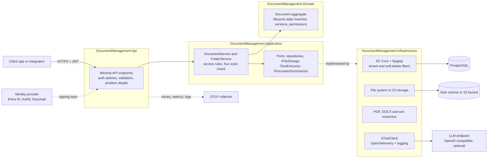
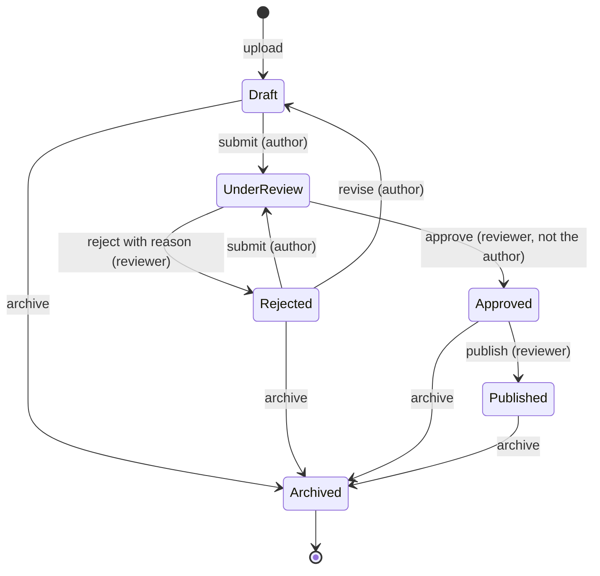
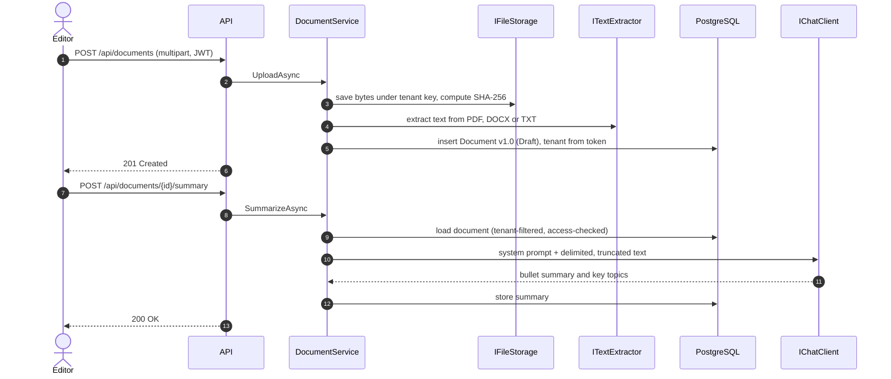
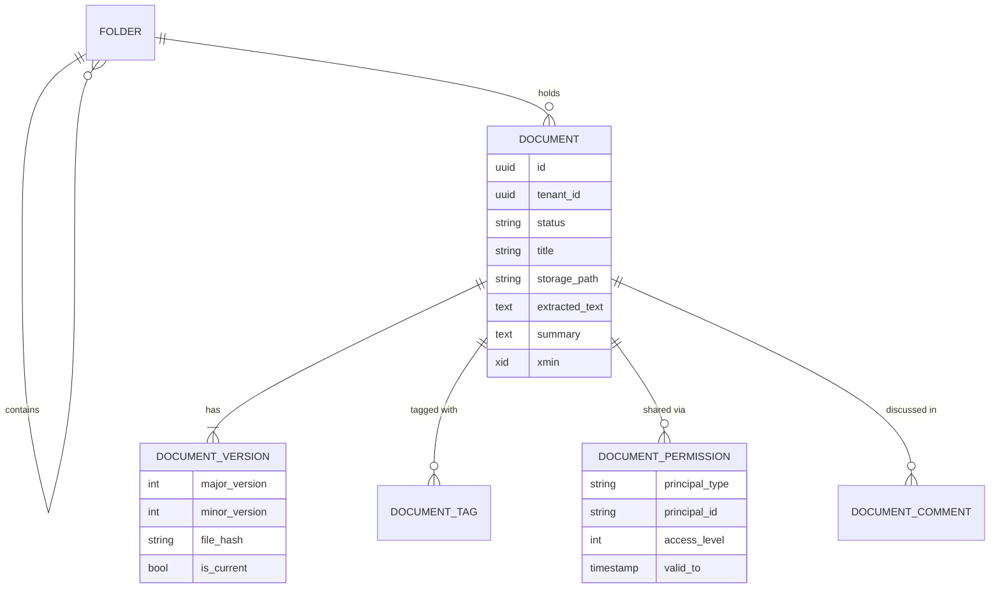

# Enterprise Document Management API (.NET 10)


A multi-tenant document management backend for regulated teams. Policies, contracts and
procedures go through a governed review workflow before publication. Every document keeps its
full version history, and only the right people can see each draft. Optionally, an LLM writes a
summary of any document through a provider-agnostic AI abstraction.

## The problem it solves

Shared drives make it impossible to answer simple compliance questions: *Which version of this
policy is official? Who approved it? Who can see the draft?* This service makes those answers
explicit:

- A document is **Draft → Under review → Approved → Published → Archived**, and every transition is checked.
- Authors cannot approve their own work (**four-eyes principle**).
- Content is **frozen while under review**. A change means a new version, after rework.
- Drafts are **private** to the author and to explicitly shared users, roles or groups. Published documents are visible tenant-wide.
- **Tenants are isolated** at the data layer, not just in controllers.

## Key features

- **Upload and versioning.** Multipart uploads with SHA-256 integrity hashes. Minor and major versions keep exactly one current version.
- **Full-text search** over title, description, keywords, file name and the extracted content of TXT/Markdown/CSV/JSON, PDF (PdfPig) and Word `.docx` files (Open XML SDK). Search wildcards are escaped.
- **Review workflow** as an explicit state machine (`DocumentLifecycle`), with role checks for reviewers and rejection reasons recorded as comments.
- **Sharing.** Time-boxed grants to a user, role or group, using `Read`/`Write`/`Delete`/`Share` flags.
- **Multi-tenancy.** EF Core global query filters read the caller's `tenant_id` claim on every request, and soft-deleted rows are excluded automatically.
- **Storage adapters.** Local disk by default, or any S3-compatible object store. Object keys are opaque and tenant-partitioned, so a user-supplied file name can never become a path.
- **AI summaries (optional).** `POST /api/documents/{id}/summary` uses `Microsoft.Extensions.AI` `IChatClient` against any OpenAI-compatible endpoint (OpenAI, Azure OpenAI, Ollama, vLLM, LiteLLM). The feature is off by default. The prompt treats document text as untrusted input and caps the input length.
- **Production hygiene.** JWT bearer auth for any OIDC provider, RFC 9457 problem details, optimistic concurrency on PostgreSQL `xmin`, upload size limits, OpenTelemetry (ASP.NET Core, HttpClient, Npgsql, AI calls), and `/health` + `/alive` probes.

## Tech stack

| Area | Technology | Version |
| --- | --- | --- |
| Runtime | .NET / C# | 10.0 (LTS) / C# 14 |
| API | ASP.NET Core Minimal APIs, OpenAPI, Scalar | 10.0.13 / 2.18 |
| Persistence | EF Core + Npgsql on PostgreSQL | 10.0 / 10.0.3 / PostgreSQL 17 |
| Generative AI | Microsoft.Extensions.AI (+ OpenAI-compatible adapter) | 10.11.0 |
| Content extraction | PdfPig, DocumentFormat.OpenXml | 0.1.16 / 3.5.1 |
| Object storage | AWSSDK.S3 (S3, R2, MinIO-compatible) | 4.0 |
| Validation | FluentValidation | 12.2.0 |
| Observability | OpenTelemetry .NET, Npgsql.OpenTelemetry | 1.20.0 / 10.0.3 |
| Tests | xUnit v3 (Microsoft Testing Platform), AwesomeAssertions, Testcontainers | 4.0 / 9.6 / 4.16 |
| Container | Multi-stage Alpine image, non-root | sdk 10.0.402 / aspnet 10.0.13 |

## Architecture

The service is a modular monolith with Clean Architecture boundaries. The domain has no
dependencies. The application layer defines ports. Infrastructure provides the adapters.



### Review workflow



### Upload and summarize



### Data model



## Project structure

```text
document-management-dotnet/
├── Directory.Build.props / Directory.Packages.props / global.json
├── DocumentManagement.slnx
├── Dockerfile · docker-compose.yml · .env.example
├── scripts/dev-token.sh                     # mints demo JWTs for the compose stack
├── src/
│   ├── DocumentManagement.Domain/           # aggregates, lifecycle, value objects, domain events
│   ├── DocumentManagement.Application/      # use cases, ports, DTOs, validators, AI summarizer
│   ├── DocumentManagement.Infrastructure/   # EF Core/Npgsql, storage, text extraction, AI wiring
│   └── DocumentManagement.Api/              # minimal API, auth policies, observability
└── tests/
    ├── DocumentManagement.UnitTests/        # domain, services, summarizer, extractors, storage
    └── DocumentManagement.IntegrationTests/ # HTTP tests against PostgreSQL (Testcontainers)
```

## Running locally

### With Docker Compose

```bash
cd document-management-dotnet
cp .env.example .env          # set POSTGRES_PASSWORD and JWT_SIGNING_KEY_BASE64 (openssl rand -base64 32)
docker compose up --build -d --wait

export $(grep -v '^#' .env | xargs)
TENANT=$(uuidgen)
TOKEN=$(./scripts/dev-token.sh alice "$TENANT" editor)

curl -s -X POST http://localhost:8080/api/documents -H "Authorization: Bearer $TOKEN" \
  -F file=@README.md -F tags=docs,readme
curl -s "http://localhost:8080/api/documents?q=workflow" -H "Authorization: Bearer $TOKEN"
```

Telemetry is visible in the dashboard at `http://localhost:18888`. To try AI summaries, set
`AI_ENABLED=true` and point `AI_ENDPOINT`/`AI_MODEL` at any OpenAI-compatible server, for
example a local Ollama.

### Without Docker

```bash
# PostgreSQL must be running and reachable via ConnectionStrings:documentsdb
cd document-management-dotnet/src/DocumentManagement.Api
dotnet user-jwts create --audience document-management-api --role editor --claim tenant_id=$(uuidgen)
dotnet run    # http://localhost:5200, OpenAPI UI at /scalar in Development
```

`dotnet user-jwts` stores its signing key in user secrets, and the API validates those tokens
through standard `Authentication:Schemes:Bearer` configuration.

## API overview

| Method and path | Purpose | Who |
| --- | --- | --- |
| `GET /api/documents?q=&status=&folderId=&tag=&page=&pageSize=` | Search readable documents | any tenant member |
| `POST /api/documents` (multipart: `file`, `title`, `description`, `category`, `folderId`, `tags`) | Upload | editor, admin |
| `GET /api/documents/{id}` · `GET /api/documents/{id}/content` | Details · download | readers of the document |
| `POST /api/documents/{id}/versions` (multipart: `file`, `notes`, `major`) | New version | editor with write access |
| `PUT /api/documents/{id}/metadata` | Edit metadata (Draft or Rejected only) | write access |
| `POST /api/documents/{id}/workflow/{submit\|approve\|reject\|revise\|publish\|archive}` | Workflow transition | author or reviewer |
| `POST /api/documents/{id}/permissions` | Share with a user, role or group | share access |
| `POST /api/documents/{id}/comments` · `PUT/DELETE /api/documents/{id}/tags/{tag}` | Collaborate | readers / writers |
| `POST /api/documents/{id}/summary` | AI summary (503 when not configured) | readers |
| `GET/POST /api/folders` | Folder tree | members / editors |

Roles come from the token's `role` or `roles` claim (`admin`, `editor`, `reviewer`). The tenant
comes from `tenant_id`.

## Testing

```bash
dotnet test --solution DocumentManagement.slnx                        # all tests (Docker required)
dotnet test --project tests/DocumentManagement.UnitTests              # no Docker
dotnet test --project tests/DocumentManagement.IntegrationTests       # PostgreSQL via Testcontainers
```

- **Unit tests (25)** cover lifecycle rules, versioning, permission resolution, service-level
  access control and four-eyes approval, summarizer prompt hardening and truncation, PDF/DOCX/text
  extraction, and the storage adapter's path-traversal protection. The AI model is a fake `IChatClient`.
- **Integration tests (10)** host the real API against PostgreSQL. They cover upload and download
  integrity, full-text search, tenant isolation, role enforcement across the workflow, versioning,
  validation, folders, AI summaries and health checks.

## Configuration

| Setting (env var form) | Default | Description |
| --- | --- | --- |
| `ConnectionStrings__documentsdb` | local PostgreSQL | **Required.** Npgsql connection string. |
| `Authentication__Schemes__Bearer__Authority` | none | OIDC authority of your identity provider (production). |
| `Authentication__Schemes__Bearer__ValidAudiences__0` | `document-management-api` | Accepted token audience. |
| `Authentication__Schemes__Bearer__SigningKeys__0__Value` / `__Issuer` | none | Symmetric demo key (compose) or user-jwts key (dev). |
| `Storage__Provider` | `FileSystem` | `FileSystem` or `S3`. |
| `Storage__RootPath` | `storage` (`/data/storage` in the container) | Root folder for the file system provider. |
| `Storage__S3__BucketName`, `__ServiceUrl`, `__Region`, `__AccessKey`, `__SecretKey` | `documents`, AWS | S3 or S3-compatible settings. Without keys, the default AWS credential chain is used. |
| `Documents__MaxUploadBytes` | 52428800 | Upload size limit (50 MB). |
| `AI__Enabled` | `false` | Turns AI summaries on. |
| `AI__Endpoint` / `AI__Model` / `AI__ApiKey` | Ollama defaults | Any OpenAI-compatible chat completions endpoint. |
| `AI__MaxInputCharacters` | 12000 | Character budget for text sent to the model. |
| `Database__EnsureCreated` | `true` | Creates the schema at startup (demo). Disable it when using migrations. |
| `OTEL_EXPORTER_OTLP_ENDPOINT` | none | Enables OTLP export when set. |

## Design decisions

- **Rebuilt rather than patched.** The previous version could not compile: there was no
  `Program.cs`, the application and search layers were empty, the workflow engine referenced
  missing types, and the authorization service injected itself. The rebuild keeps the domain
  model and delivers a smaller system that works end to end.
- **PostgreSQL instead of SQL Server + Elasticsearch + Redis.** One open-source database covers
  persistence and substring search at this scale with far less to operate. Postgres full-text
  or `pgvector` semantic search is the natural next step.
- **Explicit state machine over a workflow engine.** The review process is a small, auditable
  table of transitions in the domain. A generic engine (the old WorkflowCore dependency) added
  weight without adding guarantees.
- **Tenant isolation in the data layer.** Query filters read the tenant from the current request
  on every query, so a forgotten `where` clause cannot leak data across tenants. The old
  implementation captured the tenant once in the cached model, which would have leaked.
- **Provider-agnostic AI.** `IChatClient` keeps the model swappable (cloud or self-hosted)
  and testable with a fake, and adds OpenTelemetry spans for every call. The prompt delimits the
  document and tells the model to ignore instructions inside it. Summaries are cleared when a
  new version is uploaded.
- **Hide what you cannot read.** Callers without read access get `404`, not `403`, so document IDs are not confirmed to outsiders.

### Known limitations and next steps

- The S3 adapter is compile-verified and follows the AWS SDK v4 APIs, but the automated tests use the file system provider.
- Schema creation uses `EnsureCreated`. Production would ship EF Core migrations and run them from a release job.
- OCR for scanned images, thumbnails and previews, and real-time notifications were part of the
  old feature list but never implemented. They are deliberately out of scope here.
