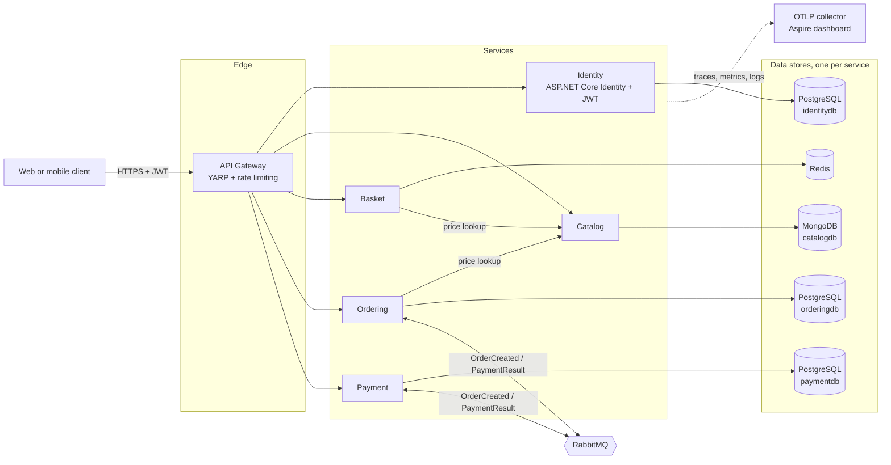
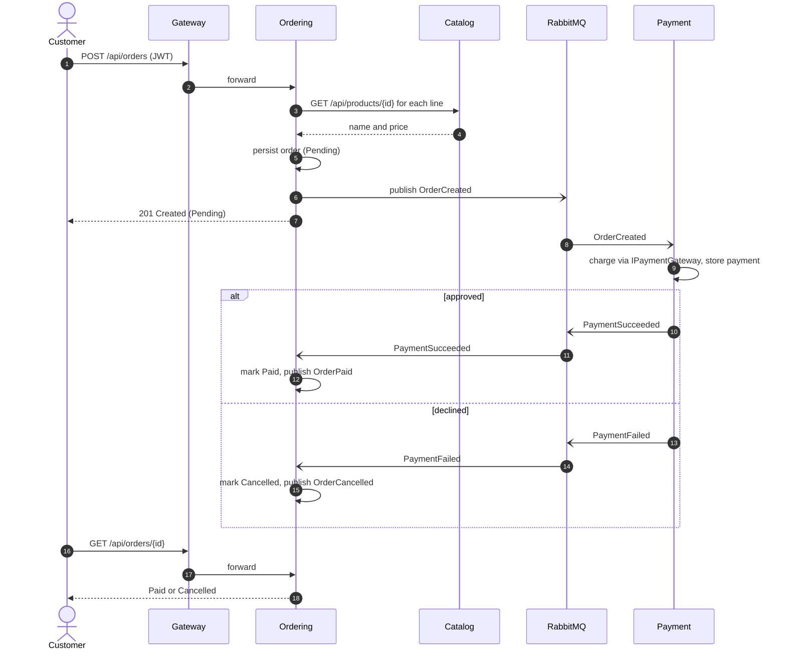
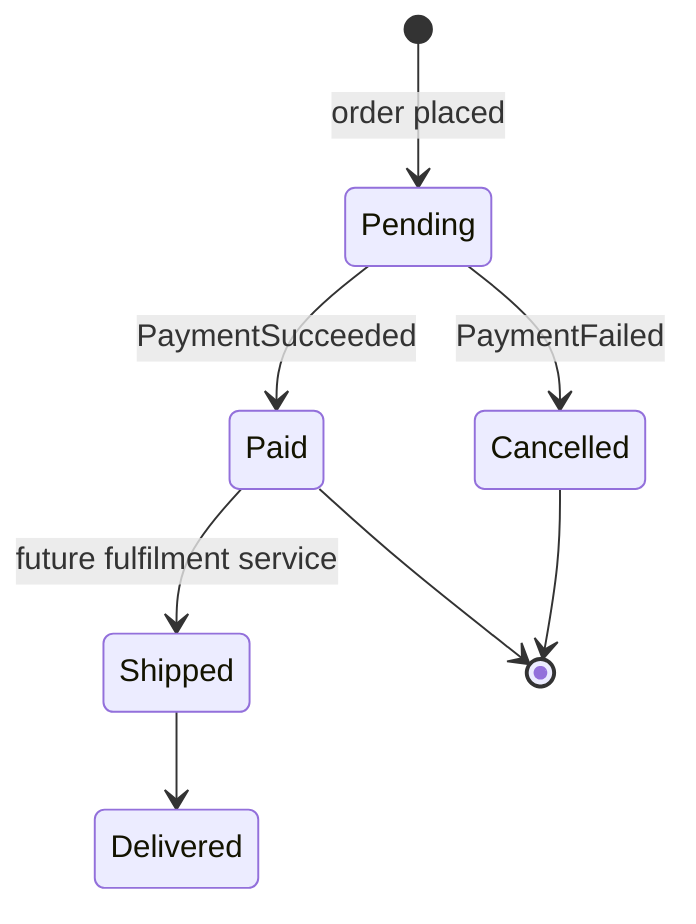

# E-Commerce Microservices (.NET 10 + Aspire)


A reference e-commerce backend split into independently deployable services. It shows how
I structure a distributed .NET system: a gateway in front, one database per service,
asynchronous choreography over a message broker, shared observability, and tests that run
against real infrastructure.

## What it does

A customer registers, browses the catalog, fills a basket and places an order. Ordering
prices the order from the catalog and publishes `OrderCreated`. Payment charges the customer
and publishes `PaymentSucceeded` or `PaymentFailed`. Ordering then marks the order **Paid** or
**Cancelled**. No service calls another service's database, and the order/payment flow keeps
working if one side is briefly unavailable, because the broker buffers the messages.

## Key features

- **Six deployable services:** Identity, Catalog, Basket, Ordering, Payment and a YARP API gateway.
- **Polyglot persistence:** PostgreSQL for Identity, Ordering and Payment; MongoDB for Catalog; Redis for Basket.
- **Event-driven order flow** with MassTransit on RabbitMQ. Consumers are idempotent, so a redelivered message never charges a customer twice.
- **JWT security:** Identity issues short-lived tokens. Every service validates them, and every basket, order and payment is scoped to the token's subject.
- **.NET Aspire:** one command starts every service and container, and the Aspire dashboard shows logs, traces and metrics.
- **OpenTelemetry everywhere:** ASP.NET Core, HttpClient, EF Core/Npgsql, MongoDB, Redis and MassTransit, exported over OTLP.
- **Health probes:** `/alive` for liveness and `/health` for readiness, including database and cache checks.
- **Gateway protections:** rate limiting at the gateway, plus per-IP login throttling and account lockout in Identity.
- **Supply-chain hygiene:** central package management, NuGet audit on every restore, and a CI gate that fails on high or critical vulnerabilities.

## Tech stack

| Area | Technology | Version |
| --- | --- | --- |
| Runtime | .NET / C# | 10.0 (LTS) / C# 14 |
| Web | ASP.NET Core Minimal APIs, OpenAPI, Scalar | 10.0.13 / 2.18 |
| Orchestration | .NET Aspire (AppHost + ServiceDefaults) | 13.6.1 |
| Gateway | YARP + Microsoft.Extensions.ServiceDiscovery | 2.3.0 / 10.11.0 |
| Messaging | MassTransit on RabbitMQ | 8.5.11 / RabbitMQ 4.3 |
| Data | EF Core + Npgsql, MongoDB.Driver, StackExchange.Redis | 10.0 / 3.x / 2.x |
| Databases | PostgreSQL, MongoDB, Redis | 17 / 8.0 / 8 |
| Auth | ASP.NET Core Identity + JWT bearer | 10.0.13 |
| Validation | FluentValidation | 12.2.0 |
| Observability | OpenTelemetry .NET | 1.20.0 |
| Resilience | Microsoft.Extensions.Http.Resilience (Polly v8) | 10.11.0 |
| Tests | xUnit v3 (Microsoft Testing Platform), AwesomeAssertions, NSubstitute, Testcontainers | 4.0 / 9.6 / 6.2 / 4.16 |
| Containers | Multi-stage Alpine images, non-root | sdk 10.0.402 / aspnet 10.0.13 |

## Architecture

### Container view



### Order placement flow



### Order lifecycle



## Project structure

```text
ecommerce-microservices-dotnet/
├── Directory.Build.props        # net10.0, nullable, warnings as errors, NuGet audit
├── Directory.Packages.props     # central package versions
├── ECommerce.slnx               # XML solution format
├── Dockerfile                   # one parameterised multi-stage image for all services
├── docker-compose.yml           # full stack without Aspire
├── k8s/                         # Kustomize manifests and a secret template
├── src/
│   ├── Aspire/
│   │   ├── ECommerce.AppHost/        # local orchestration of services and containers
│   │   └── ECommerce.ServiceDefaults/ # OpenTelemetry, health, discovery, resilience
│   ├── ApiGateway/ECommerce.ApiGateway/
│   ├── Services/{Identity,Catalog,Basket,Ordering,Payment}/
│   └── Shared/
│       ├── ECommerce.Shared.Common/     # JWT auth, validation filter, problem details, catalog client
│       ├── ECommerce.Shared.Contracts/  # HTTP DTOs
│       └── ECommerce.Shared.Events/     # integration events (transport-agnostic)
└── tests/
    ├── ECommerce.UnitTests/         # domain, services and MassTransit consumers (in-memory)
    └── ECommerce.IntegrationTests/  # HTTP APIs against real containers via Testcontainers
```

## Running locally

Prerequisites: the .NET 10 SDK and Docker (or another OCI runtime).

### Option A: .NET Aspire (recommended)

```bash
cd ecommerce-microservices-dotnet
dotnet user-secrets --project src/Aspire/ECommerce.AppHost set "Parameters:jwt-signing-key" "$(openssl rand -base64 48)"
dotnet user-secrets --project src/Aspire/ECommerce.AppHost set "Parameters:admin-password" "<choose-a-password>"
dotnet run --project src/Aspire/ECommerce.AppHost
```

The dashboard opens at `http://localhost:15080`. It lists every resource with its URL, logs,
traces and metrics. Aspire starts PostgreSQL, MongoDB, Redis and RabbitMQ for you.

### Option B: Docker Compose

```bash
cd ecommerce-microservices-dotnet
cp .env.example .env    # then fill in JWT_SIGNING_KEY, POSTGRES_PASSWORD, RABBITMQ_PASSWORD
docker compose up --build -d --wait
```

- Gateway: `http://localhost:8080`
- Telemetry dashboard: `http://localhost:18888`
- RabbitMQ management: `http://localhost:15672`

### Option C: a single service with `dotnet run`

Each service runs on a fixed port (Identity 5100, Catalog 5101, Basket 5102, Ordering 5103,
Payment 5104, Gateway 5000). It reads a dev-only signing key from `appsettings.Development.json`.
With no `messaging` connection string, Ordering and Payment fall back to MassTransit's
in-memory transport, so you can debug one service without a broker.

### Try it

```bash
GW=http://localhost:8080
curl -s -X POST $GW/api/account/register -H 'Content-Type: application/json' \
  -d '{"email":"ada@example.com","password":"S3cure-passw0rd!","firstName":"Ada","lastName":"Lovelace"}'
TOKEN=$(curl -s -X POST $GW/api/account/login -H 'Content-Type: application/json' \
  -d '{"email":"ada@example.com","password":"S3cure-passw0rd!"}' | jq -r .accessToken)
PRODUCT=$(curl -s "$GW/api/products?pageSize=1" | jq -r '.items[0].id')
curl -s -X POST $GW/api/orders -H "Authorization: Bearer $TOKEN" -H 'Content-Type: application/json' \
  -d "{\"items\":[{\"productId\":\"$PRODUCT\",\"quantity\":1}],\"shippingAddress\":{\"street\":\"1 Main St\",\"city\":\"Bogota\",\"state\":\"DC\",\"country\":\"CO\",\"postalCode\":\"110111\"},\"paymentMethod\":\"CreditCard\"}"
```

Orders above `PAYMENT_APPROVAL_LIMIT` (10,000 by default) are declined, so you can see the
cancellation path too. In Development each service also serves an OpenAPI document at
`/openapi/v1.json` and a Scalar UI at `/scalar`.

## Testing

```bash
dotnet test --solution ECommerce.slnx                      # everything (needs Docker for integration tests)
dotnet test --project tests/ECommerce.UnitTests            # fast, no Docker
dotnet test --project tests/ECommerce.IntegrationTests     # Testcontainers: PostgreSQL, MongoDB, Redis
```

- **Unit tests** cover the order aggregate's rules, catalog and basket services, token issuance
  and validation, and both sides of the payment choreography. The messaging tests run on the
  MassTransit test harness, including the idempotency check for redelivered messages.
- **Integration tests** host each service in-process with `WebApplicationFactory` against real
  containers. They cover authorization (401/403), validation (400), conflicts (409),
  per-customer isolation and health checks.

CI (`.github/workflows/ecommerce-microservices-dotnet.yml`) restores, builds with warnings as
errors, runs both test suites, enforces the vulnerability gate, and builds every container image.

## Configuration

| Setting (env var form) | Used by | Description |
| --- | --- | --- |
| `Jwt__SigningKey` | all services | HMAC key, at least 32 bytes. **Required.** Supply it via a secret store or env var. |
| `Jwt__Issuer` / `Jwt__Audience` | all services | Token issuer and audience. Defaults: `ecommerce-identity` / `ecommerce-api`. |
| `Jwt__AccessTokenLifetimeMinutes` | identity | Access token lifetime. Default: 60. |
| `ConnectionStrings__identitydb` | identity | PostgreSQL connection string. |
| `ConnectionStrings__catalogdb` | catalog | MongoDB URL. The database name comes from the URL path. |
| `ConnectionStrings__redis` | basket | Redis endpoint. |
| `ConnectionStrings__orderingdb` / `ConnectionStrings__paymentdb` | ordering / payment | PostgreSQL connection strings. |
| `ConnectionStrings__messaging` | ordering, payment | `amqp://` URI. If empty, the in-memory transport is used (single process only). |
| `services__catalog__http__0` | basket, ordering | Catalog base URL for service discovery. Aspire sets it automatically. |
| `services__<name>__http__0` | gateway | Downstream addresses for identity, catalog, basket, ordering and payment. |
| `Identity__Admin__Email` / `Identity__Admin__Password` | identity | Optional admin account (`admin` role) seeded at startup. |
| `Catalog__SeedData` | catalog | Seeds demo products into an empty catalog. Default: `true`. |
| `PaymentGateway__ApprovalLimit` | payment | The simulated gateway declines amounts above this. Default: 10000. |
| `OTEL_EXPORTER_OTLP_ENDPOINT` | all | Enables OTLP export of logs, traces and metrics when set. |
| `Cors__AllowedOrigins__0..n` | gateway | Allowed browser origins. |

## Design decisions

- **Aspire for the inner loop, plain containers for deployment.** The AppHost gives a
  one-command developer experience and a telemetry dashboard. The services don't depend on
  Aspire at runtime: they read standard `ConnectionStrings__*` and `services__*` settings, so
  the same images run under Compose or Kubernetes.
- **YARP instead of Ocelot.** YARP is Microsoft-supported, fast, and plugs into the same
  service discovery as the rest of the stack.
- **ASP.NET Core Identity + JWT instead of Duende IdentityServer.** The original design
  needed a commercial IdentityServer license for a simple first-party login. A small issuer
  plus shared validation is enough here. A real deployment would put Entra ID, Auth0 or
  Keycloak behind the same `Jwt` options.
- **PostgreSQL instead of SQL Server.** It is lighter, open source, runs natively on ARM
  laptops, and has first-class Aspire and Testcontainers support.
- **No MediatR or AutoMapper.** Both moved to commercial licenses. The services are small
  enough that explicit application services and hand-written mappings are clearer and faster.
- **MassTransit pinned to 8.5.x.** v9 is commercially licensed. 8.5 is the maintained
  Apache-2.0 line, and the version is pinned in `Directory.Packages.props`.
- **Choreography over orchestration.** Two services and three events don't justify a saga
  state machine yet. Idempotent consumers and guarded state transitions on the `Order`
  aggregate keep the flow correct under redelivery.
- **Prices are never trusted from the client.** Basket and Ordering always re-read the price from Catalog.

### Known limitations and next steps

- Integration events are published right after `SaveChanges` (at-least-once, not atomic with
  the write). The next hardening step is MassTransit's EF Core transactional outbox.
- Schemas are created with `EnsureCreated` for demo convenience. Production should apply EF
  Core migrations from a deployment job.
- Payment uses a deterministic simulated gateway (`IPaymentGateway`). A real PSP adapter
  would replace it, and card data would never enter this system.
- The Kubernetes manifests are a starting point for a demo cluster. Production would add
  managed data services, an ingress with TLS, and External Secrets.
