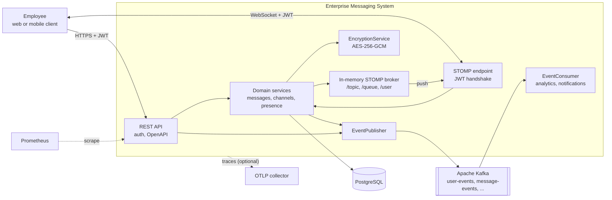
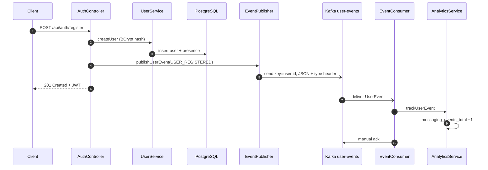
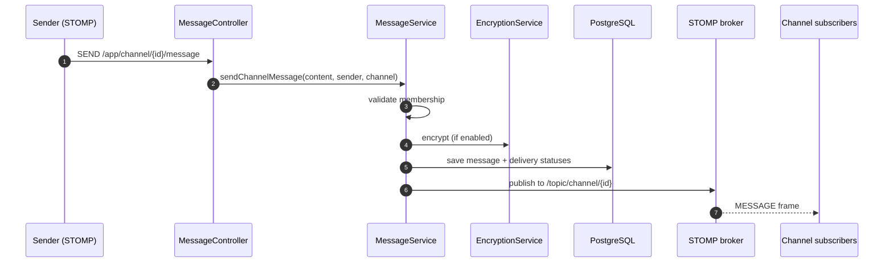

# Enterprise Messaging System (Java)


A Spring Boot backend for team chat inside an organization, similar in shape to Slack or Teams.
It has channels and groups, real-time delivery over STOMP WebSockets, reactions, read receipts
and presence, and domain events streamed through Apache Kafka. Message content can be encrypted
at rest. The goal is a realistic event-driven service with an honest test suite that runs against
real PostgreSQL and Kafka.

## What it does

Internal chat has two jobs that pull in different directions. Delivery must be immediate for
online users, and every message must also be durable, auditable and available to downstream
consumers such as notifications, analytics and compliance. This service handles both:

- **Synchronous path:** clients send over STOMP. The message is persisted in PostgreSQL and fanned
  out to channel subscribers through the WebSocket broker.
- **Asynchronous path:** domain events (`user-events`, `message-events`, ...) go to Kafka, where
  consumers process them independently with manual acknowledgements.

## Key features

- **Real-time messaging**: STOMP over WebSocket (`/websocket`, plus SockJS on `/ws`). It covers
  channel messages, typing indicators, reactions, per-user read receipts and presence updates.
- **JWT authentication** for REST and for the WebSocket handshake. The authenticated user becomes
  the STOMP principal.
- **Event streaming**: Kafka topics with explicit retention, idempotent producer, Jackson 3 JSON
  with type headers, `ErrorHandlingDeserializer`, observation and tracing across produce/consume.
- **Event metrics**: each consumed event increments
  `messaging_events_total{category,type}` (Prometheus).
- **Encryption at rest**: optional AES-256-GCM with a random IV per message (authenticated, so
  tampering is detected).
- **Domain model**: users, channels (public/private/direct), groups, invites, threaded replies,
  attachments, reactions, delivery status and presence.
- **Observability**: health probes, Prometheus metrics, OpenTelemetry tracing through Micrometer
  (OTLP export when configured), trace IDs in every log line, ECS JSON logs in containers.
- **Schema management**: Liquibase migrations, with Hibernate validating the mapping at startup.

## Tech stack

| Area | Technology | Version |
| --- | --- | --- |
| Language / runtime | Java (Eclipse Temurin), virtual threads | 21 LTS |
| Framework | Spring Boot (Spring Framework 7, Spring Security 7) | 4.1.1 |
| Real time | Spring WebSocket, STOMP, SockJS | Boot-managed |
| Event streaming | Spring for Apache Kafka / Apache Kafka (KRaft) | 4.1.1 / 4.2.2 |
| Persistence | Spring Data JPA, Hibernate ORM | Boot-managed (Hibernate 7.4) |
| Database | PostgreSQL | 18.6 |
| Migrations | Liquibase | Boot-managed |
| Auth | JJWT | 0.13.0 |
| API docs | springdoc-openapi | 3.1.1 |
| Observability | Micrometer, Prometheus registry, OpenTelemetry | Boot-managed |
| Testing | JUnit 5, AssertJ, Awaitility, Testcontainers (PostgreSQL, Kafka) | Boot-managed (Testcontainers 2) |
| Build | Maven wrapper, Spotless | Maven 3.9.16 |
| Container | Multi-stage Dockerfile, Temurin JRE on Alpine, non-root | 21.0.12 |

## Architecture

### Container view



### Registration event flow



### Sending a channel message



## Project structure

```
enterprise-messaging-java/
├── src/main/java/com/enterprise/messaging/
│   ├── config/        # security, WebSocket/STOMP, Kafka topics, JPA auditing
│   ├── controller/    # REST auth endpoints
│   ├── domain/        # JPA entities and enums
│   ├── dto/           # request/response payloads
│   ├── event/         # Kafka event contracts (MessageEvent, UserEvent)
│   ├── exception/     # domain exceptions
│   ├── repository/    # Spring Data repositories
│   ├── security/      # JWT provider, filter, UserDetailsService
│   ├── service/       # messaging, channels, presence, encryption, events
│   └── websocket/     # STOMP controllers, payloads, handshake interceptor
├── src/main/resources/
│   ├── application.yml
│   └── db/changelog/  # Liquibase changelog (formatted SQL)
├── src/test/java/     # unit tests and *IT integration tests (Testcontainers)
├── Dockerfile
└── docker-compose.yml # PostgreSQL, Kafka (KRaft), app, optional Jaeger
```

## Running locally

Prerequisites: JDK 21 and Docker. The Maven wrapper downloads Maven for you.

**With Docker Compose (app + PostgreSQL + Kafka):**

```bash
cp .env.example .env            # optional: adjust values
docker compose up --build
docker compose --profile observability up --build   # adds Jaeger UI on :16686
```

**Without Docker for the app:**

```bash
docker compose up -d postgres kafka
./mvnw spring-boot:run
```

Then try it:

```bash
curl -X POST localhost:8080/api/auth/register -H 'Content-Type: application/json' \
  -d '{"username":"bob","email":"bob@example.com","password":"s3cure-passw0rd"}'
curl -s localhost:8080/actuator/prometheus | grep messaging_events
```

STOMP clients connect to `ws://localhost:8080/websocket?token=<JWT>` (or use the
`Authorization: Bearer` header). They send to `/app/channel/{channelId}/message` and subscribe to
`/topic/channel/{channelId}`.

## Testing

```bash
./mvnw spotless:check   # formatting
./mvnw test             # unit tests (JWT, AES-GCM encryption)
./mvnw verify           # unit + integration tests (needs Docker for Testcontainers)
```

`MessagingApplicationIT` starts PostgreSQL 18 and Kafka 4.2 in containers. It applies the
Liquibase changelog, validates the JPA mapping and exercises registration, login, duplicate
detection and auth rejection. It also checks the full Kafka round trip: a registration event is
published, consumed and counted in Micrometer. CI runs the same `verify` on every pull request.

## Configuration

| Variable | Default | Purpose |
| --- | --- | --- |
| `DATABASE_URL` | `jdbc:postgresql://localhost:5432/messaging_db` | JDBC URL |
| `DATABASE_USERNAME` / `DATABASE_PASSWORD` | `messaging_user` / `messaging_pass` | Database credentials (local dev only) |
| `DATABASE_POOL_SIZE` | `20` | Hikari max pool size |
| `KAFKA_BOOTSTRAP_SERVERS` | `localhost:9092` | Kafka brokers |
| `KAFKA_CONSUMER_GROUP` | `messaging-service` | Consumer group id |
| `JWT_SECRET` | dev-only value | HS256 key, Base64 or raw, at least 256 bits. **Set in every real environment.** |
| `JWT_EXPIRATION` | `86400000` | Token lifetime in ms |
| `ENCRYPTION_ENABLED` | `false` | Encrypt message content at rest |
| `ENCRYPTION_KEY` | unset | Base64 256-bit AES key (`openssl rand -base64 32`), required when encryption is on |
| `FILE_UPLOAD_MAX_SIZE` / `FILE_STORAGE_PATH` | `50MB` / `/tmp/messaging-uploads` | Attachment limits and storage |
| `LOG_LEVEL` | `INFO` | Application log level |
| `LOGGING_STRUCTURED_FORMAT_CONSOLE` | unset (ECS in the image) | `ecs`, `logstash` or `gelf` JSON logs |
| `TRACING_SAMPLING_PROBABILITY` | `0.1` | Trace sampling ratio |
| `MANAGEMENT_OPENTELEMETRY_TRACING_EXPORT_OTLP_ENDPOINT` | unset | e.g. `http://collector:4318/v1/traces`; enables OTLP export |
| `SERVER_PORT` | `8080` | HTTP port |

## Design decisions

- **Kafka for side effects, WebSockets for delivery.** Online users get messages straight from
  the STOMP broker. Notifications and analytics consume Kafka at their own pace, so a slow
  consumer never delays a chat message.
- **Boot auto-configuration for Kafka.** Producer, consumer and listener settings live in
  `application.yml` rather than hand-built factories. The same configuration then serves local
  runs, Docker and Testcontainers service connections, and observation stays on everywhere.
- **Type headers plus `ErrorHandlingDeserializer`.** One consumer factory handles several event
  types safely, and a malformed record cannot put a listener into a poison-pill loop.
- **AES-GCM instead of AES/ECB.** ECB leaks plaintext patterns and gives no integrity. GCM with a
  random 96-bit IV is authenticated encryption.
- **Virtual threads.** Request handling and blocking JDBC calls run on virtual threads, which
  suits an I/O-heavy chat backend.
- **Real dependencies in tests.** Testcontainers PostgreSQL and Kafka instead of H2 or embedded
  Kafka, so the tests run the production SQL dialect, migrations and broker protocol.

## Known limitations

- The STOMP broker is the in-memory simple broker, so WebSocket fan-out is per instance.
  Running several replicas requires a broker relay (RabbitMQ/ActiveMQ STOMP) or Kafka-driven
  fan-out.
- REST endpoints for channel and message management are not exposed yet. Those operations are
  available through the services and STOMP destinations.
- Push and email notifications are logged stubs in `NotificationService`.
