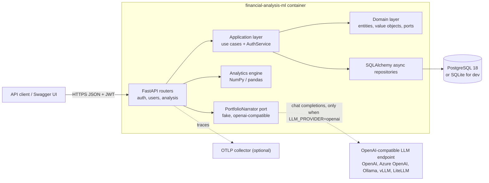
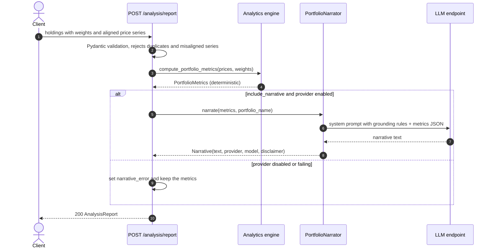
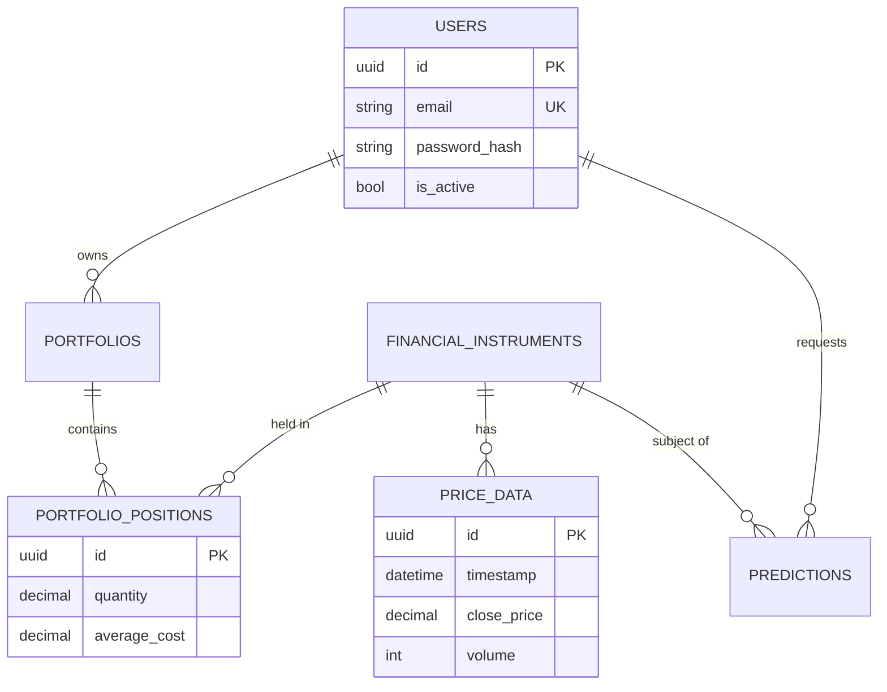

# Financial Analysis ML


A portfolio analytics API built on clean architecture. You send holdings and their price history. The API computes **risk and return metrics deterministically** with NumPy and pandas, and can **narrate them with an LLM** through any OpenAI-compatible endpoint. The model is given only the computed numbers, and every narrative carries a "not financial advice" disclaimer.

> Problem: analysts and advisors spend time turning raw risk numbers into readable commentary. LLMs write well but are unreliable at arithmetic. This service keeps the math in tested Python code and uses the LLM only for wording, so every figure in a report can be traced back to code.

## Key features

- **Portfolio report**: `POST /api/v1/analysis/report` returns total and annualized return, annualized volatility, Sharpe ratio, maximum drawdown, one-day 95% historical VaR, best and worst day, concentration (Herfindahl index) and per-holding contribution.
- **Optional GenAI narrative**: a provider-agnostic `PortfolioNarrator` port with three settings: `fake` (deterministic template, the default), `openai` (any OpenAI-compatible Chat Completions API) or `disabled`. If the provider fails, the endpoint still returns the metrics plus a `narrative_error` field instead of a 5xx.
- **User accounts**: register, log in (JWT bearer), manage your profile and deactivate your account. Passwords are hashed with bcrypt and must meet a complexity policy.
- **Clean architecture**: domain entities and value objects, application use cases, and infrastructure adapters (SQLAlchemy 2 async repositories).
- **Operations**: structured JSON logs (structlog) with a request id on every log line, `/health` that checks the database (returns 503 when it is degraded), optional OpenTelemetry tracing, Alembic migrations, a multi-stage non-root Docker image.
- **Optional LSTM forecasting module** (`infrastructure/ml`, TensorFlow). It is kept as an opt-in extra so the default install and CI stay lightweight.

## Tech stack

| Area | Technology | Version |
|---|---|---|
| Language | Python | 3.13 |
| Packaging | uv + `pyproject.toml` (PEP 621), hatchling | uv 0.13 |
| Web framework | FastAPI / Uvicorn | 0.143 / 0.54 |
| Validation and settings | Pydantic / pydantic-settings | 2.14 / 2.16 |
| Persistence | SQLAlchemy (async, typed ORM) + asyncpg / aiosqlite, Alembic | 2.1 / 1.20 |
| Analytics | NumPy / pandas | 2.5 / 3.0 |
| GenAI | `openai` SDK against any OpenAI-compatible endpoint | 3.33 |
| Auth | PyJWT, bcrypt | 2.15 / 5.0 |
| Observability | structlog, OpenTelemetry (optional `otel` extra) | 26.1 / 1.45 |
| ML (optional `ml` extra) | TensorFlow, scikit-learn | 2.21 / 1.9 |
| Quality | Ruff (lint and format), mypy, pytest + pytest-cov, pip-audit | 0.17 / 2.4 / 9.1 |
| Runtime | Docker (`python:3.13.16-slim-trixie`), PostgreSQL 18 | |

## Architecture

### Container view



### Report generation flow



### Data model (persistence layer)



## Project structure

```text
financial-analysis-ml/
├── src/financial_analysis/
│   ├── api/                 # FastAPI app factory, routers, schemas, middleware, deps
│   ├── analysis/            # Deterministic portfolio metrics (NumPy/pandas)
│   ├── genai/               # PortfolioNarrator port, fake + OpenAI-compatible adapters
│   ├── application/         # Use cases, DTOs, AuthService (JWT)
│   ├── domain/              # Entities, value objects, repository ports, exceptions
│   ├── infrastructure/
│   │   ├── database/        # SQLAlchemy 2 models, engine, repositories
│   │   └── ml/              # Optional LSTM forecaster (TensorFlow, `ml` extra)
│   ├── config.py            # pydantic-settings configuration
│   └── observability.py     # structlog + optional OpenTelemetry
├── alembic/                 # Database migrations
├── tests/{unit,integration}
├── Dockerfile               # Multi-stage, non-root, healthcheck
├── docker-compose.yml       # API + PostgreSQL + one-shot migration job
└── pyproject.toml / uv.lock
```

## Running locally

### With uv (SQLite, zero setup)

```bash
cd financial-analysis-ml
uv sync                      # add --extra ml for TensorFlow, --extra otel for tracing
cp .env.example .env         # optional
uv run uvicorn financial_analysis.api.main:app --reload
# open http://localhost:8000/docs
```

Try a report:

```bash
curl -s -X POST localhost:8000/api/v1/analysis/report \
  -H 'content-type: application/json' \
  -d '{"portfolio_name":"Core Tech","holdings":[
        {"symbol":"AAPL","weight":0.6,"prices":[180,182,181,185,187]},
        {"symbol":"MSFT","weight":0.4,"prices":[400,398,405,410,409]}]}'
```

### With Docker Compose (PostgreSQL)

```bash
docker compose up --build     # runs `alembic upgrade head`, then starts the API on :8000
docker compose down -v
```

The image alone also works and falls back to SQLite inside the container: `docker build -t financial-analysis-ml . && docker run -p 8000:8000 financial-analysis-ml`.

## Testing and quality

```bash
uv run ruff check . && uv run ruff format --check .
uv run mypy
uv run pytest                 # unit + API tests with coverage (gate: 80%)
```

The tests use a temporary SQLite database and the deterministic fake narrator, so they need no network access or external services. CI (`.github/workflows/financial-analysis-ml.yml`) runs lint, format, type-check and tests on Python 3.13, then a Docker build with a container health smoke test. It also runs an **advisory** `pip-audit` job (`continue-on-error`), so a newly published CVE is reported without blocking unrelated PRs.

## Configuration

| Variable | Default | Description |
|---|---|---|
| `DATABASE_URL` | `sqlite+aiosqlite:///./financial_analysis.db` | SQLAlchemy async URL. Use `postgresql+asyncpg://…` in production |
| `JWT_SECRET_KEY` | `change-me-in-production` | HMAC secret for access tokens |
| `JWT_ALGORITHM` / `ACCESS_TOKEN_EXPIRE_MINUTES` | `HS256` / `30` | Token settings |
| `ALLOWED_ORIGINS` | `["http://localhost:3000"]` | CORS origins (JSON list) |
| `LOG_LEVEL` / `LOG_JSON` | `INFO` / `true` | Logging level and JSON vs console rendering |
| `LLM_PROVIDER` | `fake` | `fake`, `openai` (any OpenAI-compatible API) or `disabled` |
| `LLM_BASE_URL` | unset (OpenAI default) | e.g. `http://localhost:11434/v1` (Ollama) or a LiteLLM proxy URL |
| `LLM_API_KEY` | unset | API key for the endpoint (local servers accept any value) |
| `LLM_MODEL` | `gpt-4o-mini` | Model name as exposed by the endpoint |
| `LLM_TIMEOUT_SECONDS` / `LLM_MAX_RETRIES` / `LLM_TEMPERATURE` | `30` / `2` / `0.2` | Client resilience and sampling |
| `RISK_FREE_RATE` / `TRADING_DAYS_PER_YEAR` | `0.02` / `252` | Analytics parameters |
| `OTEL_EXPORTER_OTLP_ENDPOINT` | unset | Turns on OTLP/HTTP tracing (requires the `otel` extra) |

## GenAI design

- **Port and adapters.** `genai/narrator.py` defines a `PortfolioNarrator` protocol. `FakeNarrator` is deterministic and template-based, used in tests and local development. `OpenAICompatibleNarrator` wraps the `openai` SDK's `AsyncOpenAI` client. `genai/factory.py` picks the adapter from `LLM_PROVIDER`. No vendor is hard-coded: changing `LLM_BASE_URL` and `LLM_MODEL` points the service at OpenAI, Azure OpenAI, a self-hosted vLLM or Ollama, or a LiteLLM gateway that fronts any provider.
- **Grounding.** The model receives only the computed metrics as JSON, plus a system prompt that forbids new calculations, invented data and buy/sell recommendations.
- **Resilience.** The client has timeouts and bounded retries. Provider errors are wrapped as `NarrativeUnavailableError`, so the API degrades to metrics-only. Logs record the error type but never the prompt or the key.
- **Testability.** The adapters are tested with stub clients. The API tests swap narrators through FastAPI `dependency_overrides`.

## Design decisions

- **The math stays out of the LLM.** Every number comes from `analysis/metrics.py`, which has its own unit tests. The LLM only adds wording on top.
- **Stateless analysis endpoint.** Price series are supplied in the request, so the service has no hidden dependency on a market-data vendor. A data-provider adapter can be added behind a port later.
- **SQLite for development, PostgreSQL for production** through portable SQLAlchemy types (`Uuid`, `JSON` with a JSONB variant on PostgreSQL). Tables are auto-created only for SQLite; PostgreSQL uses Alembic.
- **Heavy machine learning is opt-in.** TensorFlow sits in the `ml` extra and is imported lazily. The default install, the Docker image and CI stay small and fast.
- **App factory + lifespan.** `create_app(settings)` makes configuration explicit and testable, with no module-level side effects other than the default `app` instance.

## Known limitations

- Portfolio, instrument, price and prediction domain models and the database schema exist, but CRUD endpoints for them are not exposed yet. The analysis endpoint takes data inline.
- The LSTM forecaster is a standalone module and is not exposed through the API. It is excluded from type-checking and coverage because CI does not install TensorFlow.
- There is no refresh-token endpoint yet (the service can issue and verify refresh tokens internally).
