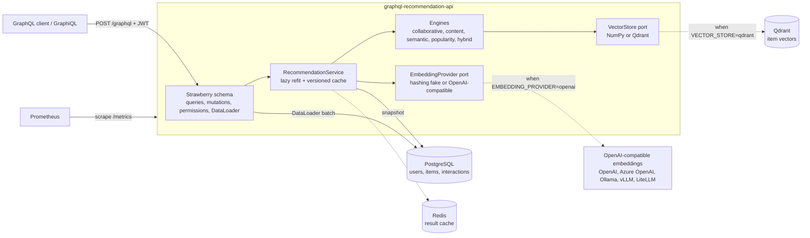
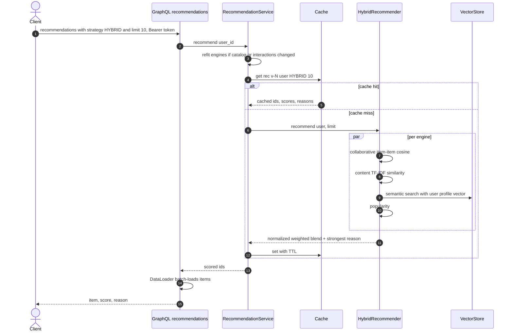
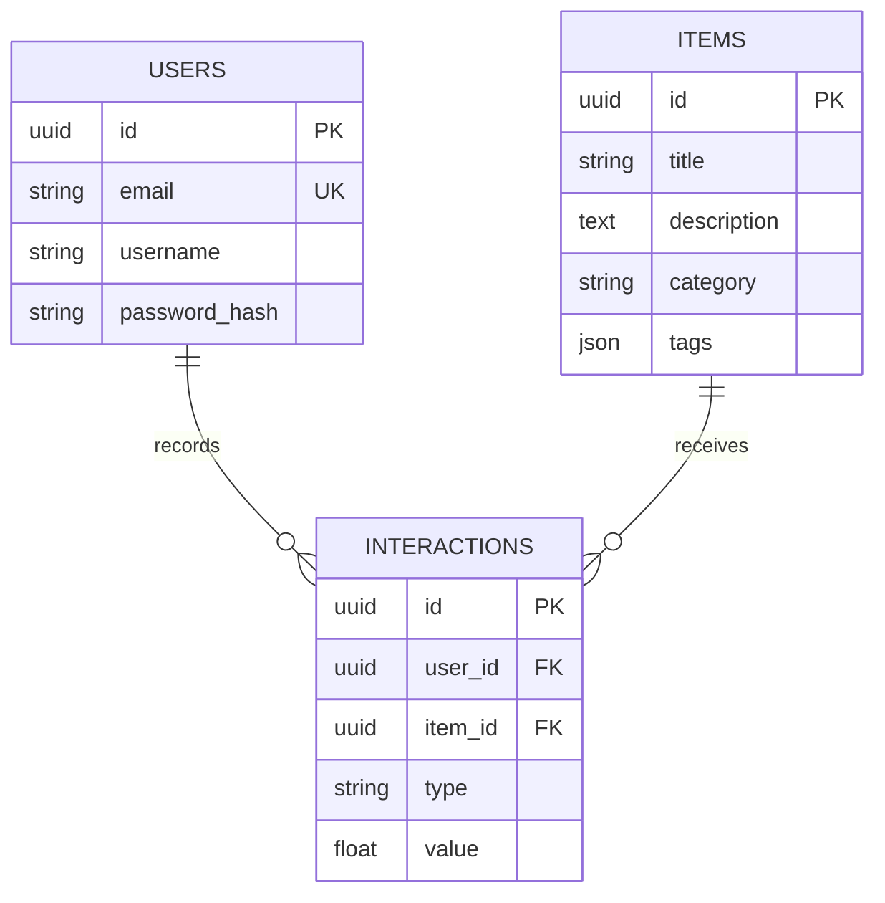

# GraphQL Recommendation API


A recommendation service exposed through **GraphQL** (Strawberry on FastAPI). It combines classic recommender techniques (item-item collaborative filtering, TF-IDF content similarity, popularity) with **embedding-based semantic recommendations and natural-language search**. The embeddings come through a provider-agnostic interface: any OpenAI-compatible endpoint, or a deterministic offline fake.

> Problem: product teams want "more like this", "because you liked X" and "search by meaning" features. Those usually mean stitching together a recommender, a vector database and an LLM provider. This service puts all three behind one typed GraphQL API with clear ports. Each backing service (embedding provider, vector store, cache) can be swapped through configuration.

## Key features

- **Hybrid recommendations** (`recommendations(strategy: HYBRID)`): a weighted blend of collaborative, content, semantic and popularity scores. Scores are min-max normalized per engine, and every result carries a human-readable `reason`. Users with no history (cold start) fall back to popularity automatically.
- **Single strategies** for comparison: `COLLABORATIVE`, `CONTENT`, `SEMANTIC`, `POPULARITY`.
- **Semantic search** (`semanticSearch(query: "...")`): natural-language queries over item embeddings.
- **Similar items** (`similarItems(itemId)`): a blend of embedding similarity, TF-IDF similarity and co-engagement.
- **Feedback loop**: `recordInteraction` (view, click, like, purchase, 1–5 rating) marks the models stale. Engines refit lazily on the next request. Results are cached per model version in Redis, or in an in-process TTL cache.
- **GraphQL hardening**: query depth limit, alias limit, result-size clamping, permission classes, masked internal errors, and a DataLoader that batches item lookups (no N+1 queries).
- **Operations**: JWT auth, structured JSON logs with request ids, Prometheus `/metrics` (HTTP and recommendation latency), `/health` checking the database and cache, optional OpenTelemetry tracing, Alembic migrations, a non-root Docker image, and Kubernetes manifests (Kustomize).

## Tech stack

| Area | Technology | Version |
|---|---|---|
| Language / packaging | Python, uv + `pyproject.toml` (PEP 621) | 3.13 / uv 0.13 |
| API | FastAPI, Strawberry GraphQL, Uvicorn | 0.143 / 0.336 / 0.54 |
| Persistence | SQLAlchemy 2 async (typed ORM), asyncpg / aiosqlite, Alembic | 2.1 / 0.32 / 1.20 |
| Recommenders | NumPy, SciPy sparse, scikit-learn (TF-IDF) | 2.5 / 1.18 / 1.9 |
| GenAI | `openai` SDK against any OpenAI-compatible `/embeddings` endpoint | 3.33 |
| Vector store | In-process NumPy index (default) or Qdrant (`qdrant` extra) | qdrant-client 1.19 |
| Cache | Redis (`redis.asyncio`) or in-process TTL | redis-py 8.1 |
| Observability | structlog, prometheus-client, OpenTelemetry (`otel` extra) | 26.1 / 0.26 / 1.45 |
| Quality | Ruff, mypy (strict), pytest + coverage, pip-audit | 0.17 / 2.4 / 9.1 |
| Runtime | Docker `python:3.13.16-slim-trixie`, PostgreSQL 18, Redis 8.8, Qdrant 1.19 | |

## Architecture

### Container view



### Hybrid recommendation flow



### Data model



## Example queries

```graphql
mutation { register(email: "ada@example.com", username: "ada", password: "s3cret-pass") { token } }

query { semanticSearch(query: "books about LLMs and retrieval", limit: 3) { score item { title } } }

# with header  Authorization: Bearer <token>
mutation { recordInteraction(itemId: "<item-id>", type: RATING, value: 5) { id } }
query { recommendations(strategy: HYBRID, limit: 5) { score reason item { title category } } }
```

## Project structure

```text
graphql-recommendation-api/
├── src/recommender/
│   ├── main.py               # App factory, lifespan, /health, /metrics
│   ├── config.py             # pydantic-settings
│   ├── models.py, db.py      # SQLAlchemy 2 models + engine lifecycle
│   ├── security.py           # bcrypt + JWT
│   ├── cache.py              # Cache port: memory / Redis (fail-open)
│   ├── observability.py      # structlog, Prometheus middleware, OpenTelemetry
│   ├── seed.py               # Demo catalog
│   ├── genai/
│   │   ├── embeddings.py     # EmbeddingProvider port + hashing fake + OpenAI-compatible adapter
│   │   └── vectorstore.py    # VectorStore port + NumPy / Qdrant adapters
│   ├── recommendation/
│   │   ├── base.py           # Snapshot, Scored, Strategy
│   │   ├── engines.py        # Popularity, item-CF, TF-IDF content, semantic
│   │   ├── hybrid.py         # Weighted blend
│   │   └── service.py        # Orchestration, lazy refit, caching, metrics
│   └── graphql/              # Strawberry types, schema, context, DataLoader
├── alembic/                  # Migrations
├── k8s/                      # Kustomize: deployment, service, HPA, ingress, config
├── tests/{unit,integration}
├── Dockerfile, docker-compose.yml
└── pyproject.toml / uv.lock
```

## Running locally

### With uv (SQLite, in-memory vectors, demo catalog)

```bash
cd graphql-recommendation-api
uv sync
uv run uvicorn recommender.main:app --reload
# GraphiQL at http://localhost:8000/graphql
```

### With Docker Compose (PostgreSQL + Redis + Qdrant)

```bash
docker compose up --build     # runs `alembic upgrade head`, then starts the API on :8000
docker compose down -v
```

### Using a real embedding model

```bash
export EMBEDDING_PROVIDER=openai
export LLM_BASE_URL=http://localhost:11434/v1   # e.g. Ollama; omit for the OpenAI default
export LLM_API_KEY=...                          # any value for local servers
export EMBEDDING_MODEL=nomic-embed-text EMBEDDING_DIMENSIONS=768 EMBEDDING_SEND_DIMENSIONS=false
```

Vectors are rebuilt from the database at startup (`reindex_all`). When you change the model or the dimensions with Qdrant, use a new `QDRANT_COLLECTION`.

## Testing and quality

```bash
uv run ruff check . && uv run ruff format --check .
uv run mypy                 # strict
uv run pytest               # unit + GraphQL integration tests, coverage gate 90%
```

Tests run fully offline. They use SQLite, the hashing embedding fake, the in-memory cache, and both vector stores: NumPy, plus Qdrant in its embedded `:memory:` mode, so no server is needed. CI also applies the Alembic migrations, verifies they match the models (`alembic check`), builds the Docker image and smoke-tests `/health`. `pip-audit` runs as an **advisory** job (`continue-on-error`).

## Configuration

| Variable | Default | Description |
|---|---|---|
| `DATABASE_URL` | `sqlite+aiosqlite:///./recommender.db` | Async SQLAlchemy URL (`postgresql+asyncpg://…` in production) |
| `SEED_DEMO_DATA` | `true` | Insert a 12-item demo catalog when the database is empty |
| `REDIS_URL` | unset | Enables the Redis result cache; otherwise an in-process TTL cache is used |
| `CACHE_TTL_SECONDS` | `300` | Recommendation cache TTL |
| `JWT_SECRET_KEY` / `ACCESS_TOKEN_EXPIRE_MINUTES` | `change-me-in-production` / `60` | Auth |
| `CORS_ORIGINS` | `["http://localhost:3000"]` | JSON list |
| `GRAPHQL_MAX_DEPTH` / `GRAPHQL_IDE` | `8` / `true` | Query depth limit, GraphiQL on or off |
| `EMBEDDING_PROVIDER` | `fake` | `fake` (hashing) or `openai` (any OpenAI-compatible API) |
| `LLM_BASE_URL` / `LLM_API_KEY` | unset | Endpoint and key for the embeddings API |
| `EMBEDDING_MODEL` / `EMBEDDING_DIMENSIONS` | `text-embedding-3-small` / `512` | Model and vector size |
| `EMBEDDING_SEND_DIMENSIONS` | `true` | Send the `dimensions` parameter (turn off for servers that reject it) |
| `VECTOR_STORE` | `memory` | `memory` or `qdrant` |
| `QDRANT_URL` / `QDRANT_API_KEY` / `QDRANT_COLLECTION` | unset / unset / `items` | Qdrant connection |
| `WEIGHT_COLLABORATIVE` / `WEIGHT_CONTENT` / `WEIGHT_SEMANTIC` / `WEIGHT_POPULARITY` | `0.4` / `0.2` / `0.3` / `0.1` | Hybrid blend weights |
| `LOG_LEVEL` / `LOG_JSON` | `INFO` / `true` | Logging |
| `OTEL_EXPORTER_OTLP_ENDPOINT` | unset | Enables tracing (requires the `otel` extra) |

## GenAI design

- **Ports, not vendors.** `EmbeddingProvider` and `VectorStore` are `Protocol`s. The OpenAI-compatible adapter talks to OpenAI, Azure OpenAI, Ollama, vLLM, LM Studio or a LiteLLM gateway by changing `LLM_BASE_URL` and `EMBEDDING_MODEL`. No provider SDK leaks into the engines.
- **Deterministic fake.** `HashingEmbeddingProvider` hashes unigrams and bigrams into a fixed-size vector with light stop-word removal and plural folding, then normalizes it. It needs no network, gives reproducible results in tests and CI, and still ranks texts with overlapping vocabulary as similar, so the semantic features can be demonstrated offline. With a real embedding model the same code paths capture synonyms and meaning.
- **Semantic personalization.** A user's profile vector is the strength-weighted mean of the vectors of items they engaged with. Recommendations are a nearest-neighbour search that excludes items already seen.
- **Resilience.** Embedding calls have timeouts, bounded retries and shape validation. Errors surface as `EmbeddingError`, and unexpected errors are masked in GraphQL responses.

## Design decisions

- **Snapshot-based engines.** Engines are pure functions over an immutable snapshot of items and interactions. That makes them easy to unit test, and the service refits them in a worker thread when data changes. The versioned cache key means stale results are never served after an interaction.
- **Exact NumPy search by default.** It is good enough for catalogs up to tens of thousands of items. Qdrant uses the same port when scale or persistence matters, and its embedded mode keeps the adapter tested in CI.
- **Lean dependency set.** The previous version pulled in `surprise`, `implicit`, three vector-database SDKs and Redis Cluster code it never used. Item-item CF on SciPy sparse matrices, together with TF-IDF and embeddings, covers the same features with wheels that install in seconds on Python 3.13.
- **App factory + lifespan.** `create_app(settings)` makes configuration explicit and lets tests build isolated apps.

## Known limitations

- Single-tenant. The earlier multi-tenant tables were dropped in favour of a coherent, tested core.
- Models live in process memory, so each replica refits independently. That is fine for moderate catalogs; large deployments would precompute item similarities offline.
- There are no GraphQL subscriptions or refresh tokens.
