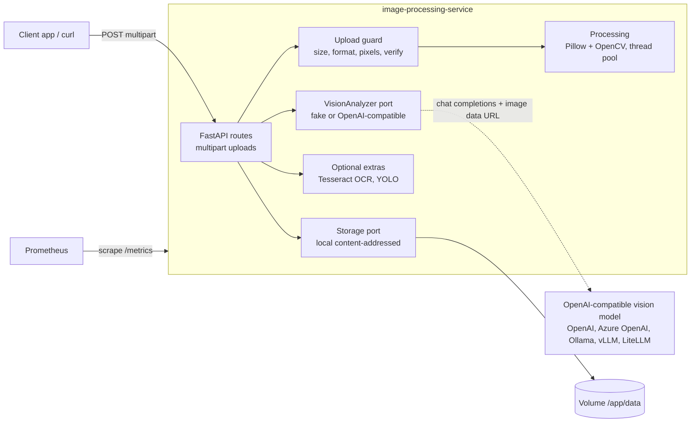
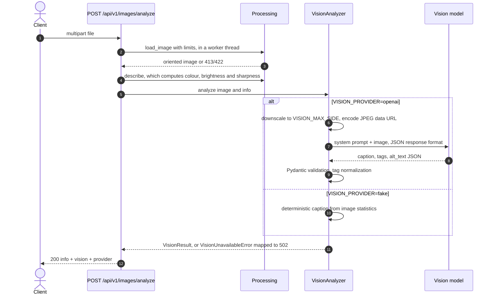

# Image Processing Service


An async image API built on FastAPI. It handles common transformations with Pillow and OpenCV (info, resize, crop, thumbnail, filters, enhancement) and stores originals in a content-addressed store. It also offers **vision-model captioning and tagging** through any OpenAI-compatible endpoint. OCR and YOLO object detection are optional extras, so the default install stays small.

> Problem: most products need the same image pipeline. They must accept untrusted uploads safely, generate renditions, and produce alt text and tags for accessibility and search. This service does that behind one small, well-tested API. The AI parts are pluggable: the core never depends on a specific model vendor or on heavy ML runtimes.

## Key features

- **Transformations**: `/images/info`, `/resize` (aspect-aware, including upscaling), `/crop`, `/thumbnail` (square centre crop), `/filter` (blur, sharpen, grayscale, edges, emboss, contour, median, sepia), `/enhance` (brightness, contrast, saturation, sharpness). Output can be JPEG, PNG or WebP.
- **Vision captioning** (`/images/analyze`): returns a caption, tags and alt text as JSON validated with Pydantic. Runs against any OpenAI-compatible vision model, or a deterministic fake for development and tests.
- **Safe uploads**: an upload size cap (at most limit + 1 bytes are read into memory; put a body-size limit at the ingress as well), a format allow-list, `verify()` for corrupt files, a pixel-count and decompression-bomb guard, EXIF orientation normalized, and metadata (EXIF/GPS) stripped from outputs.
- **Storage**: `POST /images` stores originals content-addressed (SHA-256, deduplicated, traversal-safe). `GET /images/{key}` serves them with immutable cache headers.
- **Optional extras**: `/images/ocr` (Tesseract) and `/images/detect` (Ultralytics YOLO) are imported lazily. They return **501** with an install hint when the extra is not present.
- **Operations**: structured JSON logs with request ids, Prometheus `/metrics` (HTTP and per-operation latency), `/health`, optional OpenTelemetry, a non-root Docker image with an optional OCR layer, and Kubernetes manifests (Kustomize).

## Tech stack

| Area | Technology | Version |
|---|---|---|
| Language / packaging | Python, uv + `pyproject.toml` | 3.13 / uv 0.13 |
| API | FastAPI, Uvicorn, python-multipart | 0.143 / 0.54 / 0.0.32 |
| Imaging | Pillow, OpenCV (headless), NumPy | 13.0 / 5.0 / 2.5 |
| GenAI | `openai` SDK against any OpenAI-compatible vision model | 3.33 |
| Optional AI | pytesseract + Tesseract (`ocr`), Ultralytics YOLO (`detection`) | 0.3 / 8.4 |
| Observability | structlog, prometheus-client, OpenTelemetry (`otel` extra) | 26.1 / 0.26 / 1.45 |
| Quality | Ruff, mypy (strict), pytest + coverage, pip-audit | 0.17 / 2.4 / 9.1 |
| Runtime | Docker `python:3.13.16-slim-trixie` | |

## Architecture

### Container view



### Vision analysis flow



## API at a glance

```bash
curl -F file=@photo.jpg localhost:8000/api/v1/images/info
curl -F file=@photo.jpg -F width=800 -F height=600 -F output_format=webp \
     localhost:8000/api/v1/images/resize -o photo.webp
curl -F file=@photo.jpg -F filter_type=sepia localhost:8000/api/v1/images/filter -o sepia.jpg
curl -F file=@photo.jpg localhost:8000/api/v1/images/analyze
```

The interactive OpenAPI docs are at `/docs`.

## Project structure

```text
image-processing-service/
├── src/image_service/
│   ├── main.py            # App factory, lifespan, /health, /metrics
│   ├── config.py          # pydantic-settings
│   ├── processing.py      # Pure image operations + upload validation
│   ├── storage.py         # Storage port + local content-addressed adapter
│   ├── extras.py          # Lazy OCR / object detection
│   ├── observability.py   # structlog, Prometheus middleware, OpenTelemetry
│   ├── genai/vision.py    # VisionAnalyzer port, fake + OpenAI-compatible adapter
│   └── api/routes.py      # HTTP endpoints
├── tests/{unit,integration}
├── k8s/                   # Kustomize: deployment, service, HPA, ingress, config
├── Dockerfile             # Multi-stage, non-root, optional WITH_OCR build arg
└── docker-compose.yml
```

## Running locally

```bash
cd image-processing-service
uv sync                         # add --extra ocr (needs the tesseract binary) or --extra detection
uv run uvicorn image_service.main:app --reload
```

With Docker (this includes Tesseract OCR):

```bash
docker compose up --build       # http://localhost:8000/docs
# or: docker build --build-arg WITH_OCR=true -t image-processing-service . && docker run -p 8000:8000 image-processing-service
```

To use a real vision model:

```bash
export VISION_PROVIDER=openai
export LLM_BASE_URL=http://localhost:11434/v1   # e.g. Ollama; omit for the OpenAI default
export LLM_API_KEY=...                          # any value for local servers
export LLM_VISION_MODEL=llama3.2-vision
```

## Testing and quality

```bash
uv run ruff check . && uv run ruff format --check .
uv run mypy                     # strict
uv run pytest                   # unit + API tests, coverage gate 90%
```

Test images are generated in memory, and vision calls use the fake or stub clients, so the suite runs offline in about a second. The OCR and detection extras are not installed in CI. Their "unavailable" paths are tested, and OCR was checked manually in the Docker image built with `WITH_OCR=true`. CI also builds the image and smoke-tests `/health`. `pip-audit` runs as an **advisory** job (`continue-on-error`).

## Configuration

| Variable | Default | Description |
|---|---|---|
| `MAX_UPLOAD_MB` | `10` | Maximum upload size (413 above this) |
| `MAX_PIXELS` | `40000000` | Decompression-bomb guard |
| `MAX_OUTPUT_DIMENSION` | `8000` | Largest allowed resize target |
| `ALLOWED_FORMATS` | `["JPEG","PNG","WEBP","GIF","BMP","TIFF"]` | Accepted input formats |
| `STORAGE_DIR` | `./data/images` | Where `POST /images` writes originals |
| `VISION_PROVIDER` | `fake` | `fake`, `openai` (any OpenAI-compatible API) or `disabled` |
| `LLM_BASE_URL` / `LLM_API_KEY` | unset | Endpoint and key |
| `LLM_VISION_MODEL` | `gpt-4o-mini` | Vision-capable model name |
| `VISION_MAX_SIDE` | `1024` | Downscale before sending to the model (cost and latency) |
| `LLM_TIMEOUT_SECONDS` / `LLM_MAX_RETRIES` | `30` / `2` | Client resilience |
| `OCR_LANGUAGES` | `eng` | Tesseract languages |
| `DETECTION_MODEL` / `DETECTION_CONFIDENCE` | `yolo11n.pt` / `0.35` | YOLO settings (`detection` extra) |
| `CORS_ORIGINS`, `LOG_LEVEL`, `LOG_JSON` | | Standard service settings |
| `OTEL_EXPORTER_OTLP_ENDPOINT` | unset | Enables tracing (requires the `otel` extra) |

## GenAI design

- **Port and adapters.** `VisionAnalyzer` is a `Protocol`. `OpenAICompatibleVisionAnalyzer` sends a downscaled JPEG data URL through the Chat Completions API with `response_format=json_object`, which works with OpenAI, Azure OpenAI, Ollama, vLLM or a LiteLLM gateway. `FakeVisionAnalyzer` derives captions from measured colour, brightness, sharpness and shape, so it is deterministic and free.
- **Structured, validated output.** The model's JSON is parsed into `VisionResult`, with length limits and deduplicated lowercase tags. Malformed output becomes a 502 instead of leaking to clients.
- **Safety and cost.** The prompt describes only visible content, refuses identification of people and ignores instructions embedded in the image (prompt-injection hardening). Images are downscaled before upload, and metadata never leaves the service.

## Design decisions

- **The CPU-bound work runs in a thread pool** (`asyncio.to_thread`), so the event loop stays responsive. Pillow and OpenCV release the GIL for most operations.
- **Validation happens before processing.** All user-controlled limits are checked up front. Errors map to 413/422, never 500.
- **Heavy ML is opt-in.** The default image ships without PyTorch or Tesseract. `WITH_OCR=true` adds Tesseract, and the `detection` extra enables YOLO.
- **Content-addressed storage** gives deduplication and safe, immutable caching for free. The `Storage` port leaves room for an object-store adapter.
- **What the old version had and this one drops.** It listed Kafka, RabbitMQ, Celery, PostgreSQL and S3 integrations with no working wiring. This version is a smaller service that actually runs, with the extension points kept explicit.

## Known limitations

- Processing is synchronous per request; there is no background job queue or batch endpoint.
- Only local filesystem storage is implemented. Multi-replica deployments need a shared volume or a future object-store adapter.
- Object detection (`detection` extra, which pulls in PyTorch) is not exercised in CI.
