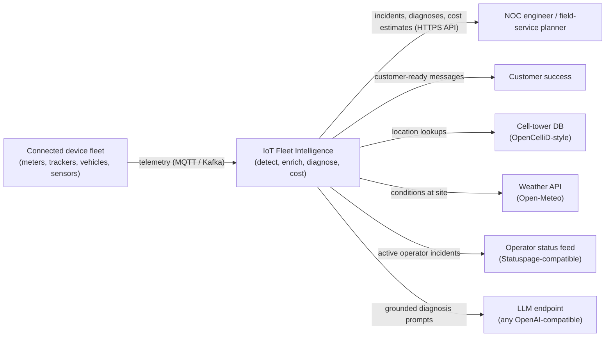
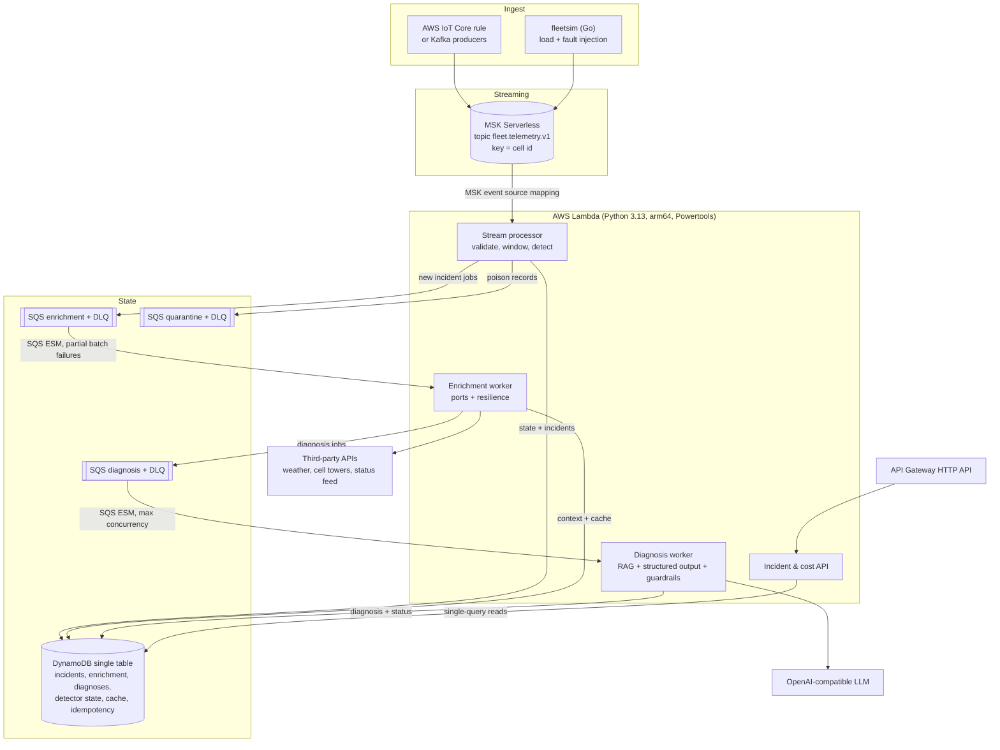
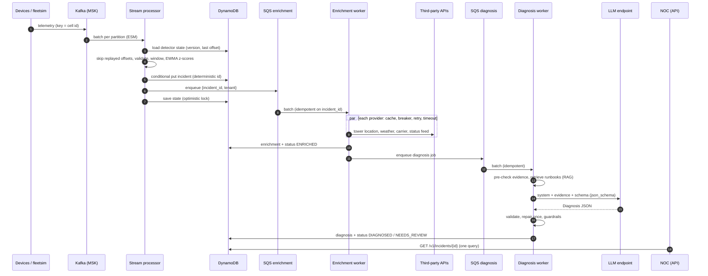
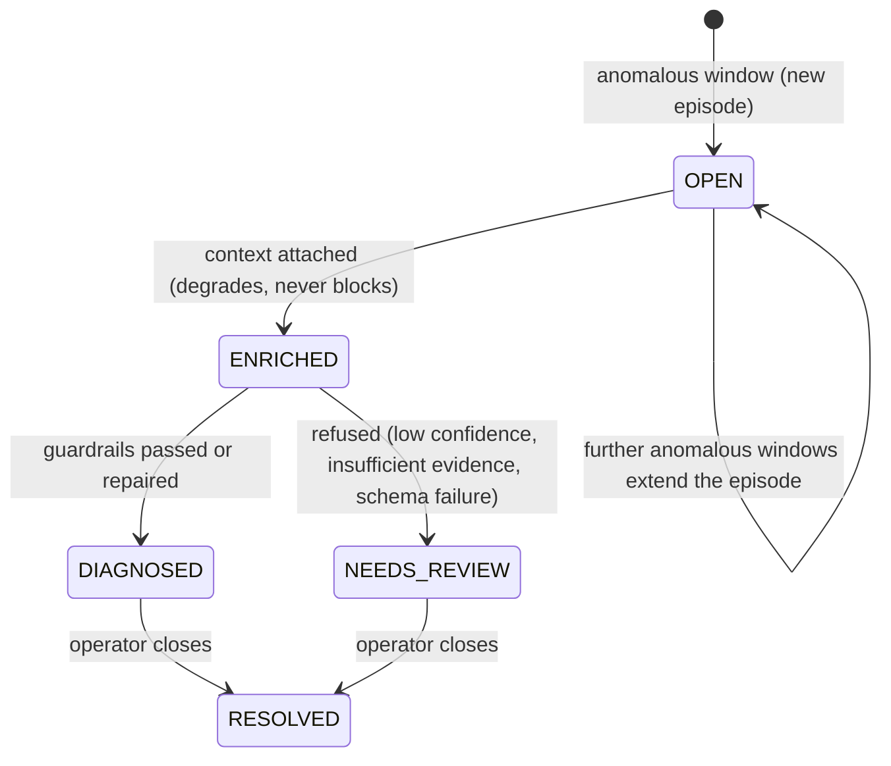
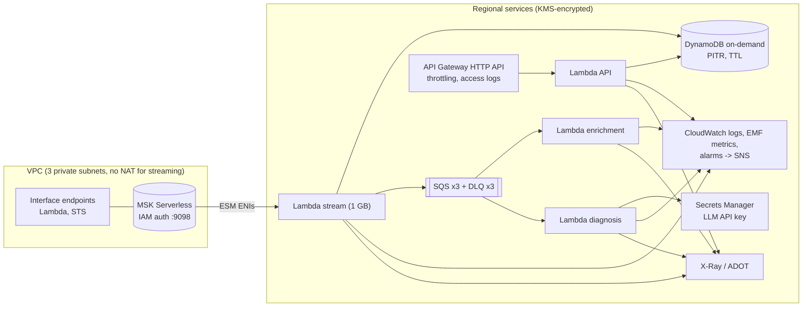

# IoT Fleet Intelligence - connectivity incidents, diagnosed and costed


**Event-driven connectivity intelligence for large IoT fleets on AWS serverless + Kafka.** Telcos, MVNOs,
utilities, logistics and smart-metering operators run millions of cellular devices. When a cell site goes
down, a roaming partner rejects SIMs, an APN is misprovisioned, a firmware rollout starts rebooting meters or
devices fall into reconnect storms, the symptoms arrive as noise across millions of telemetry messages - and
the default response is a ticket, a war room and, too often, an unnecessary **truck roll**. This platform
streams fleet telemetry through Kafka, detects incidents per cell / visited network / APN / firmware build,
enriches them with external context (weather, tower location, carrier and roaming data, operator status
feeds) and uses an LLM grounded in connectivity runbooks to produce a **diagnosed, actionable remediation**
with an explicit truck-roll decision and a customer-ready message. It also answers the buyer's first
question: **what does this cost to run at my scale?**

> **Value hypotheses (estimates, not measured results).** Industry figures commonly put a field-service
> truck roll at USD 150-500. If 20-30% of connectivity-related dispatches are avoidable (remote-fixable root
> causes such as APN, roaming or congestion issues), a 1M-device fleet with ~300 connectivity dispatches per
> month could avoid ~60-90 truck rolls (~USD 10k-45k per month), against a modelled platform cost of
> **~USD 14.8k per month (USD 0.015 per device)** before optimizations and ~USD 6k after edge batching.
> Faster time-to-detect (~90 s after fault onset in the simulator) also reduces SLA-penalty exposure. Validate
> with your own dispatch and SLA data.

**Highlights**

- **Go fleet simulator**: 1M devices in 84 MB, **12M events/s** on one laptop (10M devices: 8.3M events/s),
  deterministic, six injectable fault scenarios, outputs to Kafka, SQS or JSONL.
- **Streaming detection** in Lambda: windowed EWMA/z-score per scope with exactly-once *effect* via
  per-partition state + offset fencing; precision/recall 1.00 on the golden set, 0 false positives on the
  fault-free baseline.
- **Resilient enrichment** behind ports: timeouts, jittered retries, circuit breakers, DynamoDB caching,
  graceful degradation.
- **GenAI diagnosis**: provider-agnostic OpenAI-compatible client, RAG over runbooks, Pydantic structured
  output, deterministic guardrails (grounded ids, abstention, truck-roll policy, PII redaction).
- **Cost estimator** as a first-class feature: library + CLI + API, versioned pricing table, exact tests,
  computed optimization levers.
- **Runs end to end offline**: `make demo` (Kafka KRaft + moto-server + Jaeger, no cloud account or token).

---

## Contents

1. [Key capabilities](#key-capabilities)
2. [Architecture](#architecture)
3. [Architecture decision records](#architecture-decision-records)
4. [Tech stack](#tech-stack)
5. [Quickstart](#quickstart)
6. [Cost estimator](#cost-estimator)
7. [Evaluation](#evaluation)
8. [Simulator benchmarks](#simulator-benchmarks)
9. [Configuration](#configuration)
10. [Observability, security and responsible AI](#observability-security-and-responsible-ai)
11. [Roadmap](#roadmap)
12. [Repository layout](#repository-layout)

## Key capabilities

| Capability | What it does | Where |
|---|---|---|
| Fleet simulation | Smart meters, asset trackers, vehicle telematics and industrial sensors with realistic RSRP/RSRQ/SINR, cell, RAT, APN, battery, firmware, payload; fault scenarios: cell outage, congestion, reconnect storm, roaming misconfiguration, APN error, firmware regression | `simulator/` |
| Ingestion | Kafka topic keyed by cell id (MSK Serverless in AWS); SQS queues with DLQs for work; poison records quarantined | `platform/src/fleetintel/handlers/stream.py` |
| Detection | Tumbling event-time windows per cell / visited PLMN / APN / firmware; EWMA baselines with effect-size and sample guards; rule table -> suspected fault; episodes -> one incident | `platform/src/fleetintel/detection.py` |
| Enrichment | Cell-tower geolocation (OpenCelliD-style), weather (Open-Meteo), carrier/roaming registry, Statuspage-compatible status feed - each behind a port with fakes and recorded fixtures | `platform/src/fleetintel/enrichment/` |
| Diagnosis | RAG over 8 connectivity runbooks, JSON-schema structured output, repair round-trip, guardrails, GenAI OTel spans | `platform/src/fleetintel/diagnosis/` |
| API | `GET /v1/incidents`, `GET /v1/incidents/{id}` (incident + enrichment + diagnosis), `POST /v1/cost/estimate`, `GET /v1/cost/scenarios`, `/health`, `/ready`; API keys scoped to one tenant | `platform/src/fleetintel/handlers/api.py` |
| Cost | Monthly AWS + LLM estimate, scenario comparison, sensitivity, quantified optimizations | `platform/src/fleetintel/cost/` |
| Evals | Golden fault scenarios -> precision/recall per fault type, diagnosis accuracy, guardrail pass rate; CI gate | `evals/`, `platform/src/fleetintel/evals/` |
| IaC | Terraform: MSK Serverless, Lambda ESMs (MSK + SQS), SQS+DLQ, DynamoDB, HTTP API, IAM least privilege, KMS, alarms, X-Ray/ADOT | `infra/terraform/` |

## Architecture

### C4 - system context



### C4 - containers



### Sequence - telemetry to diagnosis



### Incident lifecycle



### Deployment (AWS reference, Terraform)



## Architecture decision records

| ADR | Decision |
|---|---|
| [0001](docs/adr/0001-kafka-backbone-sqs-work-dispatch.md) | Kafka for the telemetry stream, SQS (+DLQ) for incident work dispatch |
| [0002](docs/adr/0002-lambda-over-containers.md) | Lambda (arm64) + Powertools instead of long-running containers |
| [0003](docs/adr/0003-dynamodb-single-table.md) | DynamoDB single-table design and its access patterns |
| [0004](docs/adr/0004-streaming-anomaly-detection.md) | Windowed EWMA/z-score + rule table instead of an isolation forest |
| [0005](docs/adr/0005-simulator-scheduling.md) | Simulator: struct-of-arrays + timing wheel + counter-based RNG |
| [0006](docs/adr/0006-llm-structured-output-rag-guardrails.md) | Provider-agnostic LLM, RAG, structured output and deterministic guardrails |
| [0007](docs/adr/0007-cost-model.md) | A first-class, versioned, tested cost model |

## Tech stack

| Area | Technology | Version |
|---|---|---|
| Simulator | Go, franz-go (Kafka), AWS SDK for Go v2 (SQS) | Go 1.27.2, franz-go 1.22.2, aws-sdk-go-v2 1.47.3 |
| Platform | Python, AWS Lambda Powertools, Pydantic v2, httpx, boto3 | 3.13, 3.36.0, 2.14.1, 0.28.1, 1.43 |
| Streaming | Amazon MSK Serverless / Apache Kafka (KRaft) | Kafka 4.3.1 |
| Queues / DB | Amazon SQS (+DLQ), Amazon DynamoDB on-demand | - |
| GenAI | OpenAI-compatible chat + embeddings API; deterministic fake for CI | - |
| Observability | OpenTelemetry API/SDK (GenAI semconv), X-Ray via Powertools, CloudWatch EMF, Jaeger locally | OTel 1.45.1, Jaeger 2.22.0 |
| Local AWS | moto-server (DynamoDB + SQS) - no account or auth token | 5.2.4 |
| IaC | Terraform, AWS provider, tflint (+ AWS ruleset) | 1.16.6, ~> 6.69, 0.64.0 |
| Quality | golangci-lint, govulncheck, ruff, mypy (strict), pytest, moto, respx, pip-audit | 2.15.0, 1.9.0, 0.17, 2.4, 9.1, 5.2, 0.23, 2.10 |

## Quickstart

Prerequisites: Docker, GNU Make. For local development also Go 1.27 and [uv](https://docs.astral.sh/uv/).

```bash
cd iot-fleet-intelligence
make demo          # builds images, starts Kafka + moto-server + Jaeger + platform,
                   # simulates 100k devices with a cell outage at minute 8, prints the result
```

Abridged output (deterministic: same seed, same incident):

```text
INCIDENT inc-88d9005560f8ade6ffe5  [DIAGNOSED]  severity=critical
  suspected : cell_outage on cell 310-260-1006-100426
  impact    : 48 of 50 devices
  signal    : no_service_ratio = 0.9636 (baseline 0.006, z=47.88)
ENRICHMENT
  carrier      ok   {"plmn": "310260", "country": "US", "operator": "Home network (US)"}
  celltower    ok   {"lat": 43.5811, "lon": -114.6443, "range_m": 3868, "tac": 1006}
  status_feed  ok   {"relevant": [], "total_active": 2}
  weather      ok   {"temperature_c": 25.2, "wind_gusts_kmh": 53.1, ...}
DIAGNOSIS  (fake:fake-diagnosis-v1, guardrails=passed, tokens=1343+258)
  root cause : cell_outage (confidence 0.97)
  step 1     : [noc] Open a priority RAN ticket for the affected site with first-drop timestamp
  step 2     : [core_network] Check site power and backhaul alarms; correlate with weather at the site
  step 3     : [noc] Enable neighbour-cell or secondary-network fallback for critical assets
  truck roll : False
  customer   : A temporary network outage is affecting devices in one coverage area. ...
  runbooks   : RB-CELL-001, RB-GEN-001
```

Explore further:

```bash
curl -s -H 'x-api-key: demo-key-acme' localhost:8080/v1/incidents | jq
curl -s -H 'x-api-key: demo-key-acme' -X POST localhost:8080/v1/cost/estimate \
     -d '{"devices": 2500000, "report_interval_seconds": 900, "readings_per_message": 4}' | jq .total_usd
open http://localhost:16686            # traces incl. "chat <model>" GenAI spans
make down                              # stop and drop state
```

Use a real model (any OpenAI-compatible endpoint) - nothing else changes:

```bash
FLEETINTEL_LLM_PROVIDER=openai_compatible FLEETINTEL_LLM_API_KEY=... FLEETINTEL_LLM_MODEL=gpt-4o-mini make demo
# or a local model: FLEETINTEL_LLM_BASE_URL=http://host.docker.internal:11434/v1 FLEETINTEL_LLM_MODEL=llama3.1
```

### Local development and tests

```bash
make setup                  # uv sync (dev + local groups)
make lint                   # gofmt, go vet, golangci-lint, ruff, mypy --strict
make test                   # go test -race + pytest with coverage gate (85%); moto for AWS
make up && make test-integration   # Kafka round trip through the stream handler
make bench                  # simulator benchmarks (1M devices)
make lambda-package         # platform/dist/lambda.zip (arm64, ~22 MB)
make tf-validate            # terraform fmt/validate, no credentials
```

Simulator on its own:

```bash
cd simulator && go run ./cmd/fleetsim -devices 1000000 -duration 10m -sink discard
go run ./cmd/fleetsim -devices 5000 -duration 20m -scenario ../scenarios/multi-fault.json \
   -out telemetry.jsonl -labels labels.json        # JSONL + ground truth
go run ./cmd/fleetsim -sink kafka -kafka-brokers localhost:29092 -speed 60   # 60x real time
go run ./cmd/fleetsim -sink sqs -sqs-queue-url "$URL" -sqs-bundle 10         # SQS ingestion path
```

## Cost estimator

`fleetintel-cost` (CLI), `POST /v1/cost/estimate` (API) and `fleetintel.cost.estimate()` (library) share one
model. Unit prices come from a dated table, [`aws-us-east-1-2026-10.yaml`](platform/src/fleetintel/cost/pricing/aws-us-east-1-2026-10.yaml),
with sources - **assumptions, not quotes** (no free tier, discounts or tax). Tests assert exact hand-computed
numbers; the report below is generated (`make cost-report`) and CI fails if it drifts.

```bash
uv run fleetintel-cost estimate --devices 1000000 --interval 300 --batch 10 --llm-large-share 0.2
uv run fleetintel-cost compare --compare-devices 10000,1000000,10000000
uv run fleetintel-cost sensitivity --intervals 60,300,900,3600
```

**Scenario comparison** (5-minute reporting, 512 B payload, 0.5 incidents per 1k devices per day, all incidents
diagnosed by a large-tier model):

| Category | 10,000 devices | 1,000,000 devices | 10,000,000 devices |
|---|---:|---:|---:|
| Ingest (IoT Core) | $148.92 | $12,964.00 | $123,340.00 |
| Streaming (MSK Serverless) | $560.47 | $1,194.37 | $6,970.18 |
| Storage (DynamoDB) | $66.28 | $368.34 | $3,682.97 |
| GenAI (LLM) | $2.24 | $224.41 | $2,244.14 |
| Compute (Lambda arm64) | $2.41 | $19.11 | $190.78 |
| Observability | $3.34 | $17.63 | $174.32 |
| Security (KMS) | $1.00 | $1.00 | $1.00 |
| Messaging (SQS) | $0.53 | $0.56 | $0.89 |
| API Gateway | $0.10 | $0.10 | $0.10 |
| Data transfer | $0.03 | $0.03 | $0.03 |
| **Total / month** | **$785.34** | **$14,789.57** | **$136,604.42** |
| Per device / month | $0.0785 | $0.0148 | $0.0137 |

**Sensitivity to reporting frequency (1M devices)** - ingest is per message, so frequency dominates:

| Report interval | Readings / month | Total / month | Per device | IoT Core share |
|---:|---:|---:|---:|---:|
| 60s | 43,800,000,000 | $54,009.84 | $0.0540 | 89% |
| 300s | 8,760,000,000 | $14,789.57 | $0.0148 | 88% |
| 900s | 2,920,000,000 | $8,045.40 | $0.0080 | 86% |
| 3600s | 730,000,000 | $5,359.82 | $0.0054 | 83% |

**Computed optimization levers (1M devices)** - each re-runs the model with one change:

| Optimization | Monthly savings | New total |
|---|---:|---:|
| Batch 10 readings per message at the edge | $8,647.65 | $6,141.92 |
| Report by exception (filter 30% unchanged readings at the edge) | $2,941.27 | $11,848.29 |
| Compress payloads (CBOR + zstd, ~50%) | $320.15 | $14,469.42 |
| Larger MSK batches (2,000 records / 10 s window) | $298.58 | $14,490.98 |
| Model tiering: small model first, escalate 20% to the large tier | $168.69 | $14,620.87 |

Take-aways: the GenAI layer is ~1.5% of the bill - **the LLM is not the cost problem, per-message ingest is**;
MSK Serverless' fixed cluster-hour dominates small fleets (consider direct-to-Kafka gateways or Kinesis below
~50k devices); detector-state writes are the main DynamoDB cost and shrink with larger stream batches.
Full report with line items: [`docs/cost-report.md`](docs/cost-report.md).

## Evaluation

Golden set [`evals/golden.yaml`](evals/golden.yaml): 10 deterministic simulator scenarios (3,000 devices,
26 virtual minutes each, ~643k events) including a fault-free baseline, overlapping faults, a 45%-intensity
outage and a 90-second storm. The harness replays telemetry through the **real handlers** (Kafka-like
partitioning by cell, Lambda-sized batches, SQS-shaped worker events) and scores incidents against the
simulator's ground-truth labels. CI gate thresholds: precision >= 0.90, recall >= 0.95, per-fault recall 1.0,
diagnosis accuracy >= 0.95, guardrail pass rate >= 0.90, zero baseline false positives.

Current results (fake LLM):

| Fault type | Precision | Recall | TP | FN | FP |
|---|---:|---:|---:|---:|---:|
| apn_error | 1.00 | 1.00 | 2 | 0 | 0 |
| cell_outage | 1.00 | 1.00 | 3 | 0 | 0 |
| congestion | 1.00 | 1.00 | 1 | 0 | 0 |
| firmware_regression | 1.00 | 1.00 | 1 | 0 | 0 |
| reconnect_storm | 1.00 | 1.00 | 2 | 0 | 0 |
| roaming_misconfig | 1.00 | 1.00 | 2 | 0 | 0 |

Diagnosis root-cause accuracy 1.00, guardrail pass rate 1.00, mean time-to-detect 90 s, 0 baseline false
positives. The fake model validates the pipeline and the gate - not model quality. To evaluate a real model
with identical data and metrics:

```bash
make sim
cd platform && FLEETINTEL_LLM_PROVIDER=openai_compatible FLEETINTEL_LLM_API_KEY=... FLEETINTEL_LLM_MODEL=... \
  uv run fleetintel-eval --golden ../evals/golden.yaml --simulator-bin ../simulator/bin/fleetsim \
  --out evals-report.json --markdown evals-report.md
```

The JSON report includes per-scenario diagnoses, confidence, guardrail outcome and token usage, so model or
prompt changes can be compared on accuracy, refusal rate and cost at the same time.

## Simulator benchmarks

Measured on an Apple M3 Pro (11 cores), `-sink discard` unless noted (reproduce with `make bench`):

| Run | Events | Throughput | Heap |
|---|---:|---:|---:|
| 1M devices, 10 virtual min, 1 shard | 8.29M | 2.5M events/s | 71 MB |
| 1M devices, 10 virtual min, 11 shards | 8.29M | **12.0M events/s** (5.6 GB/s JSON) | 84 MB |
| 1M devices, binary-heap scheduler | 8.29M | 9.5M events/s | 49 MB |
| 10M devices, 5 virtual min | 41.4M | 8.3M events/s | 584 MB |
| 1M devices to JSONL file | 8.29M | 5.7M events/s | 85 MB |
| 100k devices to Kafka (docker compose) | 1.16M | ~1M events/s | 226 MB |

`Emit` costs 339 ns and 0 allocations per event; a wheel reschedule 3.4 ns vs 78 ns for the heap with 1M
pending devices. Per-device state is 20 bytes. Design: [ADR 0005](docs/adr/0005-simulator-scheduling.md).

## Configuration

All platform settings are environment variables (`FLEETINTEL_` prefix, typed and validated by
`pydantic-settings`, see [`config.py`](platform/src/fleetintel/config.py) and [`.env.example`](.env.example)).

| Variable | Default | Purpose |
|---|---|---|
| `FLEETINTEL_BACKEND` | `memory` | `aws` (DynamoDB + SQS, real or moto-server) or `memory` |
| `FLEETINTEL_TABLE_NAME` | `fleetintel` | Single DynamoDB table |
| `FLEETINTEL_ENRICHMENT_QUEUE_URL` / `_DIAGNOSIS_` / `_QUARANTINE_` | - | SQS queue URLs |
| `FLEETINTEL_AWS_ENDPOINT_URL` | - | Emulator endpoint (moto-server) for local runs |
| `FLEETINTEL_WINDOW_SECONDS` | `60` | Detection window |
| `FLEETINTEL_ALLOWED_LATENESS_SECONDS` | `30` | Watermark lateness |
| `FLEETINTEL_Z_THRESHOLD` / `_EWMA_ALPHA` / `_MIN_SAMPLES` | `4.0` / `0.2` / `8` | Detector sensitivity |
| `FLEETINTEL_ENRICHMENT_MODE` | `fake` | `fake` fixtures or `live` HTTP providers |
| `FLEETINTEL_HTTP_TIMEOUT_SECONDS` / `_HTTP_RETRIES` | `2.5` / `2` | Third-party call budget |
| `FLEETINTEL_BREAKER_FAILURE_THRESHOLD` / `_BREAKER_RESET_SECONDS` | `5` / `30` | Circuit breaker |
| `FLEETINTEL_CACHE_TTL_SECONDS` | `900` | Enrichment cache TTL |
| `FLEETINTEL_OPENCELLID_API_KEY` / `_STATUS_FEED_URL` | - | Live provider settings (Open-Meteo needs no key) |
| `FLEETINTEL_LLM_PROVIDER` | `fake` | `fake` or `openai_compatible` |
| `FLEETINTEL_LLM_BASE_URL` / `_LLM_MODEL` / `_LLM_EMBEDDING_MODEL` | OpenAI defaults | Any OpenAI-compatible endpoint |
| `FLEETINTEL_LLM_API_KEY` / `_LLM_API_KEY_SECRET_ARN` | - | Key from env (local) or Secrets Manager (AWS) |
| `FLEETINTEL_RAG_TOP_K` / `_MIN_CONFIDENCE` | `3` / `0.55` | Retrieval depth, abstention threshold |
| `FLEETINTEL_API_KEYS` | - | `tenant:sha256(key)` pairs |

## Observability, security and responsible AI

**Observability.** Powertools structured JSON logs (correlation ids, tenant), EMF metrics (events, invalid
records, incidents opened, degraded enrichment sources, LLM tokens, guardrail outcomes) and X-Ray tracing in
Lambda; OpenTelemetry spans for the stream shard, enrichment provider calls and **LLM calls with GenAI
semantic conventions** (`gen_ai.operation.name`, `gen_ai.provider.name`, `gen_ai.request.model`,
`gen_ai.usage.input_tokens/output_tokens`), exported to Jaeger locally and via ADOT in AWS. Alarms: DLQ not
empty, Lambda errors, MSK `OffsetLag`, API 5xx, guardrail refusal spikes.

**Security.** Least-privilege IAM per function (the API role is read-only; only the diagnosis role can read
the LLM secret); KMS encryption for DynamoDB, SQS, logs, SNS, secrets and Lambda environment; MSK IAM auth in
private subnets with no NAT; API keys stored only as SHA-256 hashes, compared in constant time, each scoped to
one tenant, cross-tenant reads return 404 and pagination cursors are bound to the tenant partition; API
throttling; strict input validation of telemetry (regex-bounded identifiers, numeric ranges) with poison
records quarantined; non-root, read-only containers (distroless for the simulator); `govulncheck` and
`pip-audit` in CI.

**Responsible AI and failure modes.** Telemetry fields are untrusted: evidence is serialised as JSON inside
`<evidence>` tags, the system prompt declares it data, and instruction-like strings are flagged.
Guardrails are code: identifiers must be grounded, low confidence or insufficient evidence routes to human
review, truck rolls are blocked for remotely-fixable causes, customer messages are scrubbed of device ids and
IMSI-like numbers. Weak incidents are refused *before* calling the model (cost and hallucination control).
Every enrichment provider degrades to `unavailable` instead of failing the incident; the LLM call has a
timeout, retries and a concurrency cap; poison telemetry never blocks a partition; all consumers are
idempotent. Data minimisation: the prompt carries aggregates and at most 10 sample device ids - no payloads,
locations of individual devices or subscriber identifiers.

**Limitations.** The fake model and fixture providers prove the pipeline, not real-world accuracy; detection
is univariate per scope (no cross-scope correlation yet); the detector state per partition must stay under
DynamoDB's 400 KB item limit (compressed, monitored, raises loudly); the Terraform has not been applied to a
live account in CI (validated and linted only); pricing is a dated snapshot.

## Roadmap

1. Cross-scope correlation (e.g. firmware x cell) and a second-stage novelty detector (isolation forest) for
   unknown fault classes.
2. Incident resolution loop: auto-resolve on recovery, operator feedback to calibrate thresholds and to build
   a labelled dataset from production.
3. Real-model eval matrix in CI (nightly, budget-capped) with prompt/model regression reports.
4. Semantic cache for diagnoses keyed by incident signature (modelled in the cost estimator, not yet built).
5. AWS IoT Core rule -> MSK in Terraform, multi-region active/passive, and a Grafana dashboard pack.
6. Live pricing refresh from the AWS Price List API into a new dated table.

## Repository layout

```text
iot-fleet-intelligence/
  simulator/            Go fleet simulator (cmd/fleetsim, internal/{fleet,sched,faults,sim,sink,rng})
  platform/             Python package fleetintel: handlers, detection, enrichment, diagnosis, cost, evals, local runner
  scenarios/            Fault-injection scenarios (JSON) shared by demo and evals
  evals/golden.yaml     Golden set + CI thresholds
  infra/terraform/      AWS reference deployment
  docs/adr/             Architecture decision records
  docs/cost-report.md   Generated cost report
  docker-compose.yml    Kafka KRaft, moto-server, Jaeger, platform, simulator
  Makefile              demo, test, lint, eval, bench, cost-report, lambda-package, tf-validate
```
