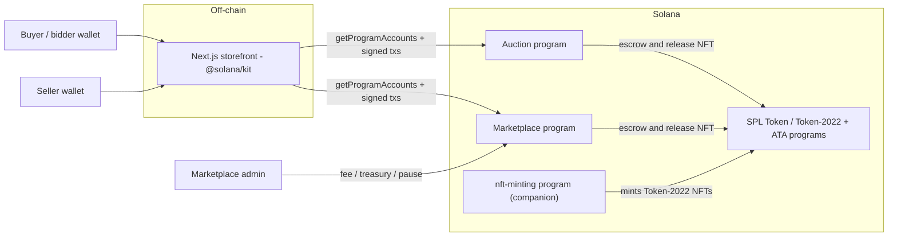
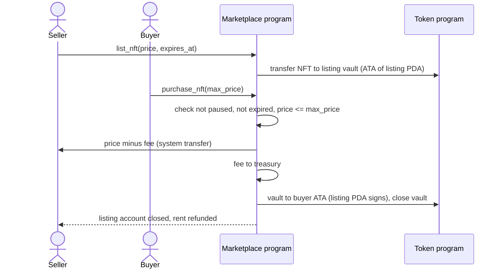
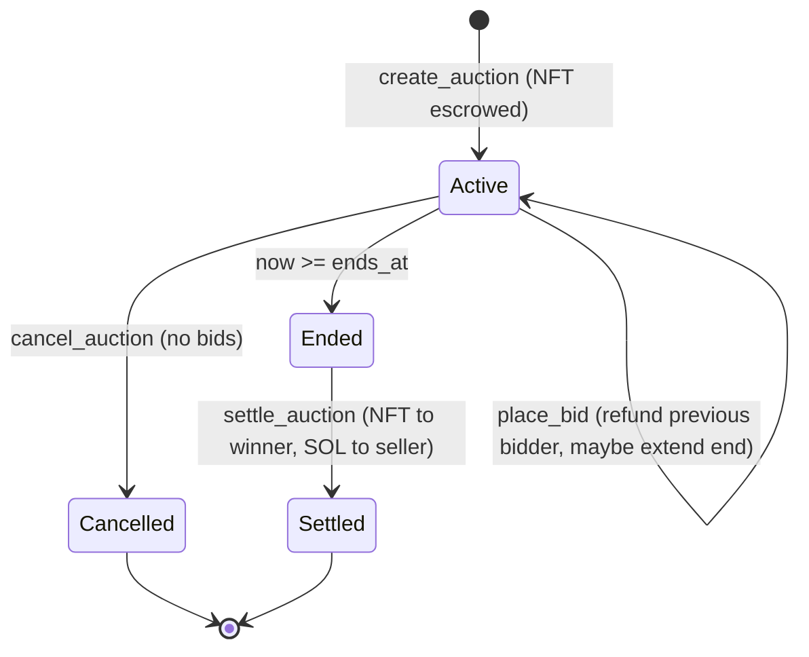
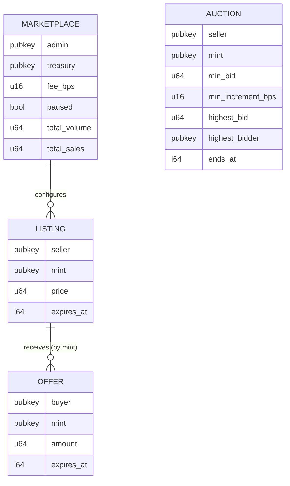

# NFT Marketplace (Solana)


A trust-minimised NFT marketplace on Solana: two Anchor programs for **escrowed fixed-price
listings with SOL offers** and **English auctions**, plus a Next.js storefront that reads listings,
offers and auctions straight from chain with `@solana/kit`.

Both programs use the SPL **token interface**, so they trade classic SPL Token NFTs and Token-2022
NFTs alike — including the on-chain-metadata NFTs produced by the companion
[`nft-minting`](../nft-minting) program.

> Portfolio / reference implementation — unaudited, not deployed to mainnet. See
> [SECURITY.md](SECURITY.md).

## Key features
**Marketplace program**
- List an NFT at a SOL price with optional expiry; the NFT is escrowed in the listing PDA's ATA.
- Update price/expiry, delist (NFT and rent returned).
- Atomic purchase: SOL to seller and fee to treasury, NFT to buyer, accounts closed — with a
  `max_price` slippage guard against last-second price changes.
- SOL offers escrowed in a PDA; buyers can cancel, sellers can accept unexpired offers.
- Admin config: fee (≤ 10%), treasury, pause switch, admin rotation; on-chain volume/sales stats.

**Auction program**
- English auctions with minimum bid and minimum increment (bps, rounded up).
- Each bid escrows SOL and refunds the previous bidder in the same instruction.
- Anti-sniping: bids in the last 5 minutes extend the auction.
- Permissionless settlement (NFT to winner, SOL to seller) and cancellation before the first bid.

**Storefront**
- Listings grid with sorting, expired filter, "my listings" and best active offer per NFT.
- Live auctions with countdowns, phase badges and next minimum bid.
- Wallet-standard wallet connection; graceful empty/error states when programs are not deployed.

## Tech stack
| Layer | Technology | Version |
| --- | --- | --- |
| On-chain programs | Anchor (`anchor-lang`, `anchor-spl`) | 1.2.1 |
| Toolchain | Agave (Solana) CLI / `cargo-build-sbf` | 4.3.2 |
| Language | Rust, edition 2024 (MSRV 1.89) | stable |
| Program tests | LiteSVM + host unit tests | 0.18.0 |
| Frontend | Next.js / React | 16.4 / 19.3 |
| Solana client | `@solana/kit`, `@wallet-standard/react` | 8.5 / 1.0 |
| Styling / tooling | Tailwind CSS 4, TypeScript 6 (strict), ESLint 9 flat config, Vitest 5 | — |
| Runtime | Node.js LTS (`node:24-alpine`, non-root) | 24 |
| CI | GitHub Actions (+ advisory `cargo audit` / `npm audit`) | — |

## Architecture

### Context / container view


### Purchase flow


### Auction lifecycle


### On-chain accounts


PDA seeds: `marketplace`, `listing + mint`, `offer + mint + buyer`, `auction + mint`. Vaults are the
associated token accounts of the listing / auction PDAs.

## Project structure
```
nft-marketplace/
├── Anchor.toml, Cargo.toml, Cargo.lock   # Anchor 1.2.1 workspace (Rust 2024)
├── programs/
│   ├── marketplace/
│   │   ├── src/                          # state, escrow helper, instructions/{admin,listing,offer}
│   │   └── tests/marketplace.rs          # LiteSVM end-to-end tests
│   └── auction-system/
│       ├── src/lib.rs
│       └── tests/auction.rs
├── app/                                  # Next.js 16 storefront (@solana/kit)
├── scripts/deploy.sh
├── docker-compose.yml                    # runs the storefront container
└── SECURITY.md
```

## Running locally

### Programs
Prerequisites: Rust stable, [Agave CLI 4.3.x](https://docs.anza.xyz/cli/install),
[Anchor CLI 1.2.1](https://www.anchor-lang.com/docs/installation) (`avm install 1.2.1`).
```bash
cd nft-marketplace
anchor build                  # SBF binaries, IDLs and TS types
cargo test --workspace        # unit + LiteSVM end-to-end tests
./scripts/deploy.sh devnet    # anchor keys sync + build + deploy
```

### Storefront without Docker
```bash
cd nft-marketplace/app
cp .env.example .env.local
npm ci
npm run dev                   # http://localhost:3000
```

### Storefront with Docker
```bash
cd nft-marketplace
docker compose up --build     # http://localhost:3000
```

## Testing
| Suite | Command | Coverage |
| --- | --- | --- |
| Unit | `cargo test --workspace --lib` | fee math, listing expiry, next-minimum-bid rules |
| Program E2E (LiteSVM) | `anchor build && cargo test --workspace` | list → purchase (fee + seller payout), slippage guard, delist, offers cancel/accept, admin-only pause; bids, refunds, wrong refund target, early settle, late bid, settlement, anti-sniping, cancellation rules |
| Frontend | `cd app && npm run lint && npm run typecheck && npm test && npm run build` | account codecs and discriminators, auction math, formatting |

## Configuration
| Variable / setting | Where | Default |
| --- | --- | --- |
| `NEXT_PUBLIC_RPC_URL` | `app/.env.local` / Docker build arg | `https://api.devnet.solana.com` |
| `NEXT_PUBLIC_CLUSTER` | `app/.env.local` / Docker build arg | `devnet` |
| `NEXT_PUBLIC_MARKETPLACE_PROGRAM_ID` | `app/.env.local` / Docker build arg | `BKvFQqBhXJNpKjmAzwvsbuHGKG54EPcdcV7YmRfxw1Te` |
| `NEXT_PUBLIC_AUCTION_PROGRAM_ID` | `app/.env.local` / Docker build arg | `5YeC15ieZAhKmeDeVHR1xDzC6patSL68yQTtgqEio7Sh` |
| Program ids | `declare_id!` + `Anchor.toml` | as above (`anchor keys sync` to use your own) |
| Marketplace fee / treasury | `initialize_marketplace` / `update_marketplace` | e.g. 250 bps |

No secrets are needed: transactions are signed client-side by the user's wallet.

## Design decisions
- **Escrow over delegate-based listings**: the program holds the NFT, so a listing is always
  fillable and cannot be double-sold; the cost is an extra ATA rent deposit, refunded on close.
- **One listing / auction per mint** (`[seed, mint]` PDAs): an NFT has exactly one owner, so this
  keeps lookups O(1) and prevents conflicting listings.
- **Offers hold lamports in the PDA itself**: no extra escrow account, and closing the PDA refunds
  escrow and rent in one step.
- **Token interface everywhere**: SPL Token and Token-2022 NFTs with one code path.
- **Royalties are not enforced on-chain here**; the minting program publishes `royalty_bps` in
  token metadata for clients that honour it (see SECURITY.md).
- **LiteSVM tests** run the real SBF binaries with the real Token and ATA programs in milliseconds.
- **Read-only storefront first**: the UI decodes accounts with unit-tested `@solana/kit` codecs and
  never shows mocked balances; transaction builders can be generated from the IDLs (`target/idl`).

## What changed in the 2026 modernisation
The previous workspace (Anchor 0.29, Metaplex, six declared programs of which three did not exist)
did not build; most instructions were placeholders and the frontend relied on mocks and a
non-existent websocket server. It was reduced to two complete, tested programs on Anchor 1.2.1, the
minting program was extracted into [`nft-minting`](../nft-minting), and the storefront was rebuilt on
Next.js 16 and `@solana/kit`.
