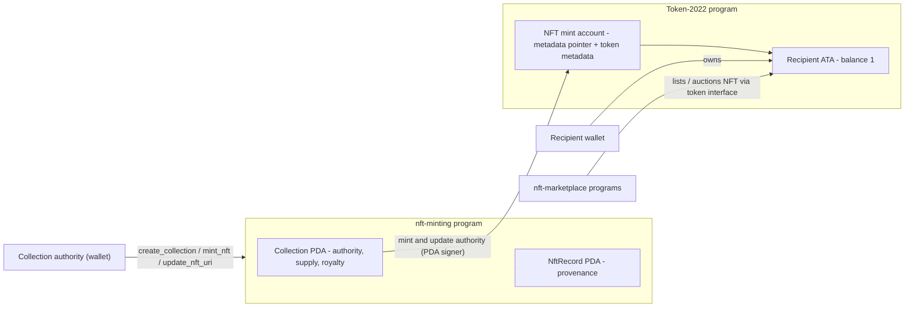
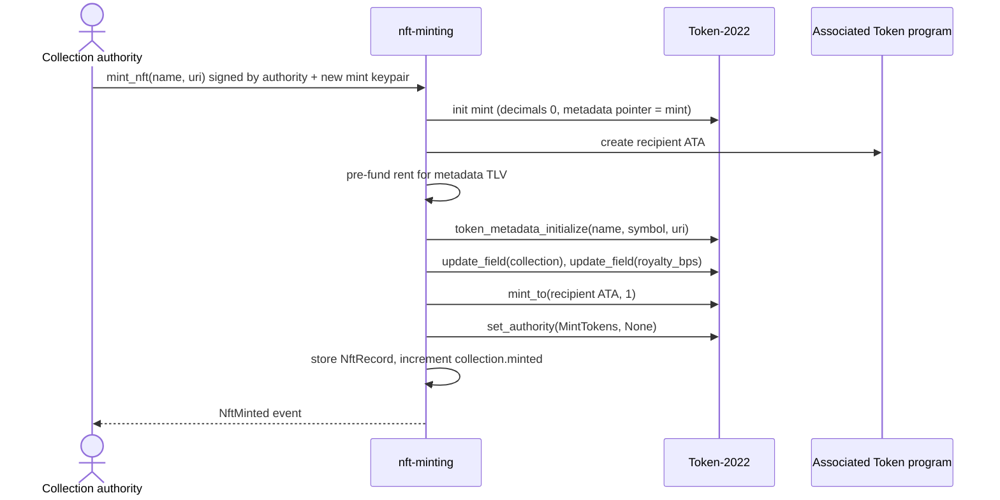
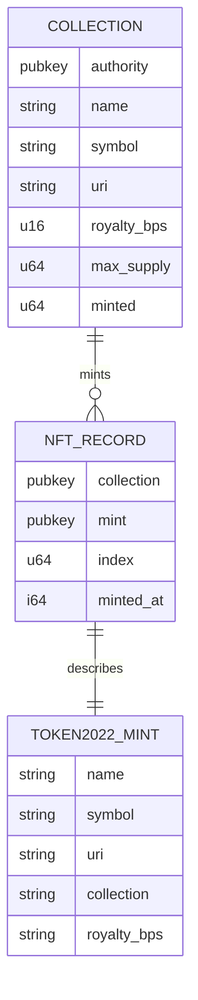

# NFT Minting (Token-2022)


A Solana program that mints 1-of-1 NFTs as **Token-2022 mints with on-chain metadata**. Instead of
depending on an external metadata program, every NFT uses the *metadata pointer* and *token
metadata* extensions, so name, symbol, URI, collection and royalty live inside the mint account
itself. Collections are program-owned PDAs that act as mint and update authority, enforce a
maximum supply and record per-NFT provenance.

It is the minting companion of [`nft-marketplace`](../nft-marketplace): NFTs minted here (decimals
0, supply 1) can be listed, offered on and auctioned there, because the marketplace programs use
the token interface and accept both SPL Token and Token-2022 mints.

## Key features
- **Collections** keyed by `(authority, name)` with symbol, collection URI, royalty (≤ 50%) and
  optional max supply.
- **Mint NFT**: creates the Token-2022 mint (metadata pointer → itself), initialises token metadata,
  writes `collection` and `royalty_bps` as additional metadata fields, mints exactly one token to
  the recipient's associated token account and **revokes the mint authority** so supply is fixed.
- **Provenance**: an `NftRecord` PDA per mint stores the collection, sequence index and timestamp.
- **Reveal / metadata refresh**: the collection authority can update the URI on-chain.
- Rent for the variable-length metadata is pre-funded by the program before Token-2022 reallocates.
- Anchor events (`CollectionCreated`, `NftMinted`, `MetadataUpdated`) for indexers.

## Tech stack
| Layer | Technology | Version |
| --- | --- | --- |
| Program framework | Anchor (`anchor-lang`, `anchor-spl`) | 1.2.1 |
| Runtime / toolchain | Agave (Solana) CLI, `cargo-build-sbf` | 4.3.2 |
| Token standard | SPL Token-2022 (metadata pointer + token metadata extensions) | bundled program |
| Language | Rust, edition 2024 (MSRV 1.89) | stable |
| Tests | LiteSVM (in-process SVM) + host unit tests | 0.18.0 |
| CI | GitHub Actions | — |

## Architecture



### Mint flow



### Accounts


## Project structure
```
nft-minting/
├── Anchor.toml                 # Anchor 1.2.1 workspace, program ids
├── Cargo.toml / Cargo.lock     # Rust workspace (edition 2024)
├── programs/nft-minting/
│   ├── src/
│   │   ├── lib.rs              # program entrypoints
│   │   ├── state.rs            # Collection, NftRecord, validation, metadata sizing
│   │   ├── errors.rs, events.rs
│   │   └── instructions/       # create_collection, mint_nft, update_metadata
│   └── tests/minting.rs        # LiteSVM end-to-end tests
└── scripts/deploy.sh           # keys sync + build + deploy
```

## Running locally

Prerequisites: Rust stable, [Agave CLI 4.3.x](https://docs.anza.xyz/cli/install) and
[Anchor CLI 1.2.1](https://www.anchor-lang.com/docs/installation) (`avm install 1.2.1`).

```bash
cd nft-minting
anchor build                   # SBF program + IDL (target/idl) + TS types (target/types)
cargo test --workspace         # unit + LiteSVM tests (needs the .so from anchor build)

# Deploy to devnet with your own program keypair
solana config set --url devnet
./scripts/deploy.sh devnet
```

Docker is not required for this project: it has no off-chain service. LiteSVM runs the compiled
program in-process, so no local validator is needed for tests.

## Testing
| Suite | Command | What it covers |
| --- | --- | --- |
| Unit | `cargo test --workspace --lib` | metadata sizing, supply limits, input validation |
| End-to-end | `cargo test --workspace` (after `anchor build`) | mint with on-chain metadata, supply fixed at 1, revoked mint authority, URI update, max supply, authority checks |

## Configuration
| Setting | Where | Default |
| --- | --- | --- |
| Program id | `declare_id!` in `lib.rs`, `Anchor.toml` | `6XjqxHv3WqK5VZL3KhuUGiW7ad51Ppu9qxg8bxLBxivr` (run `anchor keys sync` to use yours) |
| Cluster / wallet | `Anchor.toml` `[provider]` | `localnet`, `~/.config/solana/id.json` |
| Limits | `state.rs` | name ≤ 32, symbol ≤ 10, URI ≤ 200 bytes, royalty ≤ 5000 bps |

## Design decisions
- **Token-2022 metadata over Metaplex**: no extra program dependency or CPI surface, metadata is
  readable from the mint account alone, and it works with any token-interface-aware marketplace.
- **PDA as authority**: the collection PDA signs minting and metadata updates, so only the program's
  rules (authority check, supply cap) can create NFTs in a collection.
- **Revoking the mint authority** gives a verifiable on-chain guarantee of a 1-of-1 supply.
- **Royalty as metadata** (`royalty_bps`) rather than a transfer hook: keeps NFTs freely transferable
  and leaves enforcement policy to marketplaces.
- **LiteSVM tests** execute the real SBF binary with the real Token-2022 and ATA programs in
  milliseconds, without a validator.

## History
This directory previously contained only an orphaned `events.rs` belonging to an unfinished minting
program inside `nft-marketplace` (Anchor 0.29, Metaplex, candy machine stubs). That program was
moved here and rewritten as a focused, buildable Anchor 1.2.1 workspace.
