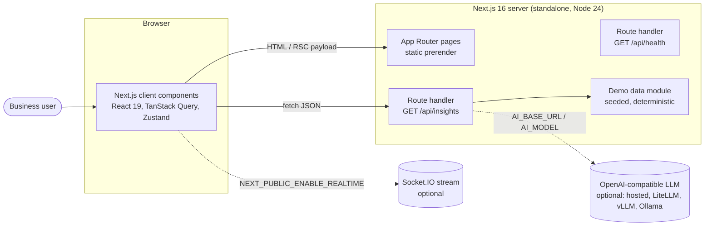
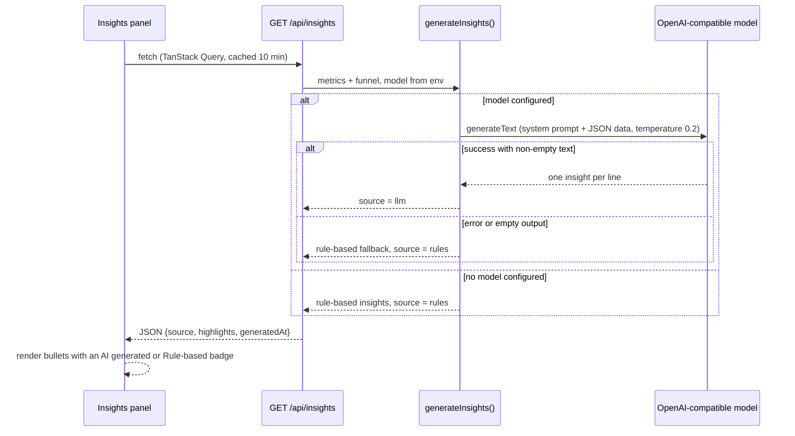

# Analytics Dashboard


A business analytics dashboard built with **Next.js 16 (App Router) and React 19**. It shows KPI cards, interactive charts, an activity feed and a **natural-language insights panel** that summarises the numbers with any OpenAI-compatible LLM, or with built-in rules when no model is configured.

## The problem it solves

Product and business teams need to see their main metrics at a glance, plus a short written explanation of *what changed*, without exporting data into another tool. This dashboard puts both on one fast page. It runs on its own with a deterministic demo dataset, and it can be pointed at real APIs and a real language model through configuration only.

## Key features

- **KPI cards**: visitors, page views, revenue and conversion, with period-over-period deltas.
- **Interactive charts** (Recharts): daily visitors (line), revenue trend (area), conversion funnel and traffic sources (bar), with a date-range selector.
- **Natural-language insights**: `/api/insights` asks a configurable LLM for 3–4 factual bullet points through the provider-agnostic **Vercel AI SDK**. If the model is not configured, cannot be reached or returns nothing, it falls back to deterministic rule-based insights, so the UI never breaks.
- **Optional real-time streaming**: a Socket.IO client with built-in reconnection and backoff. It is off by default (`NEXT_PUBLIC_ENABLE_REALTIME`).
- **State management**: TanStack Query for server state and Zustand 5 + Immer for client state (theme, notifications, dashboards).
- **Dark mode** with `next-themes` and Tailwind CSS 4 class-based variants.
- **Production-ready container**: standalone Next.js output, a non-root Node 24 image, a `/api/health` healthcheck and security headers.

## Tech stack

| Area | Technology | Version |
| --- | --- | --- |
| Runtime | Node.js (LTS) | 24 |
| Framework | Next.js (App Router, Turbopack) | 16.4 |
| UI library | React | 19.3 |
| Language | TypeScript (`strict`) | 6.0 |
| Styling | Tailwind CSS (CSS-first config) | 4.3 |
| Charts | Recharts | 3.10 |
| Server state | TanStack Query | 5.104 |
| Client state | Zustand + Immer | 5.0 / 11.1 |
| GenAI | Vercel AI SDK + `@ai-sdk/openai-compatible` | 7.0 / 3.0 |
| Real-time | socket.io-client | 4.8 |
| Testing | Vitest + Testing Library + jsdom | 5.0 / 16.3 / 30 |
| Linting | ESLint flat config (`eslint-config-next`) | 9.39 |
| Container | Docker multi-stage, `node:24-alpine` | 24.22 |

## Architecture

### Container view



### Insights request flow



## Project structure

```text
react-analytics-dashboard/
├── src/
│   ├── app/
│   │   ├── api/health/route.ts      # liveness endpoint used by Docker HEALTHCHECK
│   │   ├── api/insights/route.ts    # natural-language insights endpoint
│   │   ├── layout.tsx, page.tsx     # App Router shell and overview page
│   │   ├── not-found.tsx
│   │   └── globals.css              # Tailwind 4 @theme tokens
│   ├── components/                  # Dashboard, Layout, Notifications, UI
│   ├── lib/
│   │   ├── analytics/mockData.ts    # seeded demo dataset (swap for real APIs)
│   │   ├── insights/                # provider resolution + generation + tests
│   │   └── websocket/               # optional Socket.IO provider
│   ├── store/                       # Zustand stores
│   ├── types/, utils/
├── Dockerfile, docker-compose.yml
├── eslint.config.mjs, next.config.ts, postcss.config.mjs
├── vitest.config.mts, vitest.setup.ts
└── .env.example
```

## Running locally

Prerequisites: Node.js 24 and npm 11.

```bash
cd react-analytics-dashboard
cp .env.example .env.local   # optional
npm ci
npm run dev                  # http://localhost:3000
```

Production build:

```bash
npm run build && npm start
```

### With Docker

```bash
docker compose up --build    # http://localhost:3000
# or
docker build -t analytics-dashboard . && docker run --rm -p 3000:3000 analytics-dashboard
```

### Enabling LLM insights

Point the app at any OpenAI-compatible endpoint, for example a local Ollama:

```bash
AI_BASE_URL=http://localhost:11434/v1 AI_MODEL=llama3.2 npm run dev
```

Without these variables the panel shows rule-based insights, marked with a "Rule-based" badge.

## Testing and quality

```bash
npm run lint         # ESLint (Next core-web-vitals + TypeScript + React Compiler rules)
npm run typecheck    # next typegen + tsc --noEmit
npm test             # Vitest unit and component tests
npm run test:coverage
```

The LLM path is tested with the AI SDK's `MockLanguageModelV4`, so tests never call a real provider. The cases covered are prompt contents, list-marker parsing, the fallback when a call fails, and the case where no model is configured.

CI (`.github/workflows/react-analytics-dashboard.yml`) runs these steps:

1. Lint, typecheck, tests with coverage and the production build.
2. `npm audit` for runtime dependencies (blocking).
3. `npm audit` for all dependencies, as an advisory step.
4. A Docker image build plus a container health smoke test.

## Configuration

| Variable | Default | Description |
| --- | --- | --- |
| `NEXT_PUBLIC_APP_URL` | `http://localhost:3000` | Public base URL used for metadata and Open Graph |
| `NEXT_PUBLIC_ENABLE_REALTIME` | `false` | Turns on the Socket.IO real-time stream |
| `NEXT_PUBLIC_WS_URL` | `ws://localhost:3001` | Socket.IO endpoint when real-time is on |
| `AI_BASE_URL` | unset | OpenAI-compatible base URL (for example `https://api.example.com/v1`, `http://localhost:11434/v1`) |
| `AI_API_KEY` | unset | API key for the endpoint, if it needs one |
| `AI_MODEL` | unset | Model identifier. Insights stay rule-based unless both `AI_BASE_URL` and `AI_MODEL` are set |

`NEXT_PUBLIC_*` values are inlined at build time. `AI_*` values are read per request on the server and never reach the browser.

## Design decisions

- **Provider-agnostic GenAI.** The insights feature depends only on the OpenAI-compatible protocol through the Vercel AI SDK, so hosted APIs, gateways such as LiteLLM, and self-hosted models are interchangeable. The model is optional and the deterministic fallback keeps the page useful offline and in CI.
- **Grounded prompts.** The model receives only aggregated KPI and funnel numbers as JSON, with a low temperature and an instruction not to speculate. Its output is capped at four lines, which limits hallucination and token cost.
- **Seeded demo data.** A seeded PRNG keeps the server and client renders identical (no hydration mismatch) and makes tests reproducible. Replacing `lib/analytics/mockData.ts` with real fetchers is the only change needed to go live.
- **Vitest instead of Jest.** The project uses the same test runner as the rest of the modern React toolchain. Startup is faster, and ESM and TypeScript work without Babel.
- **Lean dependencies.** The upgrade removed unused heavy packages: module federation, three.js, d3, chart.js, Storybook 8 and PWA plugins. That shrinks the install and the attack surface. Recharts covers every chart that is actually rendered.
- **Standalone output.** The runtime image contains only `.next/standalone` and the static assets, and runs as the non-root `node` user with a healthcheck.

## License

MIT, see [LICENSE](LICENSE).
