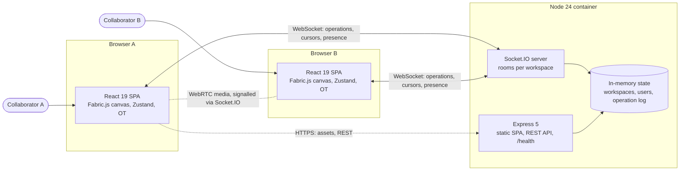
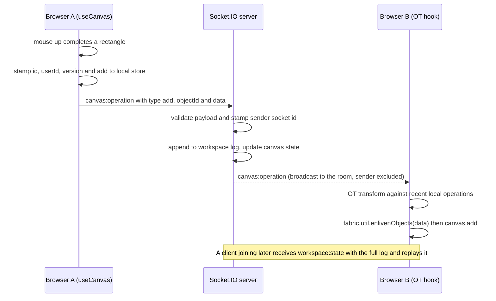

# Collaboration Canvas


A real-time collaborative whiteboard in the style of Figma or Miro. Several people draw on the same Fabric.js canvas, see each other's cursors live, and keep a consistent view through operational transform (OT) over Socket.IO. Peer-to-peer audio and video run over WebRTC.

## The problem it solves

Distributed teams need a shared visual space for sketching, diagramming and design reviews where every change shows up for everyone at once. This project shows the core building blocks:

- low-latency operation broadcast
- conflict handling for concurrent edits
- presence (who is here and where their cursor is)
- late-joiner state replay
- a single deployable container

## Key features

- **Drawing tools**: select, rectangle, circle, line, free-hand pen, text and pan. Snap-to-grid, zoom and keyboard shortcuts are included.
- **Real-time sync**: local add, update and delete operations are broadcast over Socket.IO and applied on peers through an OT layer. The server keeps the canonical history and replays it to late joiners.
- **Presence**: an online user list, live cursors and an activity feed.
- **Layers and properties**: drag-to-reorder layers, visibility and lock toggles, and a properties panel for position, size, colour and opacity.
- **Import and export**: PNG, SVG, JSON and PDF. jsPDF is lazy-loaded so it does not slow the first page load.
- **Optional WebRTC**: audio, video and screen sharing between peers, with Socket.IO as the signalling channel.
- **Production server**: one Node 24 process serves the built SPA, the REST API and the Socket.IO endpoint. It logs structured JSON, validates incoming operations and shuts down gracefully.

## Tech stack

| Area | Technology | Version |
| --- | --- | --- |
| Runtime | Node.js (LTS, native TypeScript type stripping) | 24 |
| UI | React | 19.3 |
| Canvas | Fabric.js | 7.4 |
| Bundler / dev server | Vite (Rolldown) | 8.3 |
| Language | TypeScript (`strict`, project references) | 6.0 |
| Styling | Tailwind CSS via `@tailwindcss/vite` | 4.3 |
| State | Zustand + Immer | 5.0 / 11.1 |
| Real-time | Socket.IO (server and client) | 4.8 |
| HTTP server | Express | 5.3 |
| Peer media | simple-peer (WebRTC) | 9.11 |
| Testing | Vitest + Testing Library + jsdom | 5.0 / 16.3 / 30 |
| Linting | ESLint flat config, typescript-eslint, React Compiler hook rules | 10.13 / 8.71 |
| Container | Docker multi-stage, `node:24-alpine` | 24.22 |

## Architecture

### Container view



### Drawing a shape (operation flow)



## Project structure

```text
react-collaboration-app/
├── server/
│   ├── app.ts            # createCollaborationServer(): Express + Socket.IO
│   ├── index.ts          # entrypoint: static SPA hosting, listen, graceful shutdown
│   ├── logger.ts         # JSON-lines structured logger
│   └── __tests__/        # integration tests with real Socket.IO clients
├── src/
│   ├── components/       # Canvas, Toolbar, Panels, Presence, Export, ui/
│   ├── hooks/            # useCanvas, useSocket, useOperationalTransform, useWebRTC, ...
│   ├── lib/              # socket manager, OT engine, WebRTC manager, Fabric setup
│   ├── stores/           # Zustand collaboration store
│   ├── test/             # Vitest setup and helpers
│   └── types/
├── public/               # manifest, service worker, favicon
├── Dockerfile, docker-compose.yml
├── vite.config.ts        # build, chunk splitting, Vitest projects (client and server)
├── eslint.config.js
└── tsconfig.{app,node,server}.json
```

## Running locally

Prerequisites: Node.js 24 and npm 11.

```bash
cd react-collaboration-app
npm ci

# terminal 1: realtime server on http://localhost:3001
npm run dev:server

# terminal 2: Vite dev server on http://localhost:3000
npm run dev
```

To try real-time collaboration, open http://localhost:3000 in two browser windows.

Production mode, with one process serving everything on port 3001:

```bash
npm run build
CLIENT_URL=http://localhost:3001 npm start   # http://localhost:3001
```

### With Docker

```bash
docker compose up --build    # http://localhost:3001
# or
docker build -t collaboration-canvas . && docker run --rm -p 3001:3001 collaboration-canvas
```

## Testing and quality

```bash
npm run lint           # ESLint 10 flat config
npm run typecheck      # tsc -b over the app, tooling and server projects
npm test               # Vitest: client (jsdom) and server (node) projects
npm run test:coverage
```

- **Client tests:** the Zustand store, the export hook and the toolbar. Network and media libraries are replaced with fakes.
- **Server tests:** a real HTTP server on an ephemeral port with real Socket.IO clients. They check the health endpoint, workspace state on join, operation broadcast, sender-identity stamping and rejection of malformed operations.

CI (`.github/workflows/react-collaboration-app.yml`) runs these steps:

1. Lint, typecheck, tests with coverage and the production build.
2. `npm audit` for the server's runtime dependencies (blocking).
3. `npm audit` for all dependencies, as an advisory step.
4. A Docker image build plus a container health smoke test.

## Configuration

| Variable | Scope | Default | Description |
| --- | --- | --- | --- |
| `PORT` | server | `3001` | HTTP and WebSocket port |
| `CLIENT_URL` | server | `http://localhost:3000` | Comma-separated origins allowed by CORS and Socket.IO |
| `LOG_LEVEL` | server | `info` | `debug`, `info`, `warn` or `error` |
| `NODE_ENV` | server | `development` | Set to `production` in the Docker image |
| `VITE_SERVER_URL` | client (build time) | dev: `http://localhost:3001`, prod: page origin | Socket.IO endpoint used by the SPA |

See `.env.example`. No secrets are needed to run the project.

## Design decisions

- **One container, one port.** The Node server hosts the built SPA, the REST API and Socket.IO together. That removes the nginx sidecar, avoids CORS in production and keeps deployment to a single image with one healthcheck.
- **No server build step.** Node 24 runs `server/*.ts` directly through native type stripping. `erasableSyntaxOnly` in `tsconfig.server.json` keeps the code compatible with that.
- **Lean runtime image.** Frontend libraries are devDependencies because they are bundled at build time. The runtime stage installs only `express`, `socket.io` and `cors`, which shrinks the image and the audit surface.
- **The server is authoritative for identity.** Clients cannot spoof `userId` on operations, because the server stamps the socket identity. Malformed payloads are dropped.
- **Fabric.js 7.** The upgrade brings ESM tree-shaking, promise-based APIs, and typed custom object properties (`id`, `userId`, `version`) that survive serialization.
- **Scaling path.** State is in memory per instance on purpose, to keep the demo self-contained. To scale out horizontally, replace the maps with Redis or a database and add the Socket.IO Redis adapter. The operation log format already supports replay.

## Known limitations

- Redo in the store is not yet implemented. Undo works on local history.
- `simple-peer` is unmaintained upstream. It works through browser polyfills of Node built-ins, but a migration to native `RTCPeerConnection` is planned.
- Test coverage focuses on sync, the server and the toolbar. Most panels have no component tests yet.

## License

MIT
