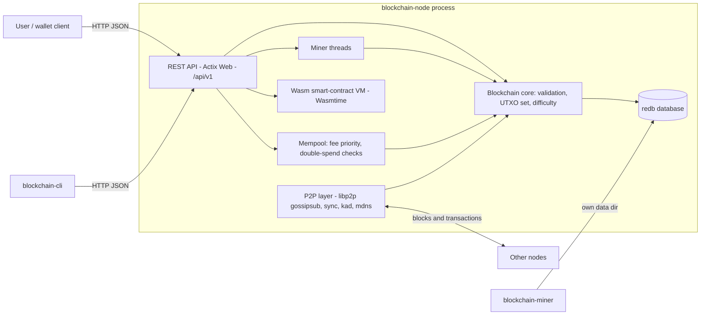
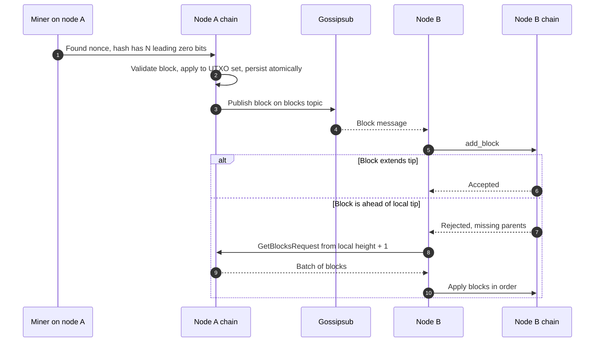
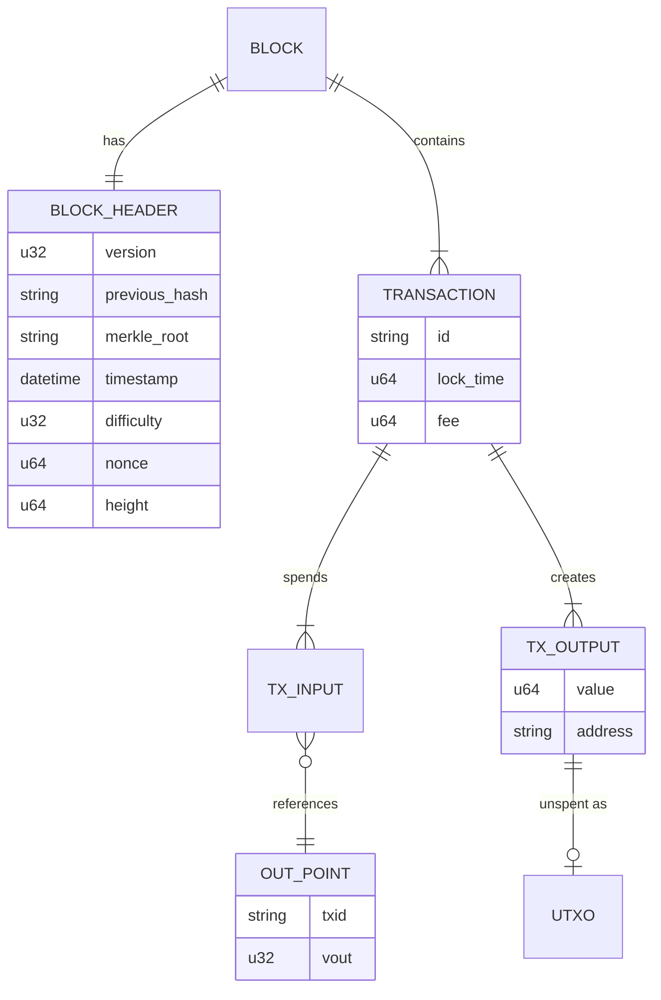

# Rust Blockchain


A compact but complete proof-of-work blockchain written in Rust: UTXO ledger,
secp256k1-signed transactions, Merkle trees, a multi-threaded miner, a fee-prioritised
mempool, embedded persistence, BIP39 wallets, a WebAssembly smart-contract VM, libp2p
peer-to-peer networking and a REST API, shipped as three binaries (node, miner, CLI).

## Purpose

Most blockchain material is either a toy hash chain or a production client too large to
read. This project sits in between: every core mechanism of a Bitcoin-style chain is
implemented end to end, with tests, in a code base small enough to study in an afternoon.
It is an educational and portfolio project, not a production cryptocurrency.

## Key features

- **Consensus**: proof of work where difficulty is the number of leading zero bits of the
  block header hash; retargeting from block timestamps; deterministic genesis block so
  independent nodes agree; block reward with halvings and coinbase maturity.
- **Ledger**: UTXO set, transaction ids independent of signatures, input signatures
  verified against the spent address, double-spend detection inside blocks and in the
  mempool, atomic block commits.
- **Cryptography**: secp256k1 ECDSA, SHA-256 / double SHA-256, real RIPEMD-160 for
  Bitcoin-style Base58Check addresses, Merkle proofs.
- **Wallets**: key management and address generation, BIP39 mnemonics (12 to 24 words)
  with passphrase support, JSON backup and restore.
- **Smart contracts**: WebAssembly contracts executed by Wasmtime with fuel-based gas,
  persistent key/value storage and log host functions, deterministic contract addresses.
- **Networking**: libp2p with TCP + Noise + Yamux, gossipsub for block/transaction
  propagation, request/response block sync, Kademlia, identify, ping, mDNS discovery
  and DNS bootstrap addresses.
- **Interfaces**: Actix Web REST API, a node binary, a standalone miner and a CLI with a
  built-in health probe used by the container health check.

## Tech stack

| Area | Technology | Version |
|------|------------|---------|
| Language | Rust (edition 2024) | 1.99.1 (pinned in `rust-toolchain.toml`), MSRV 1.96 |
| Async runtime | Tokio | 1.53 |
| P2P | libp2p (tcp, noise, yamux, gossipsub, kad, mdns, request-response, dns) | 0.57 |
| HTTP API | actix-web, actix-cors | 4.17, 0.7 |
| Cryptography | secp256k1, sha2, ripemd, bs58 | 0.33, 0.11, 0.2, 0.5 |
| Wallets | bip39 | 3.0 |
| Smart contracts | wasmtime (cranelift), wat | 49, 1.262 |
| Storage | redb (pure-Rust embedded database) | 4.4 |
| Serialization | serde, serde_json, postcard | 1.0, 1.0, 1.1 |
| CLI | clap, colored | 4.6, 3 |
| Testing | built-in test harness, tempfile, criterion | 3.27, 0.8 |
| Supply chain | cargo-deny | `deny.toml` |
| Container | Debian trixie slim, non-root | `rust:1.99.1-slim-trixie` builder |

## Architecture

### Container view



### Block propagation and sync



### Core data model



## REST API (prefix `/api/v1`)

| Method | Path | Description |
|--------|------|-------------|
| GET | `/health` | Node status and chain height |
| GET | `/chain/info` | Height, difficulty, best hash, totals |
| GET | `/blocks/latest?limit&offset` | Recent blocks |
| GET | `/block/height/{height}`, `/block/hash/{hash}` | Block lookup |
| POST | `/transaction` | Submit a signed transaction |
| GET | `/transaction/{txid}` | Transaction lookup |
| GET | `/mempool` | Mempool statistics |
| GET | `/address/{address}/balance` | Balance of an address |
| POST | `/wallet`, `/wallet/restore` | Create or restore (BIP39) a wallet |
| GET | `/wallets`, `/wallet/{name}/balance` | Wallets and balances |
| POST | `/wallet/{name}/address`, `/send` | New address, build and send a payment |
| POST | `/mining/start`, `/mining/stop` | Control background mining |
| GET | `/mining/stats` | Hash rate and blocks found |
| POST | `/contract/deploy`, `/contract/call` | Deploy and call Wasm contracts |
| GET | `/contract/{address}` | Contract metadata |
| GET | `/fee/estimate?target_blocks` | Fee estimate |

Further detail lives in [`docs/API_REFERENCE.md`](docs/API_REFERENCE.md) and
[`docs/ARCHITECTURE.md`](docs/ARCHITECTURE.md).

## Project structure

```
rust-blockchain/
├── src/
│   ├── lib.rs             # Core types (Block, Transaction, UTXO) and constants
│   ├── blockchain.rs      # Chain state, validation, difficulty retargeting
│   ├── transaction.rs     # Transaction building, signing, validation
│   ├── utxo.rs            # UTXO set
│   ├── mempool.rs         # Fee-prioritised pending transactions
│   ├── mining.rs          # Multi-threaded proof of work
│   ├── merkle_tree.rs     # Merkle root and proofs
│   ├── crypto.rs          # Keys, hashing, signatures
│   ├── wallet.rs          # Wallets and Base58Check addresses
│   ├── bip39_wallet.rs    # Mnemonic wallets
│   ├── smart_contracts.rs # Wasmtime VM with gas, storage and logs
│   ├── persistence.rs     # redb storage
│   ├── codec.rs           # postcard binary encoding helpers
│   ├── network.rs         # libp2p behaviour, gossip and block sync
│   ├── node.rs            # Full node runtime: chain + P2P + API
│   ├── api.rs             # REST API
│   ├── error.rs           # Error types
│   └── bin/               # blockchain-node, blockchain-miner, blockchain-cli
├── tests/                 # Integration tests (including a two-node localhost sync test)
├── benches/               # criterion benchmarks
├── docs/                  # Architecture and API reference
├── Dockerfile             # Multi-stage, non-root runtime image
└── docker-compose.yml     # Single node, optional peers and miner
```

## Running locally

### With Docker

```sh
docker compose up --build                       # one node on :8080 (API) and :8333 (P2P)
docker compose --profile multi-node up --build  # plus two peers on :8081 and :8082
curl http://localhost:8080/api/v1/health
```

### Without Docker

Requirements: Rust via `rustup` (the pinned toolchain is installed automatically). No
system libraries are needed.

```sh
cargo run --release --bin blockchain-node -- --data-dir ./data --api-port 8080 --p2p-port 8333

# Second node on the same machine, bootstrapping from the first
cargo run --release --bin blockchain-node -- --data-dir ./data2 --api-port 8081 \
  --p2p-port 8334 --bootstrap /ip4/127.0.0.1/tcp/8333

# CLI
cargo run --release --bin blockchain-cli -- --help
cargo run --release --bin blockchain-cli -- health --addr 127.0.0.1:8080

# Standalone miner
cargo run --release --bin blockchain-miner -- --data-dir ./miner --address <ADDRESS> --threads 4
```

## Testing

```sh
cargo fmt --all -- --check
cargo clippy --all-targets --all-features -- -D warnings
cargo test --all-features     # 144 unit, 15 integration and 1 doc test
cargo bench                   # criterion benchmarks
cargo deny check              # advisories, licenses, sources
```

All tests run in the default suite; none are ignored. The networking integration test
starts two nodes on loopback TCP and needs no external network. CI
(`.github/workflows/rust-blockchain.yml`) runs formatting, clippy, the tests, benchmark
compilation, cargo-deny, and builds the Docker image and probes the node's health
endpoint.

## Configuration

The binaries are configured with command-line flags (`--help` lists them all).

| Flag (blockchain-node) | Default | Description |
|------------------------|---------|-------------|
| `-d, --data-dir` | `./data` | Database directory |
| `-a, --api-port` / `--api-host` | `8080` / `127.0.0.1` | REST API listen address |
| `-p, --p2p-port` / `--p2p-host` | `8333` / `0.0.0.0` | libp2p listen address |
| `-n, --network` | `testnet` | Network name |
| `--difficulty` | chain default | Genesis difficulty in leading zero bits (must match across peers) |
| `-b, --bootstrap` | none | Peer multiaddress, repeatable (`/ip4/...` or `/dns4/...`) |
| `--no-mdns` | off | Disable local mDNS discovery |

| Environment variable | Default | Description |
|----------------------|---------|-------------|
| `RUST_LOG` | `info` in the image | Log filter (`env_logger`) |
| `MINER_ADDRESS` | placeholder | Reward address for the compose `mining` profile |

## Design decisions

- **Difficulty as leading zero bits** keeps the proof-of-work check exact and easy to
  reason about, while still allowing retargeting.
- **Deterministic genesis** (fixed timestamp, pre-mined nonce) so nodes started
  independently share the same chain root and can sync.
- **Signature-independent transaction ids** avoid malleability: signing never changes the
  id that outputs reference.
- **redb instead of RocksDB/sled**: a maintained, pure-Rust, ACID embedded store; no C++
  toolchain in builds or images, and atomic multi-table commits per block.
- **postcard instead of bincode**: bincode is no longer maintained; postcard is a compact,
  maintained serde format.
- **Fuel-metered Wasmtime** gives deterministic gas accounting and protects the node from
  runaway contracts.
- **HTTP/1.1 API without HTTP/2**: TLS and HTTP/2 belong to a reverse proxy, and turning
  the feature off removes the `h2` 0.3 line flagged by RustSec.
- **Std-only health probe in the CLI**, so the runtime image stays minimal (no curl).

## Known limitations

- Single-key, address-based signatures instead of a script language.
- Blocks are accepted only when they extend the current tip; there is no fork choice or chain reorganisation.
- The REST API is unauthenticated and intended for local or trusted networks; wallet
  operations hold keys on the node.

## License

MIT
