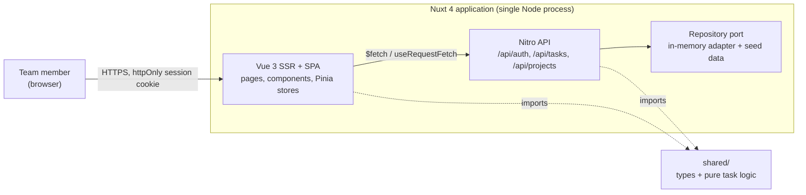
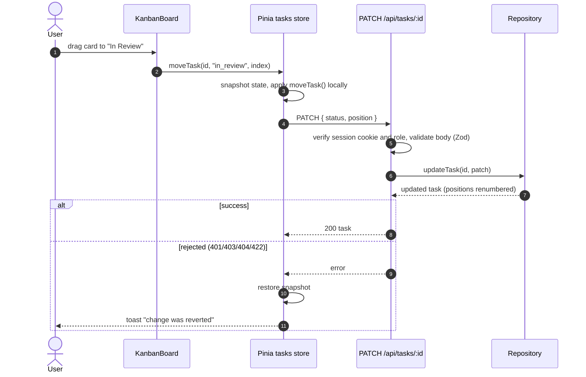
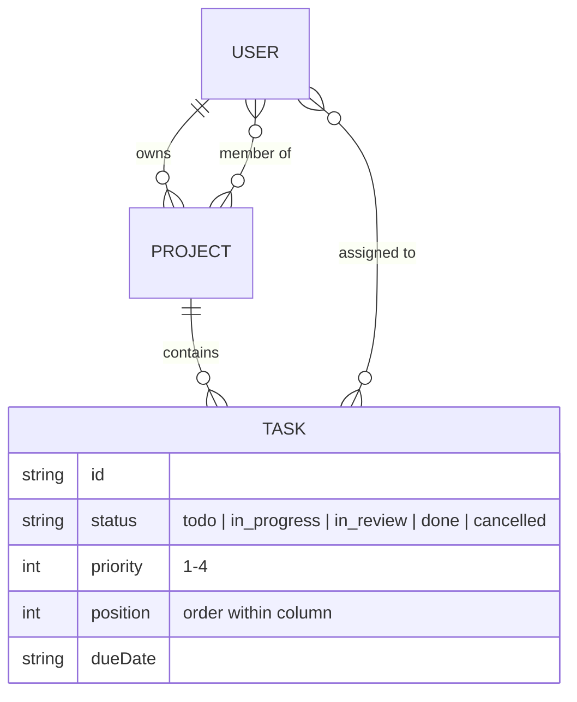

# Vue Project Management


A full-stack project management workspace built with **Nuxt 4** and **Vue 3.5**: a dashboard with delivery metrics, a drag-and-drop Kanban board and a projects overview, backed by a typed Nitro API with cookie-based JWT sessions and role-based permissions.

## Problem it solves

Small product teams need a single place to see what is in flight, what is late and how each project is progressing, without the setup cost of an enterprise tool. This app gives each member a personal view ("my open tasks", "due this week") and the team a shared board, while keeping the codebase small enough to read in an afternoon.

## Key features

- **Dashboard**: active projects, in-progress / completed / overdue counters, per-project progress, tasks due in the next 7 days and the signed-in user's open work sorted by urgency.
- **Kanban board**: native HTML5 drag and drop across *To Do / In Progress / In Review / Done*, optimistic updates with automatic rollback if the API rejects the move, list view toggle and "only my tasks" filter.
- **Task creation** with schema validation shared between the form (Nuxt UI `UForm` + Zod) and the API.
- **Projects** view with progress derived from task state, team avatars and target dates.
- **Global search** in the header filters tasks by title, description or tag.
- **Auth and roles**: httpOnly cookie session (HS256 JWT via `jose`), bcrypt password hashes, `admin` / `manager` / `member` / `viewer` permissions enforced server-side.
- **Light/dark mode**, responsive layout, skip link and labelled controls for accessibility.
- **Operations**: `/api/health` probe, structured JSON request logs, non-root multi-stage Docker image.

## Tech stack

| Layer | Technology | Version |
| --- | --- | --- |
| Runtime | Node.js (LTS) | 24 |
| Framework | Nuxt (SSR, Nitro server) | 4.6 |
| UI library | Vue | 3.5 |
| Components / styling | Nuxt UI, Tailwind CSS | 4.12 / 4.3 |
| State | Pinia (setup stores) | 4.1 |
| Validation | Zod | 4.6 |
| Auth | jose (JWT), bcryptjs | 6.2 / 3.0 |
| Language | TypeScript (strict, `vue-tsc`) | 6.0 |
| Tests | Vitest, @nuxt/test-utils, Vue Test Utils, happy-dom | 5.0 / 4.3 / 2.5 / 21 |
| Lint | ESLint flat config via @nuxt/eslint | 10 / 1.17 |
| Container | node:24-alpine multi-stage image | 24.22 |

## Architecture

### Context and containers



The Kanban ordering, statistics and filtering rules live in `shared/utils/tasks.ts` as pure functions, so the browser (optimistic updates) and the server (persisted order) apply exactly the same logic. Persistence sits behind the `Repository` interface in `server/utils/repository.ts`; the demo ships an in-memory adapter, and a database adapter can be added without touching API handlers.

### Key flow: moving a card on the board



### Domain model



## Project structure

```text
vue-project-management/
├── app/                    # Nuxt 4 app directory
│   ├── components/         # StatsCard, TaskList, TaskCreateModal, kanban/*
│   ├── composables/        # useWorkspaceData (SSR-friendly data loading)
│   ├── layouts/            # default (sidebar + header) and auth
│   ├── middleware/         # auth / guest route guards
│   ├── pages/              # dashboard, tasks, projects, auth/login
│   └── stores/             # Pinia: auth, projects, tasks
├── server/
│   ├── api/                # Nitro route handlers
│   ├── data/seed.ts        # demo users, projects and tasks
│   ├── plugins/            # structured request logging
│   └── utils/              # repository port, session (JWT), Zod schemas
├── shared/                 # types + pure task logic used by app and server
├── test/
│   ├── unit/               # node environment: task logic, repository, tokens, schemas
│   └── nuxt/               # Nuxt environment: components and stores
├── Dockerfile
└── docker-compose.yml
```

## Running locally

Prerequisites: Node.js 24 LTS and npm 10+.

```bash
cd vue-project-management
npm install          # also runs `nuxt prepare`
npm run dev          # http://localhost:3000
```

Sign in with one of the seeded demo accounts (shown on the login page), for example `manager@example.com` / `manager123`. In development a built-in fallback secret is used; production requires `NUXT_JWT_SECRET`.

### With Docker

```bash
cd vue-project-management
export NUXT_JWT_SECRET="$(openssl rand -base64 48)"
docker compose up --build   # http://localhost:3000
```

Or build and run the image directly:

```bash
docker build -t vue-project-management .
docker run -p 3000:3000 -e NUXT_JWT_SECRET="$(openssl rand -base64 48)" vue-project-management
```

## Testing and quality

```bash
npm run lint           # ESLint flat config (@nuxt/eslint)
npm run typecheck      # vue-tsc across app, server and shared
npm test               # Vitest: unit + Nuxt component/store projects
npm run test:coverage  # with V8 coverage
npm run build          # production build into .output/
```

CI (`.github/workflows/vue-project-management.yml`) runs lint, typecheck, tests with coverage and a production build, then boots the built server and smoke-tests health, authentication, the tasks API and server-side rendering. It also builds the Docker image and waits for its health check. `npm audit` runs as a separate advisory job: the remaining high-severity findings are in Nuxt/Nitro build-time tooling with no patched release yet.

## Configuration

| Variable | Default | Description |
| --- | --- | --- |
| `NUXT_JWT_SECRET` | dev-only fallback | HS256 secret for session tokens. **Required** when `NODE_ENV=production`. |
| `NUXT_SESSION_MAX_AGE` | `28800` | Session lifetime in seconds. |
| `NUXT_COOKIE_SECURE` | `true` | Set to `false` only when serving plain HTTP on a non-localhost host. |
| `NUXT_PUBLIC_APP_NAME` | `Vue PM` | Name shown in the sidebar. |
| `HOST` / `PORT` | `0.0.0.0` / `3000` | Listener for the production server. |

See `.env.example`.

## Design decisions

- **Nuxt 4 with `app/`, `server/` and `shared/` directories.** One deployable keeps the demo simple, and `shared/` gives the client and server a single source of truth for types and business rules.
- **Pure functions for board logic.** `moveTask`, `filterTasks` and `computeTaskStats` have no framework dependencies, so they are trivially unit-tested and reused for optimistic UI updates.
- **Cookie sessions instead of tokens in `localStorage`.** An httpOnly, `SameSite=Lax` cookie keeps the token out of reach of injected scripts and lets SSR render authenticated pages on the first request.
- **Repository port with an in-memory adapter.** The portfolio demo runs with zero infrastructure; the interface is the seam for a Postgres/Prisma adapter (see the `social-media-platform` project for that stack).
- **Native drag and drop.** HTML5 DnD covers the board without an extra dependency; the drop handler only emits `(taskId, status, position)`, so swapping in a richer DnD library later is a local change.
- **Server-side authorization.** Role checks live in the API handlers, the UI only hides controls the user cannot use.

## License

MIT
